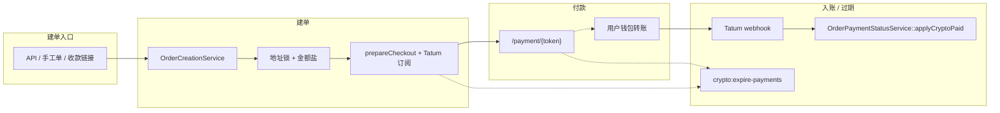
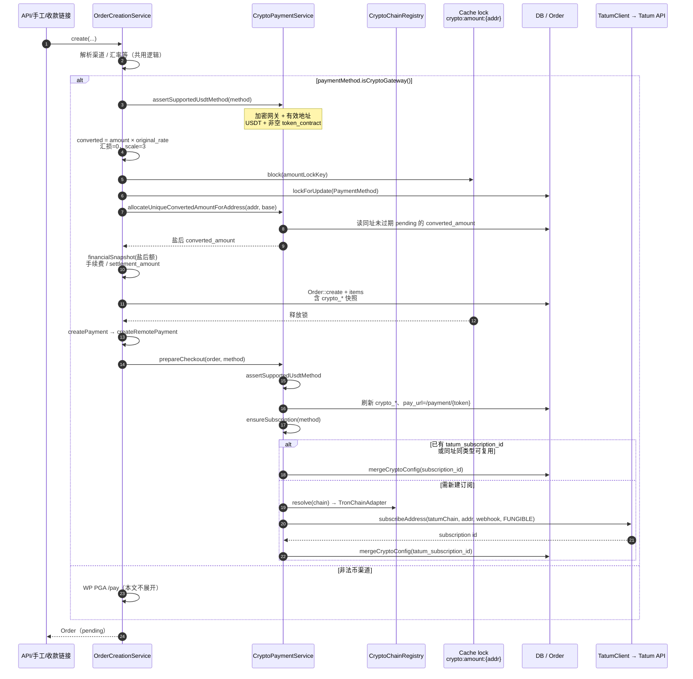
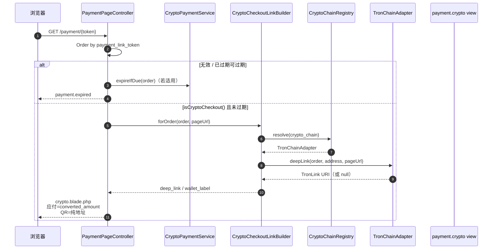
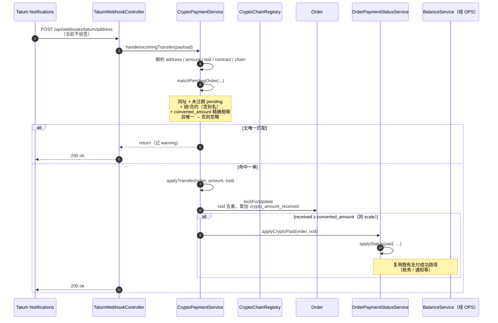
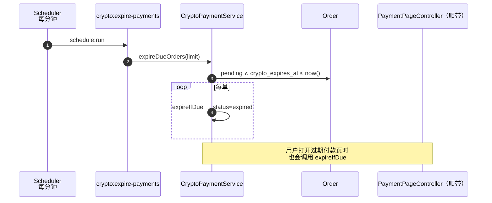

# 加密支付实现方案

本站加密收款为 **listen-only**：固定收款地址 + Tatum 地址订阅，**不持私钥、不代发、不托管钱包**。P0 仅开放 **USDT**，链适配 Registry **当前仅挂载 Tron**（`EthereumChainAdapter` / `BitcoinChainAdapter` 源码入库但未注册）。稳定决策见 [D-29](../docs/decisions.md#d-29-crypto-payment-amount-mutex)；表结构见 [database.md](../docs/database.md)；架构入口见 [architecture.md](../docs/architecture.md)。

---

## 一、产品边界

| 项 | 口径 |
|---|---|
| 识别 | 配置模板 `payment_config_tag` 为 `crypto` 或 `crypto_*`（如 `crypto_tron_usdt`） |
| 模式 | 固定 `receive_address` + Tatum Notifications；本站只听链入账 |
| 币种 | 仅 USDT，且必须配置 `token_contract`（不支持空合约原生币） |
| 链 | `CryptoChainRegistry` 当前注册 Tron；ETH/BTC 适配器未挂载 |
| 配置落点 | `payment_methods.config`；缺省回退 `config/tatum.php` / `.env` |
| pending TTL | 默认 480 分钟（`CRYPTO_PAYMENT_TTL_MINUTES`）→ `orders.crypto_expires_at` |
| 拆笔 | **禁止**；webhook 入账金额须与应付 `converted_amount` **精确相等**才匹配 |

与 Stripe/PayPal 一样**不**单独建资产模型、**不**在渠道上存 `gateway_driver`；加密与否只看模板 tag，其余仍走 WP 插件路径。

---

## 二、匹配不变量

听链 webhook **不带本站订单号**。同址、未过期 `pending` 窗口内保证：

```text
(crypto_receive_address, converted_amount @ scale=3) → 至多一笔订单
```

- 应付、付款页展示、钱包深链、webhook 匹配、成交额统计：**同一字段** `orders.converted_amount`（列 `decimal(15,3)`）
- 精度常量：`CryptoPaymentService::CONVERTED_SCALE = 3`（盐上限亦为服务内常量 `1`，**不**读链适配器的 `amountSaltMaxOffset`）
- **不写** `crypto_amount_expected` / `crypto_amount_scale` / `crypto_quote_*`

订单建单快照列：`crypto_chain`、`crypto_symbol`、`crypto_token_contract`、`crypto_receive_address`、`crypto_amount_received`、`crypto_expires_at`、`crypto_txids`。

---

## 三、端到端生命周期



四条主链路见下文「调用链路图」；日常运维只关心：建单是否写出唯一 `converted_amount`、订阅是否成功、webhook 是否打到本站、调度是否在跑。

---

## 四、配置与环境变量

### 渠道网关配置（`payment_methods.config`）

| 键 | 说明 |
|---|---|
| `chain` | 链提示（归一后如 `tron`） |
| `symbol` | 币种，P0 须为 USDT |
| `token_contract` | USDT 合约地址（必填） |
| `receive_address` | 固定收款地址（必填，非占位） |
| `tatum_api_key` / `tatum_base_url` / `tatum_webhook_url` | 可选，覆盖全局 |
| `tatum_subscription_id` | 订阅成功后回填 |

模板字段定义在 `payment_method_config_maps`（如 Tron USDT 种子）；后台编辑支付方式时写入渠道 config。

### 全局缺省（`.env` / `config/tatum.php`）

```bash
TATUM_API_KEY=
TATUM_BASE_URL=https://api.tatum.io
TATUM_WEBHOOK_URL=          # 必须是公网 https；.local/localhost 会被 Tatum 拒绝。留空则用 APP_URL 拼接
TATUM_TIMEOUT=15
CRYPTO_PAYMENT_TTL_MINUTES=480
TATUM_QUOTE_CACHE_TTL_HOURS=24   # 非稳定币报价缓存；P0 建单不写报价列
```

---

## 五、调用链路图

### 5.1 建单（含盐 + checkout + 订阅）

入口统一为 `OrderCreationService`（API / `ManualOrderService` / `CheckoutLinkOrderService` 均复用）。加密渠道**不**走 WordPress PGA `/pay`。



盐规则（锁内）：占用集合 = 同址 + `pending` + `crypto_expires_at > now()` 的 `converted_amount`；候选从 base 起每次 −0.001，下限 `max(base−1, 0.001)`；无空槽则抛错，整单失败。

### 5.2 付款页与深链



说明：二维码只编码收款地址；「Open in wallet」用适配器深链。ETH/BTC 适配器未注册时，非 Tron 订单 `resolve` 为 null，仅展示地址/金额、无深链按钮。

### 5.3 Tatum webhook 入账



匹配失败（金额不对、多单撞额、已过期等）只打日志，HTTP 仍返回成功，避免 Tatum 无意义重试刷爆；需靠监控与人工对账发现孤儿款。

### 5.4 过期释放金额槽



`expired` 后同址同额可被新单再次占用；迟到链上款可能误配到新 pending（P1：冷却窗）。

---

## 六、建单要点（对照 5.1）

1. `assertSupportedUsdtMethod`：加密网关、有效地址、USDT、非空合约。
2. **`original_rate`** 折算，**汇损为 0**，千分位写入候选 `converted_amount`。
3. `Cache::lock('crypto:amount:'.strtolower(address))` 内：盐 → 按盐后额算费 → 落库（含 `crypto_receive_address`）。
4. `createPayment` → `createRemotePayment` → **`prepareCheckout`**（刷新快照、`pay_url`、`ensureSubscription`），**不**调用 WP `/pay`。

盐写在成交额上，成交额最多被压低 **1 USD**；手续费与 `settlement_amount` 均按盐后额。

---

## 七、付款页要点（对照 5.2）

- 路由：`/payment/{token}` → `PaymentPageController`
- 视图：`resources/views/payment/crypto.blade.php`
- 展示：订单号、网络/币种、`converted_amount`、收款地址、复制、Open in wallet
- 深链：`CryptoCheckoutLinkBuilder` → 已注册 `CryptoChainAdapter`

---

## 八、入账要点（对照 5.3）

| 项 | 说明 |
|---|---|
| 路由 | `POST /api/webhooks/tatum/address` |
| 验签 | **当前不做** |
| 订阅类型 | 有 `token_contract` → `INCOMING_FUNGIBLE_TX`（P0 实际路径） |
| 匹配 | 同址 + 链/合约 + **`converted_amount` 精确相等** + 未过期 pending，且唯一 |
| 入账 | `applyTransfer` → 累计 received / txids；足额 → `applyCryptoPaid` |

---

## 九、过期要点（对照 5.4）

- 命令：`php artisan crypto:expire-payments`
- 调度：`routes/console.php` 每分钟 `withoutOverlapping`
- 行为：到期 pending → `expired`，释放金额槽；付款页访问亦可触发单笔 `expireIfDue`

---

## 十、代码地图

| 组件 | 职责 |
|---|---|
| `OrderCreationService` | 加密分支：无汇损折算、锁内盐、落库；`createRemotePayment` 转 checkout |
| `CryptoPaymentService` | 校验、盐、checkout、订阅、webhook 匹配、过期 |
| `CryptoChainRegistry` + `TronChainAdapter` | 链归一、深链、合约别名、占位地址（已挂载） |
| `EthereumChainAdapter` / `BitcoinChainAdapter` | 预留实现，**未**挂 Registry |
| `TatumClient` | HTTP：订阅、汇率；`using(渠道 config)` |
| `CryptoCheckoutLinkBuilder` | 付款深链载荷 |
| `CryptoQuoteService` | 报价（稳定币 peg / Tatum）；**P0 建单不写入订单** |
| `TatumWebhookController` | webhook 入口 |
| `ExpireCryptoPaymentsCommand` | 过期命令 |
| `OrderPaymentStatusService::applyCryptoPaid` | 链上足额后进入统一 paid 路径 |
| `CryptoServiceProvider` | 注册 Registry（当前仅 Tron） |
| `PaymentMethod` / `Order` | `isCryptoGateway` / `isCryptoCheckout` 及 crypto 读助手 |

新链：实现 `CryptoChainAdapter`，在 `CryptoServiceProvider` 挂载；并补配置模板与测试。挂载前须对齐建单校验（当前强制 USDT + 合约）与盐精度策略。

---

## 十一、运维注意

1. **公网回调**：生产必须配置可达的 `TATUM_WEBHOOK_URL`（或渠道级 webhook）；本地 `.local` 无法完成真实订阅。订阅失败时订单仍可展示收款信息，但**听不到账**。
2. **调度**：生产需跑 `schedule:run`，否则 pending 不会批量过期（仅靠用户打开过期页顺带过期）。
3. **API Key**：全局或渠道至少一方配置 `tatum_api_key`，否则跳过订阅。
4. **对账**：成交额含盐；报表用 `converted_amount`，净入账用 `settlement_amount`，勿混用。
5. **安全**：webhook 暂无验签，依赖 URL 保密与业务匹配严格性；加固属 P1。
6. **误配风险**：过期后同额迟到款可能命中新单；监控「无法唯一匹配」日志。

---

## 十二、验证

```bash
php artisan test --compact --filter=Crypto
```

相关 Feature：`CryptoPaymentTest`、`CryptoCheckoutLinkBuilderTest`、`CryptoChainRegistryTest`（及报价相关测试若改动 `CryptoQuoteService`）。
