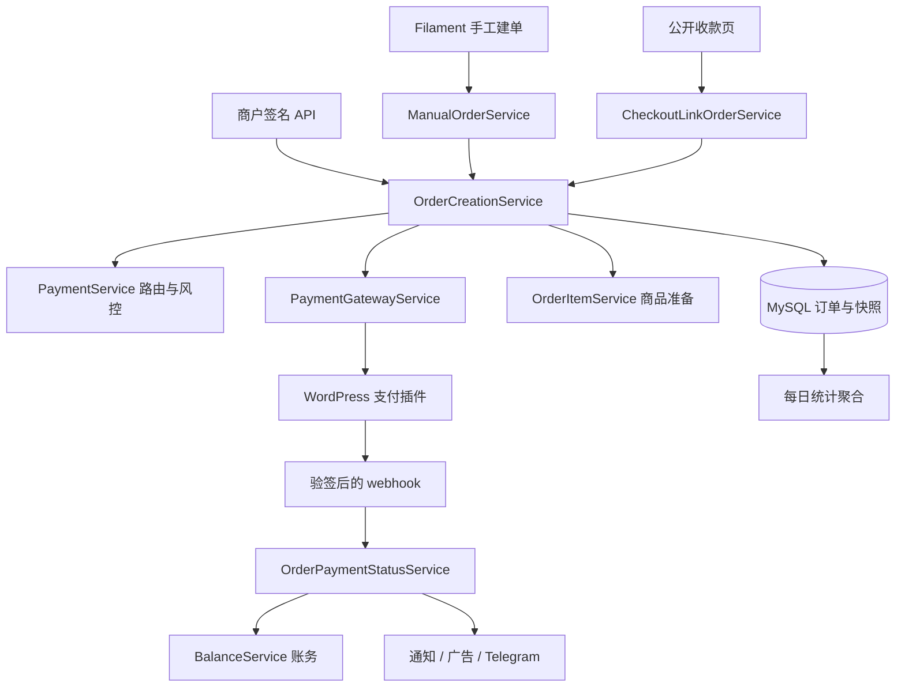

# 系统架构

核对日期：2026-10-16。本文按当前仓库实现整理；基线与旧资料差异见 [开发记录](development-log.md)。入口约定见 [AGENTS.md](../AGENTS.md)，数据语义见 [database.md](database.md)。

## 1. 系统职责与技术栈

系统连接商户应用、WordPress/WooCommerce 支付站点和管理后台，负责下单路由、支付状态、商户账务、物流、通知、统计与公开收款链接。

| 层面 | 当前实现 |
|---|---|
| 服务端 | PHP `^8.2`、Laravel `^12.0`、bcmath；具体安装版本以 `composer.lock` 为准 |
| 管理端 | Filament `^5.0`，Spatie Permission `^6.25` |
| 数据 | MySQL 为生产目标；Eloquent、软删除、生成列唯一约束 |
| 缓存/队列 | Laravel Cache/Queue 抽象，生产部署文档使用 Redis；驱动由环境配置决定 |
| 前端 | Blade、Vite `^7.0.7`、Tailwind CSS `^4.0.0`，依赖见 `package.json`/锁文件 |
| 文件与外部集成 | 阿里云 OSS、WordPress 支付插件、WooCommerce 商品、邮件、Telegram、广告转化、Cloudflare SaaS/Turnstile |

这是主要职责图，非完整状态机；远端 HTTP 建单在本地订单事务提交后执行。

## 2. 请求入口与访问边界

路由装配在 [bootstrap/app.php](../bootstrap/app.php)。

| 入口 | 路由/代码 | 访问方式 |
|---|---|---|
| 平台后台 `/admin` | `app/Providers/Filament/AdminPanelProvider.php` | 超管、商户级管理员；可限制平台域名 |
| 商户后台 `/merchant` | `app/Providers/Filament/MerchantPanelProvider.php` | 归属商户的用户；与平台端共享 Resource 配置 |
| 观察者 `/observer` | `app/Providers/Filament/ObserverPanelProvider.php` | 独立 `Observer` 模型及 `observer` guard，按渠道授权只读 |
| `/api/order/create`、`query`、`ship` | [routes/api.php](../routes/api.php) | POST，受 `API_DOMAIN` 限制，`api.auth` 验签，身份从 Application 取得 |
| `/api/webhooks/payment-gateway/status` | `PaymentGatewayWebhookController` | POST，不限制域名，独立 `X-PGA-Signature` 原始 body 验签，允许收款链接自定义域名回调 |
| 接口文档 `/docs/api/{locale?}` | `ApiDocumentationController`、`resources/views/api-documentation.blade.php` | 公开只读的通用协议页，支持 `zh_CN` / `en` 与固定章节锚点；不查询商户应用或展示真实凭证 |
| `/payment/{token}` | [routes/web.php](../routes/web.php)、`PaymentPageController` | 已存在订单的付款链接 |
| `/c/{slug}` | [routes/checkout.php](../routes/checkout.php)、`CheckoutLinkController` | 可反复建单的公开收款链接，使用 web/session/CSRF 中间件 |
| 争议附件 | `DisputeAttachmentController` | 控制器内检查访问权限，不因公开路由而公开文件 |

平台日志页仅由 `AdminPanelProvider` 注册并限制超级管理员访问。`RecentLogProvider` 复用日志插件解析器，在请求内缓存结果，绕过插件全量 Redis 缓存；按文件修改时间优先选择符合插件单文件上限且累计不超过 2 MiB 的日志，保留其中最新 1000 条。页面筛选和统计只覆盖这部分记录，完整历史仍在服务器日志中。`LogViewer` 关闭自动发现，避免被共享页面扫描加入商户后台。

商户配置分组的“服务配置”由 `ServiceSettings` 统一提供物流跟踪与 Telegram 两个区块，共用商户选择器，分别校验和提交；保存一个区块不会提交另一区块的改动。页面允许具备任一服务管理权限的用户访问，各区块只向具备对应权限的用户展示并加载凭证，所有保存、测试消息和回调令牌轮换再次检查对应权限及商户范围。切换商户重载两个区块；旧 `LogisticsTrackingSettings` / `TelegramSettings` 地址保留权限检查并跳转新页，不再显示独立菜单。

租户过滤有三种场景：

- 登录 `User`：`MerchantScope` 调 `User::manageableMerchantIds()`；超管返回 `null` 表示不限，商户级管理员返回名下商户 ID，普通用户返回自身商户 ID。
- API、CLI、队列：没有后台用户，业务调用必须显式限定商户，或说明为何执行全平台任务。
- 观察者：`MerchantScope` 不处理 `Observer`，Resource 根据 `observer_payment_methods` 过滤订单。不能依赖默认 guard 的用户一定是 `User`。

`MerchantResource::canEdit()` 在每次编辑页请求和保存时重新查询数据库中的商户归属，并检查用户启用状态与商户管理权限；不能只依赖初次打开页面时的 `getEloquentQuery()`。商户转交其他管理员或平台后，原管理员已打开的编辑页也会失去保存权限。

创建、编辑商户与入驻向导通过 `MerchantPaymentSettingsForm` 共用默认财务表单：商户保存交易/退款/拒付手续费、保证金比例及锁定天数，并沿用商户的结算模式/周期作为默认值。新分配系统级支付方式时，双向分配关系使用 `MerchantPaymentMethod`，在事务内先锁商户，再写分配并由 `MerchantPaymentSettingsService::initializeForAssignment()` 复制最新默认值到 `merchant_payment_settings`。已有独立配置不覆盖，取消后重新分配也保留；修改商户默认值仅影响后续首次配置的新分配。保存商户时还会通过 `initializeMissingForMerchant()` 为该商户已有分配中缺失的独立配置补齐默认值，与商户保存共用事务；已有记录（含空值或 0）保留。商户自有渠道保留原有独立配置入口和渠道默认回退规则，不后台扫描全平台历史分配。

`PaymentMethod` 自己覆盖商户 scope：既支持商户自有渠道，也支持经 `merchant_payment_methods` 分配的系统级渠道。`owner_id` 解决管理员维护未分配渠道时的可见性；编辑权限还需查 Resource。启用的超级管理员可在系统级支付方式编辑页通过“更改归属管理员”重新指派给启用的平台管理员（含超管），由 `PaymentMethodOwnershipService` 校验操作者、目标账号并锁定渠道后只更新归属；不改变商户分配、支付组或下单范围。商户自有渠道仍按 `merchant_id` 管理。

支付方式列表在商户端固定使用当前商户的生效手续费、保证金及结算配置；平台端未选商户时显示渠道默认值，使用“查看商户生效配置”筛选后，通过 `forMerchant()` 展示该商户自有和已分配渠道，并加载仅限该商户的独立配置。筛选值须属于当前平台用户可管理的启用商户，非法或越权选择返回空表；商户账号伪造此筛选不会切换财务上下文。列表显示与下单保持相同空值回退规则，未初始化的存量分配仍回退渠道费率，不能仅改变显示值伪装配置已生效。

支付方式详情页提供“生成进货单”，历史记录由 `PurchaseOrdersRelationManager` 展示，仅启用的超级管理员可生成、查看和编辑运费/优惠。`PurchaseOrderService` 从所选支付方式的 `siteProducts()` 随机选品并保存独立进货快照：商品不足 30 种全选，否则随机选 30 至总数种，每种 10–20 件；价格采用 `price_min`（视作 USD）× 7 × 0.3，四舍五入为人民币两位小数。默认运费按商品合计 3%–8%、优惠按 10%–20% 随机生成，也可手动输入金额。下单时间可设置，付款/发货/签收时间及交易号为模拟数据。此入口只写 `purchase_orders` 和 `purchase_order_items`，不创建收款订单、不调用网关或改变商户余额；运费/优惠编辑通过 Service 锁单重算总额。

历史记录的“查看采购订单”在新标签页打开 `purchase-orders.show`（`/purchase-orders/{purchaseOrder}`），由 `PurchaseOrderController` 再次校验启用的超级管理员身份后查询记录，并用 `resources/views/purchase-orders/show.blade.php` 展示 1688 样式的采购页面。商品、价格、数量和时间来自进货快照，图片读取关联站点商品的当前安全 HTTP(S) 地址，供需方名称读取支付方式当前档案；没有图片时显示占位。权益词由 `PurchaseOrderService::initializePerksWords()` 在首次打开任一采购页面时随机选取 4–8 个并保存到该单的 `perks_words`；事务中锁行并再次检查，后续两页读取相同结果，已保存的空数组也不重选。首次初始化仅写权益词，不改金额、明细或订单更新时间；运费和优惠仍从后台编辑。

采购页面的“订单详情”进入 `purchase-orders.details`（`/purchase-orders/{purchaseOrder}/details`），模板为 `resources/views/purchase-order-details.blade.php`，展示四步时间线、收货与卖家资料、采购明细、费用及打印区域；两个页面共享控制器的鉴权与数据构造。收货地址优先使用档案 `stock_addresses` 中首个非空字符串，再回退到 `company_address`；联系人、手机号、供应商信息读取当前档案。现有采购单不保存物流公司和运单号，详情以缺省文案展示，不发起物流、评价或支付请求。

订单列表的物流模板导出沿用当前筛选与搜索条件，不要求平台账号选定单个商户；超管可跨商户导出，其他用户限定在 `manageableMerchantIds()` 范围。物流上传仍绑定登录用户所属商户。订单支付方式筛选及观察者账户的渠道分配包含软删除渠道，保留渠道的租户可见性过滤；观察者关联也包含软删除渠道，以便回显和保留已有分配。

API 文档页覆盖创建订单、查询订单、上传物流、商户网站物流回传，并补齐共用签名、支付结果通知、状态与错误码。文案存于 `lang/zh_CN/api_docs.php` 和 `lang/en/api_docs.php`，按执行代码与 [API 手册](../doc/api.md) 同步维护；目录锚点在两种语言中保持一致，语言切换保留当前章节，不改变后台会话语言。首页、应用列表及创建/编辑表单提供“API 文档”入口。正文提供币种、platform 和全部订单状态的附录跳转；`ApiDocumentationReferenceService` 只读取 `exchange.supported_currencies` 与 `order.platforms` 两个公开配置，沿用系统配置缓存及清除机制动态展示列表。币种列表是部署配置参考，不新增 API 币种枚举校验；原 `order-statuses` 锚点保留，完整状态表位于附录 C。

商户网站物流回传由应用的 `is_shipment_sync_enabled` 开关与完整 HTTPS `shipment_sync_url` 配置，默认关闭；地址保留路径和 query，发送时读取该应用当前地址及 `app_id` / `api_key`，复用 `SignatureCanonicalizer`。`OrderShippingService::record()` 在物流保存后调用 `MerchantShipmentSyncService`，新增独立物流快照并提交后派发 `SyncMerchantShipmentJob`。本地改单仍覆盖 `order_shippings`；已有待发、待重试或暂停的旧版本标为 `superseded`，只尝试最新物流。历史物流不自动回填，具备订单查看、物流权限及租户访问权限的用户可在订单详情手动推送当前物流。

应用表单的回传地址提供“检测地址”按钮，使用当前输入的完整 URL 发起不带应用凭证和业务数据的 HEAD 请求，复用公网 DNS 校验及固定 IP 连接，禁止跟随重定向。检测不保存应用、不创建物流记录，只展示连通性和 HTTP 状态；401/403/405 等不能证明带签名 POST 可用，实际回传仍在订单详情手动验证。

回传成功要求 HTTP 200 且 JSON `code = 0`。网络异常、429、5xx 含首次最多尝试 5 次，间隔 30 秒、5 分钟、30 分钟、1 小时；其他响应直接终止。`order_shipment_syncs` 与 `order_shipment_sync_attempts` 保留物流快照、请求及响应结果，开关关闭时暂停待发任务，调度回收超过两分钟的 `processing` 任务。终败 Telegram 按商户每组最多 5 笔合并，发送失败或限流保留提醒待办并冷却 5 分钟，按提醒到期时间扫描；商户没有可用机器人时标记 `unavailable`，保留回传失败记录。该链路不改变支付插件的 `sync_*` 或物流 Provider 轨迹字段；外部接收协议见 [API 手册](../doc/api.md#外部物流回传协议附件-v11)。

物流模板与观察者订单导出使用 XLSX，共用 `XlsxExport` 按行写出。除订单金额外，所有单元格均显式保存为文本并设置文本格式，保留纯数字编号、前导零、长物流号和公式样式文本的原值；金额为数值单元格并显示两位小数。物流模板的空物流号等填写格同样设为文本，商户保留 XLSX 和单元格格式填写后可直接上传；旧 CSV/XLS 导入仍兼容。物流模板受单表容量限制，超过 1,048,574 笔订单时不生成下载文件，并提示缩小筛选范围，以免上传仅读首表时遗漏记录。查询继续分批读取，导出格式不改变商户/观察者范围或金额口径。

观察者订单使用 `ObserverOrderStatus` 统一状态口径：`paid/shipped/completed` 展示为支付成功（`paid` 即待发货），`refunded/partially_refunded` 归并退款，`disputing/dispute_review` 归并争议中，拒付独立；其他状态在查询入口排除，列表、详情及导出一致。日期范围按系统时区的订单创建日期筛选，包含起止当天。`ObserverOrderExportService` 流式导出当前筛选/搜索命中的全部记录，重新限定观察者授权渠道及可见状态，仅输出列表字段，金额沿用账户显示比例。

订单状态颜色由 `OrderStatusColor` 统一读取系统配置 `order.status_colors`（`json` 类型、`order` 分组）。普通订单列表与详情、客服查询、观察者列表与详情均按原始订单状态取色；观察者归并文案不参与配色。公开收款结果页的订单状态文字使用同一配置及调色板的 `600` 色阶。超级管理员在系统配置中直接编辑 JSON 对象，键为现有订单状态，值限于 `gray/primary/success/info/warning/danger`，允许部分覆盖或空对象；默认沿用普通订单列表配色，缺失或无效配置回退默认，未知状态为灰色。保存立即清除对应缓存；数据迁移和 Seeder 仅补齐缺失配置，不覆盖已保存颜色，数据迁移回滚保留配置。采购订单页面独立展示。

收款链接 `auto_redirect` 默认开启，提交后自动跳转到 `pay_url`；关闭时跳转到 `/c/{slug}/payment` 展示付款地址。展示页按 Host、启用状态、会话订单 ID 及订单所属商户/链接校验，刷新不重复建单。

收款页地址由 `CheckoutAddress` 按国家整理为 PayPal 地址语义：`state` 对应 `admin_area_1`，`city` 对应城镇 `admin_area_2`。Google 自动填充与服务端共用省州映射表；FormRequest 归一化并校验，`CheckoutLinkOrderService` 再检查省州值，后续沿用插件原有 `state`/`city` 协议。国家限制、字段来源及数据更新约定见 [收款链接手册](../doc/checkout-link.md#地址字段与-paypal-rest)。

## 3. 下单链路

主要入口：[OrderCreationService.php](../app/Services/OrderCreationService.php)。

1. 对 `merchant_id + merchant_order_no` 加缓存锁。查到旧单时比较币种与原始请求金额（`original_amount`，历史单回退 `amount`）；冲突拒绝，匹配则复用本地订单。已有 `pay_url`、已收款或不处于 `pending/failed` 时直接返回；只有无链接且未收款的 `pending/failed` 订单可沿用原渠道补建。普通及指定渠道重提均重新检查原渠道，不另选通道，详见下文。
2. 校验 `amount = subtotal + shipping_fee - discount + tax`，公式容差由 `Order::AMOUNT_TOLERANCE` 定义（当前 0.01）；商品明细按两位小数核对小计。
3. 应用开启自动折扣时，首次建单随机减免原币种应付金额，保存原始金额及折扣快照；然后读取汇率及汇损，换算 USD。回跳域名校验的当前策略见 [D-05](decisions.md#d-05-下单域名策略)。
4. 校验支付组归属且启用。普通路径经 `PaymentService` 筛选风控后，按当天成交额/权重升序、权重降序、ID 升序排列，从前三个候选中等概率随机选择；不足三个时全部参与。指定 `payment_method_key` 的路径跳过组内路由与限额检查，但仍检查渠道可用范围、启用状态和三个回跳 URL 的渠道域名，并且不自动切换渠道。
5. 通过 `PaymentMethod::configurationForMerchant()` 优先使用商户与渠道的独立财务配置；手续费和保证金空值继承渠道默认值，结算模式/周期空值继承商户默认值。固定交易手续费及 `settlement_amount`；手续费超过 USD 金额拒单。在数据库事务内写订单、原始商品明细，以及结算模式/周期、保证金比例/天数、退款与拒付手续费快照。旧订单的 `settlement_mode` 为 NULL，沿用原规则，不追溯重算。
6. 指定渠道新单在本地落库后触发 `DesignatedOrderCreated`。随后准备匹配商品并调用插件 `/pay`，回填 `pay_url`、`wp_order_id`。网关建单或明确的商品准备失败（`OrderItemPreparationException`）后，当前请求立即停止，返回“建单失败，请重试”，不再尝试其他渠道；本地订单和已锁定的渠道、财务快照保留。同渠道的 HTTP 连接重试沿用原配置；若失败期间已取得付款链接或已收款，则返回最新订单，不覆盖已有结果。首次选渠道仍跳过手续费超过订单金额的候选。
7. 是否派发付款链接邮件由调用方决定，Service 仅保存意图。API 重试补单后的发信行为由 `OrderCreateRetryMailTest` 覆盖。

付款链接邮件的发件人、驱动和凭证统一读取订单所属商户的 `Application`，由应用编辑页顶部“邮件发送”配置，受应用 `is_order_email_enabled` 开关控制。应用未配置完整时记录发送失败，不使用支付方式历史账号或平台默认账号。邮件正文在应用表单配置，留空使用系统默认模板；支付方式不再提供发信账号或正文配置，也不读取其历史邮件模板。已有仅配置在支付方式上的邮件设置需在对应应用重新配置，不自动跨应用复制，详见 [D-21](decisions.md#d-21-付款链接邮件统一使用应用发信配置)。

失败后再次提交同商户订单号时，按订单已保存的支付组、指定渠道标记和回跳 URL 决定校验方式，不采用新请求的 `group_key` / `payment_method_key` 改变原模式。原渠道必须仍启用、未软删除且商户有权使用；普通路由还要求原支付组有效、渠道仍在组内且通过当前风控，失效返回 `NO_AVAILABLE_PAYMENT_METHOD`，即使其他渠道可用也不切换。指定渠道按保存的原 ID 重新校验授权、启用/软删除状态及三个回跳 URL，失效返回 `PAYMENT_METHOD_NOT_AVAILABLE`，域名不符返回 `PAYMENT_METHOD_DOMAIN_MISMATCH`，仍保留其跳过普通组内风控的语义。

重试保留同一本地订单、`order_no`、商户单号、付款 token、原渠道、原远端引用、财务快照、原始商品、应付金额、汇率和首次自动折扣；CREATE/COPY 继续复用此前已创建的商品，不因重提切换站点或重新计算金融快照。历史 `payment_method_id` 为空时只补齐同一渠道的关联，不改写引用或快照。`Order::gatewayOrderReference()` 对 NULL 回退本地 `order_no`；支付创建、主动查询、日志及支付插件物流同步使用该引用，商户网站物流回传仍使用原 `merchant_order_no`。首次前三候选路由沿用 [D-20](decisions.md#d-20-前三候选随机路由与同请求网关故障切换)，失败和重试规则见 [D-24](decisions.md#d-24-网关建单失败立即返回与原渠道重试)。

保留历史渠道切换产生的网关引用、来源日志和迟到结果校验，旧尝试回调/查询不能改变当前尝试的状态及账务；本次及后续同单号重试不生成新的渠道尝试引用。同渠道恢复依赖插件对同一 `s_order_id` 的幂等处理，不把本地锁或引用校验描述成全链路绝无重复支付的保证。

`PaymentGatewayService::createPayment()` 最终失败时（包括业务错误、连接重试耗尽、异常响应和缺少付款链接），根据 `OrderCreationService` 传入的本地订单派发 `PaymentLinkCreationFailed`。现有 `SendTelegramNotification` 队列监听器将脱敏后的原因、错误码、订单号/商户单号、金额和渠道信息发送给订单商户的已启用机器人。每次调用最终失败仅派发一次，通知异常不覆盖原异常，本地订单继续支持幂等补建；没有可信订单上下文时只记跳过日志，不按全局订单号或渠道商户推断接收人。进入 `createPayment()` 前的渠道/商品准备异常不在此事件范围。

连续建单失败保护由 `OrderCreationService::createPayment()` 调用 [PaymentMethodFailureService](../app/Services/PaymentMethodFailureService.php) 的 `recordFailure()` / `recordSuccess()` 统一记录：网关建单或明确的商品准备最终失败时，针对当前渠道累计一次 `consecutive_failed_times`；一次创建内部的多次 HTTP 连接重试只计一次。成功保存有效 `pay_url` 才清零；已有链接的幂等命中、金额/授权校验或风控拒绝既不计数也不清零。计数按支付方式 ID 跨商户持久化，事务中先锁原订单、再锁渠道，核对原商户、当前渠道/引用及收款/链接状态，过期结果不计入其他尝试。直接调用底层网关客户端的工具操作不在该统计入口内。

系统配置 `payment.max_failed_times` 默认 5，渠道 `max_failed_times` 可单独设置大于等于 1 的整数，留空由 `PaymentMethod::maxFailedTimes()` 动态继承当前系统值。连续次数达到有效阈值时将渠道 `is_active` 置为 false；不自动换通道，成功清零也不自动重新启用。仅由启用转为停用时，在计数事务后通过原有 `TelegramNotificationService` 发提醒给原订单商户及该渠道关联的全部商户（共享渠道包括所有分配商户，去重），未配置/未启用机器人或触发限流时沿用原服务的跳过规则；通知异常不覆盖建单失败，原来逐次网关建单失败的提醒继续保留。部署新增字段及配置补缺的规则见 [数据库说明](database.md#2-租户身份和渠道)，决策见 [D-25](decisions.md#d-25-渠道连续建单失败达到阈值自动停用)。

人工核验渠道恢复后，通过 `PaymentMethod` 模型将停用渠道重新启用（`is_active: false → true`）时，同次保存自动将 `consecutive_failed_times` 清零，开始新一轮计数。普通编辑但启用状态未变时不清零；运行中的成功/失败计数使用 `saveQuietly()`，不触发该模型事件。编辑页只提交主动修改的启用状态，在事务内重新锁定并读取渠道后保存，避免旧页面恢复自动停用状态或重复清掉新计数；保存后同步页面的启用状态。此补充无需新增字段或迁移。

两类明细不可混用：`order_items` 保存商户原始商品，`order_matched_items` 保存发给支付站点的商品。`OrderItemService` 支持 `MATCH`、`VIRTUAL`、`CREATE`、`COPY`；同站点直连优先于模式选择。`CREATE`/`COPY` 需要远端真实商品 ID，因此下单过程同步建品。

锁只覆盖同一商户订单号，不等于对整个支付渠道做额度预占；租期至少为 `payment_gateway.creation_lock_seconds`（默认 600 秒），并按单渠道 HTTP 重试及原始商品条数的同步建品超时预算向上调整；不再读取 `failover_max_attempts`。写入链接时仍以订单行锁核对当前远端引用和渠道。风控当前统计已成交数据，待支付订单不计负载。首次前三候选随机允许连续碰巧选中同一渠道，不保证逐单轮转、固定进单比例或严格串行化所有渠道订单。

## 4. 支付状态与账务

[OrderPaymentStatusService](../app/Services/OrderPaymentStatusService.php) 共用 webhook 的 `handle()` 与主动查询的 `queryAndApply()`，最终统一进入状态应用逻辑。它处理状态映射、行锁、重复/乱序守卫、首次 `paid_at`/`failed_at`、账务和通知编排。

`PendingOrderStatusSyncService` 每分钟扫描全平台最近 48 小时创建、`status = pending` 且 `paid_at` 为空的订单，按创建满 30 分钟、90 分钟两个时点逐笔调用 `queryAndApply()`，每单最多自动补查两次。次数与最近领取时间持久化到订单，查询前用符合到期条件与原次数的原子更新领取；缺凭证、远端失败或未知状态也消耗一次，单轮每单最多一次。第一次已离开待支付状态时不再二查；停机错过时点则在 48 小时内分轮补查，实际执行顺延到下一次扫描，不承诺秒级触发。

查询窗口包含 48 小时及 30/90 分钟边界，排除未来创建数据与软删除订单；分批按 ID 遍历，沿用订单锁定渠道（含系统共享、已停用或软删除渠道）。单笔失败继续，命令最终返回非零并记录调度失败日志；手工查询不占用自动补查次数，网关客户端内部连接重试沿用原配置。日志归档仍由 `OrderEventSyncService` 单独负责。

| 行为 | 当前实现 |
|---|---|
| 支付成功 | 新订单在状态事务内保存 `OrderAccountingTask`，随后按 `settlement_amount` 幂等计入总余额和待结算（经 `BalanceService::creditForPaidOrder()`）；首次正常 `paid` 派发商户通知与广告转化；曾收款状态恢复 `paid` 不重复触发首次支付副作用。旧单仍沿用原即时入账 |
| 重复/乱序状态 | 按最终本地状态判重；已收款订单不被未收款状态回退；终态有保护；主动查询返回 `paid` 时允许纠正任意本地状态。曾收款订单恢复时，有本商户未软删除的物流记录则保存为 `shipped`，否则为 `paid`；保留原支付时间和资金审计记录 |
| 网关 `refunded` / `confused` | 后者映射 `chargeback`；尝试自动退款/拒付记账。业务性失败保留状态并告警，支持人工补录 |
| 网关 `disputing` | 网关争议中，更新状态并拉日志；不等同人工冻结审核 |
| 人工 `dispute_review` | `OrderDisputeService` 编排，资金由 `BalanceService` 冻结/释放；期间 webhook 不覆盖人工审核状态，主动查询为 `paid` 可纠正订单状态，但不关闭审核事件或释放冻结 |
| 物流 | `OrderShippingObserver` 在符合条件时推进 `shipped`，并派发物流同步 |
| 订单结算 | `OrderSettlement` 保存本单模式、周期及保证金快照；支付或首次有效物流开始计时，到期由 `BalanceService` 将待结算分入循环保证金和可提现；争议期间暂停，到期时间不重置 |
| 保证金 | 固定保证金只能从可提现额人工冻结；循环保证金按净结算额提取，锁定期从实际结算起算，0 天不锁定。循环保证金只到期自动释放，争议期间暂停释放 |
| 提现 | 新申请占用独立待出款，后台确认放款即扣总额及占用，驳回恢复可提现；负可提现时禁止新增提现和确认放款，仍可驳回。旧提现保持原冻结占用方式 |
| 订单事件日志 | `OrderEventSyncService` 拉取插件 `/order-logs` 归档；不以日志反推支付状态 |

余额写操作集中在 [BalanceService](../app/Services/BalanceService.php)。锁顺序先商户行、再相关订单/业务单据。当前状态事务与退款/拒付账务事务分开，避免反向加锁造成死锁；不可描述为远端状态和本地资金全程原子提交。人工资金动作使用 `FinanceSecurity` 做 TOTP 二次验证。

新单资金反向扣减依次使用本单待结算、本单未释放循环保证金，再由可提现承担；额外手续费直接扣可提现。原交易手续费不返还，不自动挪用固定保证金、其他订单专属资金或待出款。未结算金额耗尽后取消结算；循环保证金抵扣后只释放剩余额。新分类划转写总额为 0 的台账及分类变化，历史流水不回填。

`OrderAccountingService` 以商户→订单→待办顺序处理新单可靠记账，失败由 `orders:settle-due` 补偿。待办 `merchant_id` 有意无外键，避免在持有订单锁的状态事务内反向请求商户锁；执行前核对商户归属。首次直接收到退款/拒付时，在同一账务事务先记录原收入再反向扣减。物流状态使用条件更新，避免覆盖并发退款；争议回复同样先锁商户，避免外键检查产生反向锁。

反向待办的本金尚未扣足时，暂停该商户的提现申请/确认放款及本单循环保证金释放，避免按旧余额出款；人工补录后按实际本金记录解除限制，调度再核销待办状态。候选扫描先排除暂停项，避免限量扫描被早期暂停记录占满。

主动查询将退款/拒付订单纠正为 `paid` 时，不撤销既有扣款或修改退款累计额；已存在拒付本金流水的订单仍不可再退款或拒付，资金资格不能仅按纠正后的状态判断。规则与适用边界见 [D-18](decisions.md#d-18-主动查询已支付结果优先于本地状态)。

漏配历史汇损可使用 `orders:recalculate-surcharge`，由 `OrderSurchargeRecalculationService` 明确按商户纠正订单快照，保留历史市场汇率及手续费金额，默认预览，仅 `--apply` 写入。只处理已入账且无反向资金/争议历史的订单，保存新旧快照报告，不修改余额或台账；人工调账差额与统计补算步骤见[操作手册](../doc/order-surcharge-recalculation.md)。

## 5. 队列和调度

| 队列 | 执行者 | 重试来源 |
|---|---|---|
| `notifications` | `SendOrderNotificationJob` | Job `tries=1`，重试由尝试记录与到期扫描驱动；行锁领取并清空旧重试时间，提交后入队 |
| `payment-links` | `SendPaymentLinkJob` | Job `tries=3`、backoff |
| `default` | `SendTelegramNotification` 队列监听器（含支付链接创建失败提醒） | Worker 配置 |
| `low` | 商品同步、物流导入、支付插件物流同步、商户网站物流回传、17TRACK 注册、广告转化 | 按 Job 定义；商户网站物流回传的 Job `tries=1`，由持久化快照与调度驱动重试；广告转化也由尝试表驱动重试 |

`config/queue.php` 的 Redis `retry_after` 必须大于长任务 Worker timeout。现有 `composer dev` 的默认 `queue:listen` 不能代替订阅全部业务队列的 Worker；启动方式参考部署文档。队列配置的 `after_commit` 当前为 false，新增事务内派发时要明确提交时机。

以下按 [routes/console.php](../routes/console.php) 核对：

| 命令 | 频率 |
|---|---|
| `exchange:fetch` | 每小时 |
| `db:backup:upload` | 每 6 小时 |
| `order-events:sync` | 每分钟，防重叠 |
| `orders:sync-pending-status` | 每分钟扫描，防重叠；最近 48 小时待支付订单在创建满 30/90 分钟各补查一次，最多两次 |
| `order-notifications:process-due` | 每分钟，防重叠 |
| `merchant-shipments:process-due` | 每分钟，后台执行、防重叠；投递到期商户物流回传、回收两分钟处理超时任务、合并失败 Telegram 提醒 |
| `ad-conversions:process-due` | 每分钟，防重叠 |
| `order-disputes:close-due`、`order-disputes:send-reminders` | 各每 5 分钟，防重叠 |
| `fund-freezes:release-due` | 每 10 秒，后台执行、防重叠；默认每次最多 500 条 |
| `orders:settle-due` | 每 10 秒，后台执行、防重叠；补偿记账、启动发货周期、到期结算，每类默认最多 500 条 |
| `order-stats:aggregate --days=8` | 每天 02:00，防重叠 |
| `order-stats:aggregate --days=2` | 每 3 小时，防重叠 |
| `checkout:check-cloudflare-ips` | 每周一 09:00 |
| `checkout:sync-domains` | 每 15 分钟，防重叠 |
| `logistics-imports:prune` | 每天 03:10，防重叠 |
| `logistics-tracking:reflag-anomalies` | 每天 06:00，防重叠；本地重算物流异常；仅 `logistics_anomaly` false→true 且启用门闩通过时主动查一次 |
| `orders:notify-unshipped-overdue` | 每天 10:00，防重叠；超 10 天未发货汇总 Telegram（不看物流跟踪开关） |

## 6. 按任务定位

仪表盘 `AdminDashboard` 使用当天、昨天、近 7 天、近 30 天、本月、上月快捷页签；自定义区间通过弹窗确认后应用，取消保留原区间。所有交易组件共享同一日期条件，按系统时区、包含首尾日期；近 7/30 天含当天，本月截至当天。页面不再提供支付方式筛选，订单数量与交易金额使用独立图表。`DashboardService` 从 `order_daily_stats` 读取创建订单数、支付成功数/成交额、失败数、商户排名与渠道占比，不在页面请求中扫描订单、日志或触发聚合。

新统计列和执行记录版本见 [数据库口径](database.md#6-汇率与统计派生数据)。`OrderStatsRun::CURRENT_METRICS_VERSION` 区分新版完整统计与旧版执行记录；缺失或旧版日期在仪表盘和订单统计页提示需重算，零交易但已按新版统计的日期不误报。定时聚合频率保持不变，显示可能存在延迟；历史范围通过现有 `order-stats:aggregate --date=...` / `--days=...` 或订单统计页刷新动作重算，页面切换不写统计表。

商户登录且具有 `finance.view` 时，`MerchantBalanceOverview` 展示当前商户总余额、可提现、待结算、待出款、保证金/冻结；余额不受交易时间条件影响。组件每次请求重新鉴权并按登录账号的商户查询，不能由 `pageFilters` 指定其他商户；复用 `Merchant` 的余额分类方法，保留旧提现占用的读时分类。平台账号不展示此单商户余额组件，无权限的直接 Livewire 请求也会拒绝。

以下完整路径以仓库根目录为基准；同一表格单元内的后续文件省略相同目录前缀。

| 任务 | 首先阅读 | 现有测试入口 |
|---|---|---|
| 下单、幂等、原渠道重试、邮件补发 | `app/Http/Controllers/Api/OrderController.php`、`app/Services/OrderCreationService.php`、`app/Services/ManualOrderService.php` | `tests/Feature/OrderCreationFailoverTest.php`、`OrderCreateRetryMailTest.php`、`DesignatedOrderTelegramNotificationTest.php` |
| 路由与限额 | `app/Services/PaymentService.php`、`app/Models/PaymentMethod.php`、`app/Models/PaymentGroup.php` | `tests/Feature/PaymentRoutingTest.php`、`PaymentRiskPaidAtTest.php` |
| 连续建单失败与自动停用 | `app/Services/PaymentMethodFailureService.php`、`OrderCreationService.php`、`app/Models/PaymentMethod.php`、`database/seeders/PaymentFailureSettingsSeeder.php` | `tests/Feature/PaymentMethodCreationFailureTest.php`、`PaymentFailureSettingsTest.php` |
| 退款、拒付、账务 | `app/Services/OrderPaymentStatusService.php`、`app/Services/BalanceService.php` | `tests/Feature/GatewayRefundChargebackTest.php`、`tests/Feature/Filament/MerchantWithdrawalRequestTest.php` |
| 商户费率、结算和保证金 | `MerchantPaymentSettingsService`、`OrderAccountingService`、`BalanceService`、`OrderSettlement` | `MerchantPaymentSettingsTest`、`OrderSettlementBalanceTest`、`OrderAccountingRecoveryTest`、`Filament/OrderSettlementResourceTest` |
| 历史订单漏配汇损补算 | `app/Console/Commands/RecalculateOrderSurcharge.php`、`app/Services/OrderSurchargeRecalculationService.php`、[操作手册](../doc/order-surcharge-recalculation.md) | `tests/Feature/RecalculateOrderSurchargeTest.php` |
| 统计 | `app/Services/OrderStatsAggregator.php`、`OrderStatsQueryService.php`、`DashboardService.php` | `tests/Feature/OrderStatsAggregatorTest.php`、`DashboardOrderStatsAlignmentTest.php`、`tests/Feature/Filament/OrderStatsPageTest.php` |
| 收款链接和域名 | `app/Services/Checkout/`、`app/Http/Controllers/CheckoutLinkController.php`、`app/Models/CheckoutLink.php` | `tests/Feature/CheckoutLinkTest.php`、`tests/Feature/Filament/CheckoutLinkFormTest.php`、`MerchantDomainResourceTest.php` |
| 物流与争议附件 | `app/Services/OrderShippingService.php`、`OrderDisputeService.php`、`app/Observers/OrderShippingObserver.php` | `tests/Feature/OrderShippingRecordTest.php`、`LogisticsTemplateTest.php`、`DisputeAttachmentTest.php` |
| 商户网站物流回传 | `app/Services/MerchantShipmentSyncService.php`、`app/Jobs/SyncMerchantShipmentJob.php`、`app/Models/OrderShipmentSync.php`、`OrderShipmentSyncAttempt.php`、`app/Console/Commands/ProcessMerchantShipmentSyncs.php`；应用配置和订单详情 | `tests/Feature/MerchantShipmentSyncTest.php`、`tests/Feature/Filament/MerchantShipmentSyncSettingsTest.php` |
| 物流轨迹跟踪 / 异常 / 未发货 TG | `app/Services/LogisticsTracking/`、`LogisticsTrackingWebhookController`、`RegisterLogisticsTrackingJob`、`MerchantLogisticsTrackingSetting`、`ServiceSettings`、`logistics-tracking:reflag-anomalies` / `orders:notify-unshipped-overdue`；系统 `available_drivers` 枚举；商户自选驱动+base_url+密钥；Webhook `POST /api/webhooks/logistics-tracking/{driver}/{webhookToken}`；无历史回填 | `tests/Feature/SeventeenTrackWebhookTest.php`、`SeventeenTrackAnomalyAndUnshippedTest.php`、`tests/Feature/Filament/ServiceSettingsTest.php`、`LogisticsTrackingSettingsAccessTest.php` |
| 权限、面板和用户 | `app/Models/User.php`、`app/Models/Observer.php`、`app/Models/Scopes/MerchantScope.php`、`app/Support/Permissions.php`、相关 Resource | 按功能选择 `tests/Feature/Filament/`，补充真实越权边界的断言 |
| 支付方式进货单 | `app/Services/PurchaseOrderService.php`、`app/Filament/Support/GeneratePurchaseOrderAction.php`、`app/Filament/Resources/PaymentMethodResource/RelationManagers/PurchaseOrdersRelationManager.php`、`app/Http/Controllers/PurchaseOrderController.php`、`resources/views/purchase-orders/show.blade.php`、`resources/views/purchase-order-details.blade.php` | `tests/Feature/PurchaseOrderTest.php`、`tests/Feature/PurchaseOrderDocumentTest.php`、`tests/Feature/PurchaseOrderDetailsTest.php`、`tests/Feature/PurchaseOrderPerksTest.php`、`tests/Feature/Filament/PaymentMethodPurchaseOrdersTest.php` |

这些是现有测试入口，不代表对应模块已完整覆盖或本次已运行测试。
