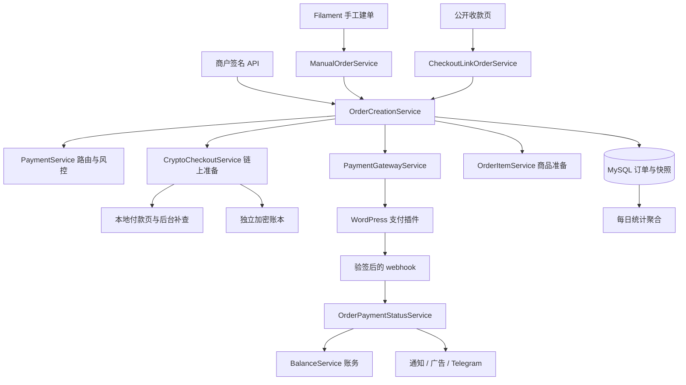

# 系统架构

核对日期：2026-11-12。本文按当前仓库实现整理；基线与旧资料差异见 [开发记录](development-log.md)。入口约定见 [AGENTS.md](../AGENTS.md)，数据语义见 [database.md](database.md)。

## 1. 系统职责与技术栈

新版区块链收款已接入统一下单和付款页，新下单由系统配置 `crypto.checkout_enabled` 控制（新安装默认关闭）。API、手工下单和公开收款链接共用 `OrderCreationService`：法币渠道继续插件流程，链上渠道保存原始汇率 USD 参考值、独立收款附表及本地付款链接，不准备 WooCommerce 商品。`CryptoCheckoutService` 后台推进公钥派生、报价、历史补查、订阅和交接补查；公开页只提交重开／重新报价意图并读取状态。报价有效时复用原地址，失效后须显式重新报价，新地址与旧地址永久分别绑定。

Tatum 回调、逐块历史线索及 EVM／UTXO／TRON 核验复用前六批服务。`CryptoSettlementService` 将净额加密余额、账本、订单付款事实和首次通知一起提交；同单其他请求有款或补查未完成时阻止自动入账。法币余额与网关状态入口保持隔离。真实 Tatum／钱包、MySQL 并发及长期地址规模尚未验收；订单展示与异常款处理已增加，归集工具与教程网页待完成，不能据模拟测试开放生产收款。边界见[方案第 6.12 节](blockchain-payment-plan.md#612-统一下单付款页与重开第七批默认关闭)。

运行配置统一由 `CryptoRuntimeSettings` 从 `system_configs` 读取；`APP_URL` 仍为部署环境配置。新增 29 个运行参数覆盖 Tatum 主／测试网凭证、回调域名、开关、确认数、链身份、测试合约及地址／行情请求超时。`SystemConfig.secret_value` 使用 Laravel encrypted cast；密钥不进入普通值列、模型序列化或表单回显，共享缓存只保存密文，事务内读取不缓存未提交值。保存由 `CryptoRuntimeSettingsService` 重查超管权限、校验并清除缓存；凭证编辑与新监控创建使用配置行锁，仍有非冷订阅时拒绝替换相关凭证。新订阅自动同步新 HMAC；原回调域名和确认策略保持快照。仅关闭新下单开关后，已有付款页、监听、补查及入账继续运行。首次升级一次性导入旧环境／配置缓存，之后不再回退 `.env`；部署和 BTC 测试填写见[部署说明](../doc/deployment.md#32-区块链系统配置与升级)。

第八批增加四个共享后台入口：`CryptoAssetBalanceResource`（总额／占用／可申请）、`CryptoLedgerEntryResource`（实收／服务费／净额凭证）、`CryptoChainEventResource`（链上事件及确认／重组状态）、`CryptoWithdrawalResource`（申请／审核／人工核销）。`CryptoFinanceAccess` 按当前账号、权限及商户归属显式过滤，观察者和匿名请求不能读取；`CryptoBalanceService` 是全部加密余额变动入口。申请占用本金与同币种费用上限，审批不扣总额，人工核销扣本金与实际费用并释放余款；每次资金操作复用 TOTP，独立追加 `crypto_withdrawal_events`。本期只记录未经链上验证的线下凭证，不签名、不广播、不实际出款；见[方案第 9.3 节](blockchain-payment-plan.md#93-当前后台实现第八批仅人工账务核销)。

第九批增加 `CryptoOrderDisplay` 和 `CryptoOrderStatisticsService`：订单保留原币价格与 USD 参考成交额，链上净入账、资产／网络、报价汇率及服务费读取独立账本和最新人工处理记录。筛选汇总按网络＋资产分别计算，不把币数量合并到美元或法币余额。`CryptoPaymentReviewResource` 是异常处理入口，`CryptoPaymentEvidenceService` 汇总整单所有历史地址的证据，`CryptoBalanceService::reconcileOrder()` 完成人工接受和冲正。原收入凭证保持不变，`crypto_payment_resolutions` 追加证据快照、操作人、理由与账务前后值；已支出或占用造成的冲正差额记 `debt_units`，后续收入／释放占用抵扣。取款与人工处理均检查当前商户归属、独立权限及 TOTP，仍无签名或出款。详细流程见[方案第 9.4 节](blockchain-payment-plan.md#94-订单展示费用汇总与异常款处理第九批)。

系统连接商户应用、WordPress/WooCommerce 支付站点和管理后台，负责下单路由、支付状态、商户账务、物流、通知、统计与公开收款链接。

| 层面 | 当前实现 |
|---|---|
| 服务端 | PHP `^8.2`、Laravel `^12.0`、bcmath；具体安装版本以 `composer.lock` 为准 |
| 管理端 | Filament `^5.0`，Spatie Permission `^6.25` |
| 数据 | MySQL 为生产目标；Eloquent、软删除、生成列唯一约束 |
| 缓存/队列 | Laravel Cache/Queue 抽象，生产部署文档使用 Redis；驱动由环境配置决定 |
| 前端 | Blade、Vite `^7.0.7`、Tailwind CSS `^4.0.0`，依赖见 `package.json`/锁文件 |
| 文件与外部集成 | 阿里云 OSS、WordPress 支付插件、WooCommerce 商品、邮件、Telegram、广告转化、Cloudflare SaaS/Turnstile |

这是主要职责图，非完整状态机；远端 HTTP 建单在本地订单事务提交后执行。

## 2. 请求入口与访问边界

WordPress 商城 PayPal / 信用卡插件已迁入 `plugins/wordpress/`，各自维护版本与清单，源码和服务端同仓库管理，GitHub Release 使用独立 `plugins/{slug}/v{version}` tag。`PluginCatalog` 读取插件目录，`PluginProtocol` 检查商户 API 协议指纹与双插件版本，`PluginReleaseService` 构建独立 ZIP 并发布到配置磁盘；稳定入口只在文件上传成功后更新。插件代码保留 PHP 7.4 兼容语法，与 Laravel PHP 运行环境分别检查。

日常上线由根目录 `deploy.sh` 统一执行：维护模式下更新代码、依赖及资源，预检协议和全部插件版本，执行增量迁移与缓存、调用 `plugins:sync` 发布安装包及下载索引，再通知队列重启并恢复访问。`PluginReleaseService::sync()` 在写入前构建并预检所有已接入插件，支持 `--dry-run` 和相同版本重试；各插件分别切换稳定入口，不提供跨插件存储事务。GitHub tag 工作流继续承担 Release 附件和旧仓库过渡镜像。边界与重试见[日常自动部署](../doc/deployment.md#9-日常自动部署)。

脚本在维护模式前自动识别并切换非 root 站点账号，优先采用本站运行目录及项目目录属主，无文件归属证据时才参考唯一的 PHP-FPM worker UID；来源冲突则停止。随后以实际账号预检代码、Git、依赖、缓存、插件与前端目录权限；`--check` 仅执行账号、权限和 Git 预检，不创建部署锁或执行上线动作。

前端预检同时选择站点可访问的 Node/npm 目录并检查实际 Node 版本；优先使用站内工具目录或 `/opt/sscpay-node/bin`，支持沿用管理员 nvm 中已安装的兼容版本。npm 缓存位于 `storage/app/deploy-cache/npm`，在维护模式前检查并准备，不依赖站点账号 HOME 可写；版本声明与根 `engines.node` 同步，依赖安装严格校验引擎要求。

主页的 `/plugins` 提供公开下载，`/plugins/updates/v1/{slug}` 提供按插件隔离的更新元数据，固定版本下载由 `/plugins/{slug}/{version}/download` 读取私有存储并流式输出。生产可复用 OSS，工作流与运行应用的 bucket/prefix 必须对齐；旧 GitHub Release 镜像仅用于把既有安装接到新更新器。商城插件支持 V1 与 V2 普通单、组合父单进度、完整体验签、事件去重、版本保护和逐子单物流；部分付款不确认 WooCommerce 付款成功。同单重试复用原商户订单号，状态落地通过 MySQL 连接级订单锁串行化。商户站的 `sscpay_shipment` WooCommerce API 入口按实际支付方式的凭据接收物流回传，父商户号＋运单号去重；只写配送 meta 和备注，不改变付款状态。协议联调由 `WordPressV2ContractTest` 覆盖实际服务端建单、通知、查单、发货与物流回传。发布配置见[部署说明](../doc/deployment.md#电商插件发布与更新)。

路由装配在 [bootstrap/app.php](../bootstrap/app.php)。

| 入口 | 路由/代码 | 访问方式 |
|---|---|---|
| 平台后台 `/admin` | `app/Providers/Filament/AdminPanelProvider.php` | 超管、商户级管理员；可限制平台域名 |
| 商户后台 `/merchant` | `app/Providers/Filament/MerchantPanelProvider.php` | 归属商户的用户；与平台端共享 Resource 配置 |
| 观察者 `/observer` | `app/Providers/Filament/ObserverPanelProvider.php` | 独立 `Observer` 模型及 `observer` guard，按渠道授权只读 |
| `/api/order/create`、`query`、`ship` | [routes/api.php](../routes/api.php) | POST，受 `API_DOMAIN` 限制，`api.auth` 验签，身份从 Application 取得 |
| `/api/webhooks/payment-gateway/status` | `PaymentGatewayWebhookController` | POST，不限制域名，独立 `X-PGA-Signature` 原始 body 验签，允许收款链接自定义域名回调 |
| `/api/webhooks/tatum/{environment}/{monitor}` | `TatumWebhookController` | POST，独立主／测试网 HMAC 与代次 UUID，速率及 64 KiB 限制；默认关闭，仅持久化待核验线索 |
| `/api/webhooks/telegram` | `TelegramWebhookController` | POST，以 `X-Telegram-Bot-Api-Secret-Token` 校验平台机器人回调；一次性链接定位商户或管理员，并重新检查绑定发起人的权限 |
| 接口文档 `/docs/api/{locale?}?version=1.0\|2.0` | `ApiDocumentationController`、`resources/views/api-documentation.blade.php` | 公开只读，支持 `zh_CN` / `en` 和独立的 1.0 / 2.0 文档，未指定版本默认 2.0；不查询商户应用或展示真实凭证 |
| `/combine-payment/{token}` | `CombinedPaymentController` | 独立组合收银台；token + Host 校验，状态 GET、报价/付款 POST 受 CSRF 与限流保护 |
| `/payment/{token}` | [routes/web.php](../routes/web.php)、`PaymentPageController` | 已存在订单的付款链接 |
| `/c/{slug}` | [routes/checkout.php](../routes/checkout.php)、`CheckoutLinkController` | 可反复建单的公开收款链接，使用 web/session/CSRF 中间件 |
| 争议附件 | `DisputeAttachmentController` | 控制器内检查访问权限，不因公开路由而公开文件 |
| 静态配置演示 `/showcase` | `StaticConfigShowcaseController`、`resources/views/showcase/merchant-admin.blade.php` | 不在 `public/`；控制器内鉴权，未登录或无权 403 |

平台日志页仅由 `AdminPanelProvider` 注册并限制超级管理员访问。`RecentLogProvider` 复用日志插件解析器，在请求内缓存结果，绕过插件全量 Redis 缓存；按文件修改时间优先选择符合插件单文件上限且累计不超过 2 MiB 的日志，保留其中最新 1000 条。页面筛选和统计只覆盖这部分记录，完整历史仍在服务器日志中。`LogViewer` 关闭自动发现，避免被共享页面扫描加入商户后台。

商户配置分组的“服务配置”由 `ServiceSettings` 统一提供时区、物流跟踪与 Telegram 三个区块，共用商户选择器，分别校验和提交；保存一个区块不会提交另一区块的改动。时区区块对能打开页面的用户都可见，只更新所选商户的 `merchants.timezone`，留空回退系统时区。物流和 Telegram 仍只向具备对应权限的用户展示并加载凭证，所有保存、测试消息和回调令牌轮换再次检查对应权限及商户范围。切换商户重载三个区块；旧 `LogisticsTrackingSettings` / `TelegramSettings` 地址保留权限检查并跳转新页，不再显示独立菜单。

Telegram 支持平台机器人快速绑定与原有自建机器人两种模式。平台在部署配置中设置 Token、用户名和回调密钥，运行 `telegram:register-webhook` 注册 HTTPS 回调；商户通过个人聊天的 `start` 或群聊的 `startgroup` 链接完成绑定，不接触平台 Token。`TelegramBindingService` 生成 10 分钟有效的一次性随机令牌，数据库只存摘要，每个商户只保留一个当前请求；重新生成、保存 Telegram 配置或解除绑定会使旧链接失效。回调在商户行锁内重新检查发起账号启用状态、`telegram.manage`、当前商户归属和商户启用状态，再保存聊天目标并消费令牌。超级管理员和商户级管理员在账号设置页给自己保存同样的两种模式，配置单独保存，不随姓名和密码提交。链接只能由本人生成。回调锁定这名管理员，并复查发起人仍是这名启用中的平台账号。自建配置只写入这名管理员的记录。普通商户用户不在账号设置里绑定个人机器人。群聊另通过 Telegram API 检查发送者是否群主或管理员，查询失败返回 503 供 Telegram 重试。已消费令牌的重放不修改记录。

每商户和每名管理员仍只有一个接收目标，个人与群聊二选一；新绑定完成才替换旧配置并启用通知。页面等待期间每 3 秒查询绑定状态，完成后只重载 Telegram 区块；解除绑定软删除配置并撤销未完成链接。`TelegramNotificationService` 根据 `uses_platform_bot` 显式选用平台或商户 Token，未绑定或已关闭通知时继续跳过，自建机器人缺少 Token 不回退平台。部署步骤见 [Telegram 快速绑定](../doc/deployment.md#31-telegram-快速绑定)，边界见 [D-43](decisions.md#d-43-telegram-平台机器人快速绑定)。

Telegram 业务通知统一由 `TelegramNotificationRouter` 发送，分为商户通知 13 项和支付通道通知 7 项。订单、资金、物流及支付组无可用通道的通知只发给事件所属商户；通道禁用、支付链接创建失败、源网站建单/付款成功、商品同步完成/失败按当前通道归属发送：商户专属通道发给该商户，系统级通道发给 `owner_id` 对应管理员。缺少归属管理员时跳过并提示配置异常，不广播给其他管理员或已分配商户。超级管理员在平台管理的「Telegram 通知管理」维护各项开关、正文和适用发送参数，也可只读预览实际接收人。`TelegramNotificationSettings` 保存配置；`TelegramMessageTemplate` 仅替换白名单变量并转义 HTML，不执行模板代码。不新增发送记录表或页面，见 [D-58](decisions.md#d-58-telegram-按业务归属统一管理)。

订单相关 Telegram 通知通过 `OrderTelegramSummary` 构造订单数据，默认包含系统订单号、商户订单号、三方交易号（`transaction_id`）、支付方式名称、系统时区付款时间和原币实际交易金额（`currency` + `amount`，不取折算 USD 或折扣前金额）。通知编辑页用一个「完整消息」编辑框展示正文及订单字段，可删除、重排或改写；发送时不再隐式追加订单信息。订单变量使用 `:order.*`，与通知事件的金额等变量区分。未发货和物流回传失败汇总使用 `[orders]…[/orders]` 重复订单内容，物流回传的应用、运单号、错误原因也在模板内。预览和发送共用 `TelegramMessageTemplate` 的变量替换、HTML 转义、限长与分条逻辑；物流回传每条最多 5 笔，提醒 ID 随对应消息保留。旧正文和订单模板读取时合成完整消息，下次保存采用新字段，见 [D-59](decisions.md#d-59-telegram-完整消息统一编辑)。空订单字段显示暂无，未付款显示未付款。创建支付链接失败和物流异常事件携带标量摘要快照。`OrderDisputeService::open()` 成功后在事务提交时派发 `OrderDisputeOpened`，事务回滚不发通知，派发异常不改变已成功的冻结结果。商户自有渠道自动禁用时，只有触发订单属于该商户才提供其订单数据。下单前无可用渠道时仅传入已知商户订单号和原币金额，其余字段保留空值，不为通知提前建单；文件导入、商品同步等批次通知不关联单笔订单，也不提供订单变量。

静态配置演示不落库、不提交。`StaticConfigShowcase::screensFor()` 决定可见屏：平台管理员（超管）和商户级管理员可见入驻向导、商户配置、支付方式配置；商户管理员和支付通道管理员仅在账号与所属商户启用时可见支付方式配置，且必须是该商户名下的这两个默认角色，单独授予支付方式权限不够。页面不挂全局 auth 中间件（项目没有 `login` 路由），未登录直接 403。入驻向导、商户创建/编辑的页头入口链到当前域名的 `/showcase#对应屏`。支付方式演示入口只在支付方式列表页页头。

租户过滤有三种场景：

- 登录 `User`：`MerchantScope` 调 `User::manageableMerchantIds()`；超管返回 `null` 表示不限，商户级管理员返回名下商户 ID，普通用户返回自身商户 ID。
- API、CLI、队列：没有后台用户，业务调用必须显式限定商户，或说明为何执行全平台任务。
- 观察者：`MerchantScope` 不处理 `Observer`，Resource 根据 `observer_payment_methods` 过滤订单。不能依赖默认 guard 的用户一定是 `User`。

组合订单、收款链接、自有域名和关键词替换分别使用 `combined_orders.view`、`checkout_links.view`、`merchant_domains.view`、`replace_keywords.view` 查看权限，统一加入平台「角色权限分配」的可选项。后三项的既有 `manage` 权限同时允许查看；单独授予 `view` 仅开放列表和只读详情，不允许创建、修改、删除、关键词导入或域名验证。组合订单不再复用 `orders.view`，子单详情链接仍要求普通订单查看权限。Resource 的记录校验和操作按钮均沿用商户范围，写操作在提交时重新鉴权。存量角色通过角色权限页面按需保存同步，已保存模板不自动增加权限；详见 [D-46](decisions.md#d-46-组合订单及商户配置的独立查看权限)。

`MerchantResource::canEdit()` 在每次编辑页请求和保存时重新查询数据库中的商户归属，并检查用户启用状态与商户管理权限；不能只依赖初次打开页面时的 `getEloquentQuery()`。商户转交其他管理员或平台后，原管理员已打开的编辑页也会失去保存权限。

商户编辑页顶部的“授权支付渠道”弹窗按未授权/已授权双栏展示渠道，支持名称/编码搜索与逐项点击即时保存，不提交商户主表单。`MerchantPaymentMethodAssignmentService` 每次重新读取操作者状态、商户管理/渠道管理权限及商户当前归属；可调整的系统级渠道须未软删且 `owner_id` 等于该商户已保存的 `owner_id`，超管代管商户时也按商户所属管理员筛选。未设置所属管理员的平台直管商户沿用当前超级管理员名下渠道。本商户自有支付方式无需分配关系，固定显示在右侧并禁止授权/撤销操作；其他商户自有渠道及范围外系统渠道隐藏，已有隐藏分配保留。系统渠道授权复用分配 Pivot 初始化独立财务配置；在此弹窗撤销时，同一事务内清理分配关系、该商户全部支付组（含软删组）的渠道引用及该商户与渠道的独立财务配置，并刷新配置表。其他商户或渠道的配置保留；重新授权复制该商户最新已保存的默认值。详见 [D-27](decisions.md#d-27-商户编辑页集中授权系统支付渠道)。

支付组创建、编辑页共用未加入/已加入双栏面板，渠道行按名称/编码、固定宽度权重输入和移出按钮对齐。创建页先选择商户，再由 `availableForMerchant()` 加载其可用渠道；`ViewField('paymentMethods')` 暂存 `[{id, priority}]`，切商户清空旧选择与权重，未提交不写组或关系。`createGroup()` 在商户行锁事务内重新验证用户权限、商户范围、渠道授权/软删状态、ID 唯一和整数权重，再一次保存组及关系。编辑页由 `PaymentMethodsRelationManager` 逐项即时加入/移出，修改权重失焦或回车时保存；下方保留当天负载快照。`PaymentGroupMethodService` 每次核对启用用户、支付组管理权限、组和商户当前归属，渠道使用 `forMerchant()` 限定为该商户自有及已授权系统渠道。组内操作不撤销商户授权或删除独立财务配置。编辑主表单不构建渠道关系字段，避免覆盖即时结果和权重。新选择默认权重 100，创建时可设置独立值。支付组创建后不能更换所属商户：编辑字段禁用、保存入口锁定当前商户及组并拒绝篡改归属，`PaymentGroup::updating` 也阻止实例变更 `merchant_id`。详见 [D-28](decisions.md#d-28-支付组内支付方式常驻双栏管理)。

创建、编辑商户与入驻向导通过 `MerchantPaymentSettingsForm` 共用默认财务表单：商户保存交易/退款/拒付手续费、保证金比例及锁定天数，并沿用商户的结算模式/周期作为默认值。新分配系统级支付方式时，双向分配关系使用 `MerchantPaymentMethod`，在事务内先锁商户，再写分配并由 `MerchantPaymentSettingsService::initializeForAssignment()` 复制最新默认值到 `merchant_payment_settings`。配置仍存在时不覆盖，修改商户默认值仅影响后续需要首次初始化的分配；商户编辑弹窗取消会删除配置，重新授权重新初始化。支付方式编辑页的新点选撤销入口也清理配置；直接 Pivot 解除关系仍保留配置。保存商户时还会通过 `initializeMissingForMerchant()` 为该商户已有分配中缺失的独立配置补齐默认值，与商户保存共用事务；已有记录（含空值或 0）保留。商户自有渠道保留原有独立配置入口和渠道默认回退规则，不后台扫描全平台历史分配。

`PaymentMethod` 自己覆盖商户 scope：商户级管理员仅能看到 `owner_id` 为自己的系统渠道及名下商户自有渠道，不再因分配关系看到其他管理员的系统渠道；普通商户用户仍可看到自己自有及已授权系统渠道。支付方式列表的商户财务筛选另加相同归属限制，防止 `forMerchant()` 移除全局 scope 后放宽列表范围。编辑页顶部突出显示归属管理员，移除更改归属入口，锁定已有记录的商户归属并丢弃伪造的 `owner_id`。新增可空备注字段，最多 5,000 字符。

支付方式创建、编辑页在“所属商户”选择框下共用“授权商户”双栏点选面板，固定两列并去除中间一层面板容器；仅未设置所属商户的系统级支付方式显示，商户自有支付方式隐藏。按商户名称/ID 搜索；创建页将选择暂存在 `assignedMerchants`，切换所属商户清空选择，提交时重新验证商户范围、启用及软删状态，并在创建事务内写入分配与财务默认配置。编辑页逐项立即保存，不提交主表单。`PaymentMethodMerchantAssignmentService` 每次重查操作者状态、支付方式管理权限及渠道当前归属，仅列出同一管理员名下的启用商户；创建时以当前管理员为渠道归属，超管代编辑也按已有渠道归属筛选。`MerchantPaymentMethod` 在关系写入时校验同一管理员边界，保护正反两个关联入口。平台直管（`owner_id=NULL`）商户只允许超管归属或历史无归属系统渠道，不允许普通商户级管理员渠道。明确撤销会清理该商户全部支付组（含软删除组）引用和独立财务配置，重新授权按商户最新已保存默认值初始化；编辑主表单保存不覆盖点选结果。历史跨管理员分配暂保留，不批量撤销现有商户使用权；管理员列表不因这些历史关系放宽。详见 [D-32](decisions.md#d-32-支付方式管理员边界与点选授权)。

支付方式列表在商户端固定使用当前商户的生效手续费、保证金及结算配置；平台端未选商户时显示渠道默认值，使用“查看商户生效配置”筛选后，通过 `forMerchant()` 展示该商户自有和已分配渠道，并加载仅限该商户的独立配置。筛选值须属于当前平台用户可管理的启用商户，非法或越权选择返回空表；商户账号伪造此筛选不会切换财务上下文。列表显示与下单保持相同空值回退规则，未初始化的存量分配仍回退渠道费率，不能仅改变显示值伪装配置已生效。

超级管理员可以在同一列表用「已删除记录」筛选查看软删除的支付方式并恢复。默认仍不显示已删除记录。恢复只清除删除时间，启用状态、商户分配和支付组引用保持删除前的样子。`method_code` 在未删除记录之间全局唯一；原代码已被占用时，恢复改为仍未被未删除记录占用的 `_recover`、`_recover2`……后缀（总长度不超过 50，过长时保留后缀、从原代码前面截断），并提示新代码。只存在于其他已删除记录上的代码可以继续使用。商户级管理员和商户用户没有这个筛选，列表查询也不会带上已删除记录，因此不能恢复。

商品同步 `WooCommerceProductSyncService` 只拉取原商品及变体，不调用翻译 API；原名称未变时保留 `site_products.name_translated`，原名称变化则清除旧译名。`PurchaseOrderService` 在选品后、进货单写入事务前调用 `ProductNameTranslationService`，只为选中且缺少译名的商品请求百度翻译并保存，下次复用；未配置或翻译失败时使用原名称，后续生成可重试，不改已有进货单名称快照。

支付方式详情页提供“生成进货单”，历史记录由 `PurchaseOrdersRelationManager` 展示，仅启用的超级管理员可生成、查看和编辑运费/优惠。`PurchaseOrderService` 从所选支付方式的 `siteProducts()` 随机选品并保存独立进货快照：商品不足 30 种全选，否则随机选 30 至总数种，每种 10–20 件；价格采用 `price_min`（视作 USD）× 7 × 0.3，四舍五入为人民币两位小数。默认运费按商品合计 3%–8%、优惠按 10%–20% 随机生成，也可手动输入金额。下单时间可设置，付款/发货/签收时间及交易号为模拟数据。此入口只写 `purchase_orders` 和 `purchase_order_items`，不创建收款订单、不调用网关或改变商户余额；运费/优惠编辑通过 Service 锁单重算总额。

历史记录的“查看采购订单”在新标签页打开 `purchase-orders.show`（`/purchase-orders/{purchaseOrder}`），由 `PurchaseOrderController` 再次校验启用的超级管理员身份后查询记录，并用 `resources/views/purchase-orders/show.blade.php` 展示 1688 样式的采购页面。商品、价格、数量和时间来自进货快照，图片读取关联站点商品的当前安全 HTTP(S) 地址，供需方名称读取支付方式当前档案；没有图片时显示占位。权益词由 `PurchaseOrderService::initializePerksWords()` 在首次打开任一采购页面时随机选取 4–8 个并保存到该单的 `perks_words`；事务中锁行并再次检查，后续两页读取相同结果，已保存的空数组也不重选。首次初始化仅写权益词，不改金额、明细或订单更新时间；运费和优惠仍从后台编辑。

采购页面的“订单详情”进入 `purchase-orders.details`（`/purchase-orders/{purchaseOrder}/details`），模板为 `resources/views/purchase-orders/details/show.blade.php`，展示四步时间线、收货与卖家资料、采购明细、费用及打印区域；两个页面共享控制器的鉴权与数据构造。收货地址优先使用档案 `stock_addresses` 中首个非空字符串，再回退到 `company_address`；联系人、手机号、供应商信息读取当前档案。现有采购单不保存物流公司和运单号，详情以缺省文案展示，不发起物流、评价或支付请求。

订单列表的物流模板导出沿用当前筛选与搜索条件，不要求平台账号选定单个商户；超管可跨商户导出，其他用户限定在 `manageableMerchantIds()` 范围。物流上传仍绑定登录用户所属商户。订单支付方式筛选及观察者账户的渠道分配包含软删除渠道，保留渠道的租户可见性过滤；观察者关联也包含软删除渠道，以便回显和保留已有分配。

API 文档页覆盖创建订单、查询订单、上传物流、商户网站物流回传，并补齐共用签名、支付结果通知、状态与错误码。两种语言分别由 `api_docs_v1.php`、`api_docs_v2.php` 保存版本独立的接口正文，`api_docs.php` 只保存共享文案、签名及参考附录，按执行代码与 [API 手册](../doc/api.md) 同步维护。语言按钮右侧的版本按钮切换 `?version=1.0|2.0`，省略参数打开最新 2.0，未知或非字符串版本返回 404；1.0 不显示组合付款内容，2.0 的普通单和组合单示例均使用 V2 通知。两种语言与版本的章节锚点保持一致，切换保留语言、版本及当前章节，不改变后台会话语言或支付配置。首页、应用列表及创建/编辑表单仍使用默认文档入口。`ApiDocumentationReferenceService` 为两版只读取 `exchange.supported_currencies` 与 `order.platforms` 两个公开配置，沿用系统配置缓存及清除机制动态展示列表。币种列表是部署配置参考，不新增 API 币种枚举校验；原 `order-statuses` 锚点保留，完整状态表位于附录 C。

商户网站物流回传由应用的 `is_shipment_sync_enabled` 开关与完整 HTTPS `shipment_sync_url` 配置，默认关闭；地址保留路径和 query，发送时读取该应用当前地址及 `app_id` / `api_key`，复用 `SignatureCanonicalizer`。`OrderShippingService::record()` 在物流保存后调用 `MerchantShipmentSyncService`，新增独立物流快照并提交后派发 `SyncMerchantShipmentJob`。本地改单仍覆盖 `order_shippings`；已有待发、待重试或暂停的旧版本标为 `superseded`，只尝试最新物流。历史物流不自动回填，具备订单查看、物流权限及租户访问权限的用户可在订单详情手动推送当前物流。

应用表单的回传地址提供“检测地址”按钮，使用当前输入的完整 URL 发起不带应用凭证和业务数据的 HEAD 请求，复用公网 DNS 校验及固定 IP 连接，禁止跟随重定向。检测不保存应用、不创建物流记录，只展示连通性和 HTTP 状态；401/403/405 等不能证明带签名 POST 可用，实际回传仍在订单详情手动验证。

回传成功要求 HTTP 200 且 JSON `code = 0`。网络异常、429、5xx 含首次最多尝试 5 次，间隔 30 秒、5 分钟、30 分钟、1 小时；其他响应直接终止。`order_shipment_syncs` 与 `order_shipment_sync_attempts` 保留物流快照、请求及响应结果，开关关闭时暂停待发任务，调度回收超过两分钟的 `processing` 任务。终败 Telegram 按商户每组最多 5 笔合并，发送失败或限流保留提醒待办并冷却 5 分钟，按提醒到期时间扫描；商户没有可用机器人时标记 `unavailable`，保留回传失败记录。该链路不改变支付插件的 `sync_*` 或物流 Provider 轨迹字段；外部接收协议见 [API 手册](../doc/api.md#外部物流回传协议附件-v11)。

物流模板与观察者订单导出使用 XLSX，共用 `XlsxExport` 按行写出。除订单金额外，所有单元格均显式保存为文本并设置文本格式，保留纯数字编号、前导零、长物流号和公式样式文本的原值；金额为数值单元格并显示两位小数。物流模板的空物流号等填写格同样设为文本，商户保留 XLSX 和单元格格式填写后可直接上传；旧 CSV/XLS 导入仍兼容。物流模板受单表容量限制，超过 1,048,574 笔订单时不生成下载文件，并提示缩小筛选范围，以免上传仅读首表时遗漏记录。查询继续分批读取，导出格式不改变商户/观察者范围或金额口径。

观察者订单使用 `ObserverOrderStatus` 统一状态口径：`paid/pending_settlement/shipped/completed` 展示为支付成功（`paid` 即待发货），`refunded/partially_refunded` 归并退款，`disputing/dispute_review` 归并争议中，拒付独立；其他状态在查询入口排除，列表、详情及导出一致。日期范围按系统时区的订单创建日期筛选，包含起止当天。`ObserverOrderExportService` 流式导出当前筛选/搜索命中的全部记录，重新限定观察者授权渠道及可见状态，仅输出列表字段，金额沿用账户显示比例。

订单状态颜色由 `OrderStatusColor` 统一读取系统配置 `order.status_colors`（`json` 类型、`order` 分组）。普通订单列表与详情、客服查询、观察者列表与详情均按原始订单状态取色；观察者归并文案不参与配色。公开收款结果页的订单状态文字使用同一配置及调色板的 `600` 色阶。超级管理员在系统配置中直接编辑 JSON 对象，键为现有订单状态，值限于 `gray/primary/success/info/warning/danger`，允许部分覆盖或空对象；默认沿用普通订单列表配色，缺失或无效配置回退默认，未知状态为灰色。保存立即清除对应缓存；数据迁移和 Seeder 仅补齐缺失配置，不覆盖已保存颜色，数据迁移回滚保留配置。采购订单页面独立展示。

收款链接 `auto_redirect` 默认开启，提交后自动跳转到 `pay_url`；关闭时跳转到 `/c/{slug}/payment` 展示付款地址。展示页按 Host、启用状态、会话订单 ID 及订单所属商户/链接校验，刷新不重复建单。

收款页地址由 `CheckoutAddress` 按国家整理为 PayPal 地址语义：`state` 对应 `admin_area_1`，`city` 对应城镇 `admin_area_2`。Google 自动填充与服务端共用省州映射表；FormRequest 归一化并校验，`CheckoutLinkOrderService` 再检查省州值，后续沿用插件原有 `state`/`city` 协议。国家限制、字段来源及数据更新约定见 [收款链接手册](../doc/checkout-link.md#地址字段与-paypal-rest)。

## 3. 下单链路

主要入口：[OrderCreationService.php](../app/Services/OrderCreationService.php)。

1. 对 `merchant_id + merchant_order_no` 加缓存锁。查到旧单时比较币种与原始请求金额（`original_amount`，历史单回退 `amount`）；冲突拒绝，匹配则复用本地订单。已有 `pay_url`、已收款或不处于 `pending/failed` 时直接返回；只有无链接且未收款的 `pending/failed` 订单可沿用原渠道补建。普通及指定渠道重提均重新检查原渠道，不另选通道，详见下文。
2. 校验 `amount = subtotal + shipping_fee - discount + tax`，公式容差由 `Order::AMOUNT_TOLERANCE` 定义（当前 0.01）；商品明细按两位小数核对小计。
3. 应用开启自动折扣时，首次建单随机减免原币种应付金额，保存原始金额及折扣快照；然后读取汇率及汇损，换算 USD。回跳域名校验的当前策略见 [D-05](decisions.md#d-05-下单域名策略)。
4. 校验支付组归属且启用。普通路径经 `PaymentService` 筛选风控后，按当天成交额/权重升序、权重降序、ID 升序排列，从前三个候选中等概率随机选择；不足三个时全部参与。指定 `payment_method_key` 的路径跳过组内路由与限额检查，但仍检查渠道可用范围、启用状态和三个回跳 URL 的渠道域名，并且不自动切换渠道。
5. 通过 `PaymentMethod::configurationForMerchant()` 优先使用商户与渠道的独立财务配置；手续费和保证金空值继承渠道默认值，结算模式/周期空值继承商户默认值。百分比手续费与 `settlement_amount` 保留两位小数并舍去千分位；手续费超过 USD 金额拒单。在数据库事务内写订单、原始商品明细，以及结算模式/周期、保证金比例/天数、退款与拒付手续费快照。旧订单的 `settlement_mode` 为 NULL，沿用原规则，不追溯重算。
6. 指定渠道新单在本地落库后触发 `DesignatedOrderCreated`。随后准备匹配商品并调用插件 `/pay`，回填 `pay_url`、`wp_order_id`。网关建单或明确的商品准备失败（`OrderItemPreparationException`）后，当前请求立即停止，返回“建单失败，请重试”，不再尝试其他渠道；本地订单和已锁定的渠道、财务快照保留。同渠道的 HTTP 连接重试沿用原配置；若失败期间已取得付款链接或已收款，则返回最新订单，不覆盖已有结果。首次选渠道仍跳过手续费超过订单金额的候选。
7. 是否派发付款链接邮件由调用方决定，Service 仅保存意图。API 重试补单后的发信行为由 `OrderCreateRetryMailTest` 覆盖。

付款链接邮件的发件人、驱动和凭证统一读取订单所属商户的 `Application`，由应用编辑页顶部“邮件发送”配置，受应用 `is_order_email_enabled` 开关控制。应用未配置完整时记录发送失败，不使用支付方式历史账号或平台默认账号。邮件正文在应用表单配置，留空使用系统默认模板；支付方式不再提供发信账号或正文配置，也不读取其历史邮件模板。已有仅配置在支付方式上的邮件设置需在对应应用重新配置，不自动跨应用复制，详见 [D-21](decisions.md#d-21-付款链接邮件统一使用应用发信配置)。

失败后再次提交同商户订单号时，按订单已保存的支付组、指定渠道标记和回跳 URL 决定校验方式，不采用新请求的 `group_key` / `payment_method_key` 改变原模式。原渠道必须仍启用、未软删除且商户有权使用；普通路由还要求原支付组有效、渠道仍在组内且通过当前风控，失效返回 `NO_AVAILABLE_PAYMENT_METHOD`，即使其他渠道可用也不切换。指定渠道按保存的原 ID 重新校验授权、启用/软删除状态及三个回跳 URL，失效返回 `PAYMENT_METHOD_NOT_AVAILABLE`，域名不符返回 `PAYMENT_METHOD_DOMAIN_MISMATCH`，仍保留其跳过普通组内风控的语义。

重试保留同一本地订单、`order_no`、商户单号、付款 token、原渠道、原远端引用、财务快照、原始商品、应付金额、汇率和首次自动折扣；CREATE/COPY 继续复用此前已创建的商品，不因重提切换站点或重新计算金融快照。历史 `payment_method_id` 为空时只补齐同一渠道的关联，不改写引用或快照。`Order::gatewayOrderReference()` 对 NULL 回退本地 `order_no`；支付创建、主动查询、日志及支付插件物流同步使用该引用，商户网站物流回传仍使用原 `merchant_order_no`。首次前三候选路由沿用 [D-20](decisions.md#d-20-前三候选随机路由与同请求网关故障切换)，失败和重试规则见 [D-24](decisions.md#d-24-网关建单失败立即返回与原渠道重试)。

保留历史渠道切换产生的网关引用、来源日志和迟到结果校验，旧尝试回调/查询不能改变当前尝试的状态及账务；本次及后续同单号重试不生成新的渠道尝试引用。同渠道恢复依赖插件对同一 `s_order_id` 的幂等处理，不把本地锁或引用校验描述成全链路绝无重复支付的保证。

`PaymentGatewayService::createPayment()` 最终失败时（包括业务错误、连接重试耗尽、异常响应和缺少付款链接），根据 `OrderCreationService` 传入的本地订单派发 `PaymentLinkCreationFailed`。现有 `SendTelegramNotification` 队列监听器将脱敏后的原因、错误码、订单号/商户单号、金额和渠道信息按通道当前归属发送。每次调用最终失败仅派发一次，通知异常不覆盖原异常，本地订单继续支持幂等补建；没有可信订单上下文时只记跳过日志，不按全局订单号猜测上下文。进入 `createPayment()` 前的渠道/商品准备异常不在此事件范围。

连续建单失败保护由 `OrderCreationService::createPayment()` 调用 [PaymentMethodFailureService](../app/Services/PaymentMethodFailureService.php) 的 `recordFailure()` / `recordSuccess()` 统一记录：网关建单或明确的商品准备最终失败时，针对当前渠道累计一次 `consecutive_failed_times`；一次创建内部的多次 HTTP 连接重试只计一次。成功保存有效 `pay_url` 才清零；已有链接的幂等命中、金额/授权校验或风控拒绝既不计数也不清零。计数按支付方式 ID 跨商户持久化，事务中先锁原订单、再锁渠道，核对原商户、当前渠道/引用及收款/链接状态，过期结果不计入其他尝试。直接调用底层网关客户端的工具操作不在该统计入口内。

系统配置 `payment.max_failed_times` 默认 5，渠道 `max_failed_times` 可单独设置大于等于 1 的整数，留空由 `PaymentMethod::maxFailedTimes()` 动态继承当前系统值。连续次数达到有效阈值时将渠道 `is_active` 置为 false；不自动换通道，成功清零也不自动重新启用。仅由启用转为停用时，在计数事务后按通道当前归属发 Telegram；逐次支付链接创建失败也采用相同归属。关闭通知、归属缺失、机器人不可用或发送异常不影响禁用结果，不另选其他接收人。业务阈值仍在支付通道设置中维护，通知页仅控制通知行为，见 [D-25](decisions.md#d-25-渠道连续建单失败达到阈值自动停用) 与 [D-58](decisions.md#d-58-telegram-按业务归属统一管理)。

人工核验渠道恢复后，通过 `PaymentMethod` 模型将停用渠道重新启用（`is_active: false → true`）时，同次保存自动将 `consecutive_failed_times` 清零，开始新一轮计数。普通编辑但启用状态未变时不清零；运行中的成功/失败计数使用 `saveQuietly()`，不触发该模型事件。编辑页只提交主动修改的启用状态，在事务内重新锁定并读取渠道后保存，避免旧页面恢复自动停用状态或重复清掉新计数；保存后同步页面的启用状态。此补充无需新增字段或迁移。

两类明细不可混用：`order_items` 保存商户原始商品，`order_matched_items` 保存发给支付站点的商品。`OrderItemService` 支持 `MATCH`、`VIRTUAL`、`CREATE`、`COPY`；同站点直连优先于模式选择。`CREATE`/`COPY` 需要远端真实商品 ID，因此下单过程同步建品。

锁只覆盖同一商户订单号，不等于对整个支付渠道做额度预占；租期至少为 `payment_gateway.creation_lock_seconds`（默认 600 秒），并按单渠道 HTTP 重试及原始商品条数的同步建品超时预算向上调整；不再读取 `failover_max_attempts`。写入链接时仍以订单行锁核对当前远端引用和渠道。风控当前统计已成交数据，待支付订单不计负载。首次前三候选随机允许连续碰巧选中同一渠道，不保证逐单轮转、固定进单比例或严格串行化所有渠道订单。

链上渠道使用同一选路与幂等入口，只有全部链上运行开关开启时才加入候选。指定链上渠道仍限定商户授权，三个回跳地址改与订单应用 `website` 比对；指定法币渠道继续比对渠道 `domain`。组内不同资产不会在付款页再切换，建议按网络／资产配置独立支付组。链上订单 `exchange_rate = original_exchange_rate`，汇损字段为零，`converted_amount` 为原汇率 USD 参考值；法币手续费／净额字段为零且 `settlement_mode=NULL`，真正费用和净额在链上请求与账本。

`/payment/{token}` 的链上页面验证平台 Host 与链接有效期，已付款仍可显示结果。`GET /payment/{token}/crypto` 只读状态；同路径 POST 经 CSRF 与独立 token/IP 限流提交 `open` 或 `requote`，必须携带当前 `request_id`。`crypto_checkouts` 保存不可改写费率快照、当前请求和可恢复进度；`crypto:prepare-checkouts` 每十秒分批执行。展示地址前需要所有历史请求补查完整、远端订阅健康、交接补查完成且无款项冲突。页面不输出 xpub、配置或提供商凭证。

## 4. 支付状态与账务

[OrderPaymentStatusService](../app/Services/OrderPaymentStatusService.php) 共用 webhook 的 `handle()` 与主动查询的 `queryAndApply()`，负责网关事实、接收审计、重复/乱序保护、首次 `paid_at`/`failed_at`、可靠记账及首次支付通知。[OrderLifecycleService](../app/Services/OrderLifecycleService.php) 根据网关、真实结算、有效物流、退款/拒付及活动审核事件推导本地主状态；后台入口不自行拼装状态机。

当前网关尝试的 webhook 被状态机拦截（保护、冲突、过期等）时，在状态事务释放行锁后主动调用一次 `queryAndApply()`，按查询结果走相同的状态、账务与通知流程。查询结果仍保留时间、版本和网关尝试引用校验，不递归补查；旧尝试回调和正常重复回调不触发补查。查询失败向上传播，webhook 返回失败以便插件重试。

`PendingOrderStatusSyncService` 每分钟扫描全平台最近 48 小时创建、`status = pending` 且 `paid_at` 为空的订单，按创建满 30 分钟、90 分钟两个时点逐笔调用 `queryAndApply()`，每单最多自动补查两次。次数与最近领取时间持久化到订单，查询前用符合到期条件与原次数的原子更新领取；缺凭证、远端失败或未知状态也消耗一次，单轮每单最多一次。第一次已离开待支付状态时不再二查；停机错过时点则在 48 小时内分轮补查，实际执行顺延到下一次扫描，不承诺秒级触发。

法币补偿查询显式排除链上订单，后者由区块链扫描与核验任务负责。查询窗口包含 48 小时及 30/90 分钟边界，排除未来创建数据与软删除订单；分批按 ID 遍历，沿用订单锁定渠道（含系统共享、已停用或软删除渠道）。单笔失败继续，命令最终返回非零并记录调度失败日志；手工查询不占用自动补查次数，网关客户端内部连接重试沿用原配置。日志归档仍由 `OrderEventSyncService` 单独负责。

| 行为 | 当前实现 |
|---|---|
| 支付成功 | 首次确认支付事实时，商户通知及广告转化首次尝试与支付事实、记账待办同事务保存，提交后派发；指定渠道付款提醒按首次支付事件触发。通知 `status` 固定为 `paid`，不依赖当前主状态是否已变待结算或完成。新订单通过可靠待办幂等计入总余额和待结算；历史 `settlement_mode=NULL` 保留旧入账方式，仅本次首次确认收款保存收入待办，不从既有已支付状态补造历史收入 |
| 正常主状态 | 支付后起算：`pending → pending_settlement → completed`；发货后起算：`pending → paid → shipped → completed`。`completed` 仅表示实际结算成功；0 天周期可以在入账或首次发货事务内完成，不等待下一轮扫描 |
| 重复/乱序状态 | 保留当前网关引用匹配，记录标准化接收审计。依据网关 `updated_at` 及本地版本识别过期或冲突结果；不能仅因到达较晚就覆盖。已收款不回退为待支付/失败/取消/过期，首次支付副作用不重复 |
| 主动查询 | 网关 `paid` 确认支付事实，再按实际结算和履约事实推导；已结算不降回 `paid/shipped`，已记账退款/拒付、活动审核不被抹掉。查询期间到达的新回调不能被旧查询结果覆盖；冲突接收记录需由有权限的人员使用后台“查询最新状态”核对，不自动发起全平台补查；商户 `/api/order/query` 始终只读本地 |
| 网关 `refunded` / `confused` | 后者映射 `chargeback`；已完成也接受最终结果，保存可靠反向记账待办并尝试扣款，失败重试或转人工。保留本金防重及部分退款后拒付的人工核对；不按网关订单金额盲目重复扣款 |
| 网关 `disputing` | 已完成也可进入争议中，暂停本单结算及循环保证金释放；不等同人工冻结审核，不自动重复冻结。胜诉恢复时按最新结算/物流事实恢复正常阶段 |
| 人工 `dispute_review` | 允许待发货、待结算、已发货、已完成、部分退款和网关争议中的合理来源；权限及 TOTP 不变。关闭审核释放该事件冻结并重新推导主状态；仍有网关争议则保持争议，不固定回 `paid`。最终网关退款/拒付不能被活动审核永久吞掉 |
| 物流 | 首次有效物流启动发货模式的周期，使用首次录入时间与支付时间中较晚者；改运单/补发不重启周期。支付后起算保持待结算或完成；已完成仍可补录物流，部分退款/争议等售后状态优先保留 |
| 订单结算 | `OrderSettlement` 保存模式、周期及保证金快照；真实余额划转、结算记录 `settled` 与正常主状态 `completed` 在同一事务落地。仅到期但记账未成功不能显示完成；部分退款主状态不被结算覆盖 |
| 争议暂停 | 结算和保证金释放直接检查活动审核、网关争议和未结清反向待办，不只看主状态。暂停保留原起算/到期时间；解除时已到期可立即或由下轮调度处理 |
| 保证金 | 固定保证金只能从可提现额人工冻结；循环保证金按实际结算剩余净额提取，锁定期从结算时起算，0 天不锁定。订单完成时保证金仍可能未释放，之后继续按独立期限和售后保护处理 |
| 提现 | 新申请占用独立待出款，后台确认放款扣总额与占用，驳回恢复可提现；负可提现时禁止新增提现和确认放款，仍可驳回。旧提现保持原冻结占用方式 |
| 订单事件日志 | `OrderEventSyncService` 拉取插件 `/order-logs` 归档，不驱动支付状态；与 `order_gateway_status_events` 接收审计分开 |

余额写操作集中在 [BalanceService](../app/Services/BalanceService.php)。锁顺序先商户行、再相关订单/业务单据。当前状态事务与退款/拒付账务事务分开，避免反向加锁造成死锁；不可描述为远端状态和本地资金全程原子提交。人工资金动作使用 `FinanceSecurity` 做 TOTP 二次验证。

新单资金反向扣减依次使用本单待结算、本单未释放循环保证金，再由可提现承担；额外手续费直接扣可提现。原交易手续费不返还，不自动挪用固定保证金、其他订单专属资金或待出款。未结算金额耗尽后取消结算；循环保证金抵扣后只释放剩余额。新分类划转写总额为 0 的台账及分类变化，历史流水不回填。

已全额完成退款记账的订单可在详情页使用“退款转拒付（补扣手续费）”，仍需拒付权限与 TOTP。`BalanceService::chargeback()` 在商户→订单锁内重查累计退款，只补扣订单快照中的拒付费，保留退款本金、退款费及结算审计；追加金额为 0 的 `chargeback` 凭证作为防重和待办结清证据。手续费为 0 也保留凭证。网关后续确认拒付时复用同一流程；单独收到退款不会自动转拒付，仅标记全额退款但未完成扣款的订单不放行。统计保留原退款，转换计一笔拒付、拒付新增本金为 0，见 [D-62](decisions.md#d-62-全额退款后转拒付仅补扣拒付费)。

部分退款订单使用“部分退款转拒付”：弹窗显示已退 USD 本金、剩余本金、拒付费和合计，必须填写理由并完成 TOTP。`chargebackPrincipalAmount()` 核对累计退款原币金额、退款单 USD 本金与实际退款本金台账，再以 `converted_amount - 已记账退款 USD 本金` 计算本次本金，保留逐次退款换汇尾差；原退款和退款费不变。网关自动拒付遇部分退款仍进入人工待办；人工完成后由既有凭证核销。后续退款通知识别拒付已结清，不再次退款或错误阻塞提现/保证金释放。见 [D-63](decisions.md#d-63-部分退款人工转拒付扣剩余本金及拒付费)。

`OrderAccountingService` 以商户→订单→待办顺序处理可靠记账，失败由 `orders:settle-due` 补偿。新单保留 paid/refund/chargeback 待办；旧单新收到的退款/拒付也保存反向待办，但不补建结算周期或重做历史收入。待办 `merchant_id` 有意无外键，避免在持有订单锁的状态事务内反向请求商户锁；执行前核对商户归属。新结算订单首次直接收到退款/拒付时，在同一账务事务先记录原收入再反向扣减。物流与结算更新在订单锁内重新推导，避免覆盖并发退款；争议回复同样先锁商户，避免外键检查产生反向锁。

反向待办的本金尚未扣足时，暂停该商户的提现申请/确认放款及本单循环保证金释放，避免按旧余额出款；人工补录后按实际本金记录解除限制，调度再核销待办状态。候选扫描先排除暂停项，避免限量扫描被早期暂停记录占满。

正常阶段和售后事实独立保存：已结算后退款/拒付不撤销原结算审计，部分退款可能耗尽本单净待结算额而使结算记录 `cancelled`，不能据此判定全额退款。人工“直接设为完成”被移除，完成必须来自真实结算；仍可对未支付订单人工标失败。新规则替代 [D-18](decisions.md#d-18-主动查询已支付结果优先于本地状态) 中“查询 `paid` 无条件改主状态”的行为，详见 [D-29](decisions.md#d-29-订单主状态由结算与售后事实统一推导)。

API 创建、查询及上传物流统一保留兼容 `status`（待结算映射为 `paid`），新增 `order_status`、`settlement_status`、`shipping_status`。后台分别展示主状态、真实结算和物流；原反向待入账筛选明确为退款/拒付记账状态。物流导入与未发货提醒按已收款事实及有效物流判断，不因先结算而漏掉尚未发货订单。

部署只增加字段与网关审计表，不批量回填状态、不全量查询网关、不重记历史资金。`settlement_mode=NULL` 的历史单继续原规则，旧人工完成阶段可在收到新事件时保存到 `normal_status` 供争议往返恢复；有真实结算记录的存量单随后续事件或到期结算逐步按新规则收敛。历史被忽略的退款/拒付需单独核对，不凭主状态推断或自动补账。

漏配历史汇损可使用 `orders:recalculate-surcharge`，由 `OrderSurchargeRecalculationService` 明确按商户纠正订单快照，保留历史市场汇率及手续费金额，默认预览，仅 `--apply` 写入。只处理已入账且无反向资金/争议历史的订单，保存新旧快照报告，不修改余额或台账；人工调账差额与统计补算步骤见[操作手册](../doc/order-surcharge-recalculation.md)。

## 5. 队列和调度

| 队列 | 执行者 | 重试来源 |
|---|---|---|
| `notifications` | `SendOrderNotificationJob` | Job `tries=1`，重试由尝试记录与到期扫描驱动；行锁领取并清空旧重试时间，提交后入队 |
| `payment-links` | `SendPaymentLinkJob` | Job `tries=3`、backoff |
| `default` | `SendTelegramNotification` 队列监听器（含支付链接创建失败提醒） | Worker 配置 |
| `low` | 商品同步、物流导入、支付插件物流同步、商户网站物流回传、17TRACK 注册、广告转化 | 按 Job 定义；商户网站物流回传的 Job `tries=1`，由持久化快照与调度驱动重试；广告转化也由尝试表驱动重试 |

`config/queue.php` 的 Redis `retry_after` 必须大于长任务 Worker timeout。现有 `composer dev` 的默认 `queue:listen` 不能代替订阅全部业务队列的 Worker；启动方式参考部署文档。队列配置的 `after_commit` 当前为 false，新增事务内派发时要明确提交时机。

以下按 [routes/console.php](../routes/console.php) 核对：

| 命令 | 频率 |
|---|---|
| `exchange:fetch` | 每小时 |
| `db:backup:upload` | 每 6 小时 |
| `order-events:sync` | 每分钟，防重叠 |
| `orders:sync-pending-status` | 每分钟扫描，防重叠；最近 48 小时待支付订单在创建满 30/90 分钟各补查一次，最多两次 |
| `combined-orders:expire` | 每分钟，防重叠；停止到期父单的新付款，不取消或释放未决远端支付 |
| `order-notifications:process-due` | 每分钟，防重叠 |
| `crypto:prepare-checkouts --limit=5` | 每十秒后台处理下单准备／页面重开／显式重新报价；默认关闭，商户与订单锁、订单级缓存互斥及持久重试 |
| `crypto:maintain-subscriptions --limit=5` | 每分钟、后台、防重叠／多调度节点互斥；默认关闭，订阅代次锁和接管条件仍独立校验 |
| `crypto:verify-receipts --limit=25` | 每分钟后台消费到期 pending／confirming 收件，默认关闭；请求级锁、批次及启动新核验的 45 秒预算，有界 RPC 超时，最终确认后不持续轮询 |
| `crypto:scan-history {network} --limit=100` | 八个网络分别每分钟后台运行；同高请求合并读块，连续游标、重组回退、冷地址持续扫描，默认关闭 |
| `crypto:settle-payments --limit=100` | 每分钟后台处理入账待办；完整覆盖＋核验后原子提交余额／订单／通知，默认关闭 |
| `merchant-shipments:process-due` | 每分钟，后台执行、防重叠；投递到期商户物流回传、回收两分钟处理超时任务、合并失败 Telegram 提醒 |
| `ad-conversions:process-due` | 每分钟，防重叠 |
| `order-disputes:close-due`、`order-disputes:send-reminders` | 各每 5 分钟，防重叠；提醒提前小时数和开关由 Telegram 通知配置读取（默认 24 小时） |
| `fund-freezes:release-due` | 每 10 秒，后台执行、防重叠；默认每次最多 500 条 |
| `orders:settle-due` | 每 10 秒，后台执行、防重叠；补偿记账、启动发货周期、到期结算，每类默认最多 500 条 |
| `order-stats:aggregate --days=8` | 每天 02:00，防重叠 |
| `order-stats:aggregate --days=2` | 每 3 小时，防重叠 |
| `checkout:check-cloudflare-ips` | 每周一 09:00 |
| `checkout:sync-domains` | 每 15 分钟，防重叠 |
| `logistics-imports:prune` | 每天 03:10，防重叠 |
| `logistics-tracking:reflag-anomalies` | 每天 06:00，防重叠；按供应商状态和系统配置天数重算物流异常，含已有异常以支持阈值放宽后恢复；仅 false→true 且启用门闩通过时主动查一次，确认异常后排队 Telegram 提醒 |
| `orders:notify-unshipped-overdue` | 每分钟读取通知配置，按系统时区在指定时刻执行，防重叠且单节点；默认每天 10:00 汇总超 10 天未发货订单，时间/天数/开关可配置（不看物流跟踪开关） |

## 6. 按任务定位

物流异常统一在 `LogisticsTrackingSyncService` 判定：`Exception` / `DeliveryFailure` / `Expired` 立即标异常；未签收超时与轨迹无更新分别读取系统配置 `logistics_tracking.no_delivery_days` / `logistics_tracking.stale_days`（默认 15 / 5 天，按连续 24 小时计算）。无事件时从发货时间计算轨迹陈旧；当前 `Delivered` 清除异常。保存时锁定当前商户的运单，避免重复回调重复提醒，并拒绝换号后的旧查询结果。换号清空旧 Provider 轨迹、签收、查询及异常字段，同号编辑保留。

异常从 false→true 时提交后派发 `LogisticsAnomalyDetected`，由独立队列监听器向订单商户的 Telegram Bot 提醒，消息包含订单号、商户单号、运单号、状态及原因。正常恢复后再次异常可重新通知；同一异常持续期间不重复派发。消息使用触发时的阈值快照，动态内容截断并 HTML 转义；缺失/禁用 Bot 跳过，限流或发送失败每 60 秒重试，最长 24 小时，不影响物流落库。规则见 [D-26](decisions.md#d-26-物流异常统一判定可配置阈值与商户提醒)。

仪表盘 `AdminDashboard` 使用当天、昨天、近 7 天、近 30 天、本月、上月快捷页签；自定义区间通过弹窗确认后应用，取消保留原区间。所有交易组件共享同一日期条件，按系统时区、包含首尾日期；近 7/30 天含当天，本月截至当天。页面不再提供支付方式筛选，订单数量与交易金额使用独立图表。`DashboardService` 从 `order_daily_stats` 读取创建订单数、支付成功数/成交额、失败数、商户排名与渠道占比，不在页面请求中扫描订单、日志或触发聚合。

新统计列和执行记录版本见 [数据库口径](database.md#6-汇率与统计派生数据)。`OrderStatsRun::CURRENT_METRICS_VERSION` 区分新版完整统计与旧版执行记录；缺失或旧版日期在仪表盘和订单统计页提示需重算，零交易但已按新版统计的日期不误报。定时聚合频率保持不变，显示可能存在延迟；历史范围通过现有 `order-stats:aggregate --date=...` / `--days=...` 或订单统计页刷新动作重算，页面切换不写统计表。

商户登录且具有 `finance.view` 时，`MerchantBalanceOverview` 展示当前商户总余额、可提现、待结算、待出款、保证金/冻结；余额不受交易时间条件影响。组件每次请求重新鉴权并按登录账号的商户查询，不能由 `pageFilters` 指定其他商户；复用 `Merchant` 的余额分类方法，保留旧提现占用的读时分类。平台账号不展示此单商户余额组件，无权限的直接 Livewire 请求也会拒绝。

以下完整路径以仓库根目录为基准；同一表格单元内的后续文件省略相同目录前缀。

| 任务 | 首先阅读 | 现有测试入口 |
|---|---|---|
| 下单、幂等、原渠道重试、邮件补发 | `app/Http/Controllers/Api/OrderController.php`、`app/Services/OrderCreationService.php`、`app/Services/ManualOrderService.php` | `tests/Feature/OrderCreationFailoverTest.php`、`OrderCreateRetryMailTest.php`、`DesignatedOrderTelegramNotificationTest.php` |
| 路由与限额 | `app/Services/PaymentService.php`、`app/Models/PaymentMethod.php`、`app/Models/PaymentGroup.php` | `tests/Feature/PaymentRoutingTest.php`、`PaymentRiskPaidAtTest.php` |
| 连续建单失败与自动停用 | `app/Services/PaymentMethodFailureService.php`、`OrderCreationService.php`、`app/Models/PaymentMethod.php`、`database/seeders/PaymentFailureSettingsSeeder.php` | `tests/Feature/PaymentMethodCreationFailureTest.php`、`PaymentFailureSettingsTest.php` |
| 退款、拒付、账务 | `app/Services/OrderPaymentStatusService.php`、`app/Services/BalanceService.php` | `tests/Feature/GatewayRefundChargebackTest.php`、`OrderLifecycleTest.php`、`OrderStatusApiCompatibilityTest.php`、`tests/Feature/Filament/OrderLifecycleActionsTest.php` |
| 商户费率、结算和保证金 | `MerchantPaymentSettingsService`、`OrderAccountingService`、`OrderLifecycleService`、`BalanceService`、`OrderSettlement` | `MerchantPaymentSettingsTest`、`OrderSettlementBalanceTest`、`OrderAccountingRecoveryTest`、`Filament/OrderSettlementResourceTest` |
| 商户支付渠道授权 | `MerchantResource/Pages/EditMerchant`、`MerchantPaymentMethodAssignmentService`、`MerchantPaymentMethod` | `Filament/MerchantPaymentMethodAssignmentTest`、`MerchantPaymentDefaultsAssignmentTest` |
| 支付组成员和权重 | `PaymentGroupResource`、`PaymentGroupResource/RelationManagers/PaymentMethodsRelationManager`、`PaymentGroupMethodService` | `Filament/PaymentGroupMethodManagementTest`、`Filament/PaymentGroupLoadSnapshotTest`、`PaymentRoutingTest` |
| 历史订单漏配汇损补算 | `app/Console/Commands/RecalculateOrderSurcharge.php`、`app/Services/OrderSurchargeRecalculationService.php`、[操作手册](../doc/order-surcharge-recalculation.md) | `tests/Feature/RecalculateOrderSurchargeTest.php` |
| 统计 | `app/Services/OrderStatsAggregator.php`、`OrderStatsQueryService.php`、`DashboardService.php` | `tests/Feature/OrderStatsAggregatorTest.php`、`DashboardOrderStatsAlignmentTest.php`、`tests/Feature/Filament/OrderStatsPageTest.php` |
| 收款链接和域名 | `app/Services/Checkout/`、`app/Http/Controllers/CheckoutLinkController.php`、`app/Models/CheckoutLink.php` | `tests/Feature/CheckoutLinkTest.php`、`tests/Feature/Filament/CheckoutLinkFormTest.php`、`MerchantDomainResourceTest.php` |
| 物流与争议附件 | `app/Services/OrderShippingService.php`、`OrderDisputeService.php`、`app/Observers/OrderShippingObserver.php` | `tests/Feature/OrderShippingRecordTest.php`、`LogisticsTemplateTest.php`、`DisputeAttachmentTest.php` |
| 商户网站物流回传 | `app/Services/MerchantShipmentSyncService.php`、`app/Jobs/SyncMerchantShipmentJob.php`、`app/Models/OrderShipmentSync.php`、`OrderShipmentSyncAttempt.php`、`app/Console/Commands/ProcessMerchantShipmentSyncs.php`；应用配置和订单详情 | `tests/Feature/MerchantShipmentSyncTest.php`、`tests/Feature/Filament/MerchantShipmentSyncSettingsTest.php` |
| 物流轨迹跟踪 / 异常 / 未发货 TG | `app/Services/LogisticsTracking/`、`LogisticsTrackingWebhookController`、`RegisterLogisticsTrackingJob`、`MerchantLogisticsTrackingSetting`、`ServiceSettings`、`logistics-tracking:reflag-anomalies` / `orders:notify-unshipped-overdue`；系统 `available_drivers` 枚举；商户自选驱动+base_url+密钥；Webhook `POST /api/webhooks/logistics-tracking/{driver}/{webhookToken}`；无历史回填 | `tests/Feature/SeventeenTrackWebhookTest.php`、`SeventeenTrackAnomalyAndUnshippedTest.php`、`tests/Feature/Filament/ServiceSettingsTest.php`、`LogisticsTrackingSettingsAccessTest.php` |
| 权限、面板和用户 | `app/Models/User.php`、`app/Models/Observer.php`、`app/Models/Scopes/MerchantScope.php`、`app/Support/Permissions.php`、相关 Resource | 按功能选择 `tests/Feature/Filament/`，补充真实越权边界的断言 |
| 静态配置演示 | `app/Support/StaticConfigShowcase.php`、`app/Http/Controllers/StaticConfigShowcaseController.php`、`app/Filament/Support/StaticConfigShowcaseAction.php`、`resources/views/showcase/merchant-admin.blade.php` | `tests/Feature/StaticConfigShowcaseTest.php` |
| 支付方式进货单 | `app/Services/PurchaseOrderService.php`、`app/Filament/Support/GeneratePurchaseOrderAction.php`、`app/Filament/Resources/PaymentMethodResource/RelationManagers/PurchaseOrdersRelationManager.php`、`app/Http/Controllers/PurchaseOrderController.php`、`resources/views/purchase-orders/show.blade.php`、`resources/views/purchase-orders/details/show.blade.php` | `tests/Feature/PurchaseOrderTest.php`、`tests/Feature/PurchaseOrderDocumentTest.php`、`tests/Feature/PurchaseOrderDetailsTest.php`、`tests/Feature/PurchaseOrderPerksTest.php`、`tests/Feature/Filament/PaymentMethodPurchaseOrdersTest.php` |

这些是现有测试入口，不代表对应模块已完整覆盖或本次已运行测试。

## 组合付款链路（2026-11-13，当前工作区）

组合付款启用权限独立于普通支付组管理权限：只有启用的超级管理员，或具有支付组管理权限且等于商户当前 `owner_id` 的商户级管理员可以开启。表单复用 `PaymentGroupMethodService::canEnableCombinedPayments()`；创建服务及编辑保存入口在商户行锁内核对归属，普通商户伪造开关、使用旧表单重新开启都被拒绝。普通商户仍可维护已有配置或关闭组合付款，关闭后不能自行重开。此处不增加数据库字段，见 [D-52](decisions.md#d-52-组合付款仅允许超管或直属管理员开启)。

支付组 `is_combine_payment_enabled` 启用、各渠道单笔限额都不足且整笔折算 USD 应付金额不超过组内 `max_combined_amount` 时，`OrderCreationService` 返回 `CombinedOrder` 父单；普通单仍返回 `Order`。API、手工下单与收款链接均使用此入口。保存父单前按商户→支付组加锁，复查组启用状态、组合开关和金额上限；超限返回 422 / `COMBINE_AMOUNT_LIMIT_EXCEEDED`，不落单或调用网关。父单只保存总额、原始资料、汇率和当前进度，不预建远端支付或未来子单。组合开关关闭或上限降低不阻止已有父单续付，见 [D-50](decisions.md#d-50-支付组控制组合付款开关与最高金额)。应用不再有组合开关或通知协议设置：建单时支付组开启组合，则新普通单使用 V2，否则 V1；`orders.webhook_version` 保存版本，通知服务只读该快照。组合父单固定 V2，子单沿用父单版本，见 [D-51](decisions.md#d-51-通知协议随支付组自动确定并按订单保存)。

链上支付保留独立 `Order`、原始法币汇率与 `CryptoCheckout` 流程，开启组合功能不改变它的币种账本。组合子单只使用法币渠道，不能把链上金额累计到法币父单；混合支付组的普通单额度判断对 crypto 使用原始汇率 USD 金额，关闭链上收款时排除 crypto 候选。独立链上订单及法币子单均通过 `PaymentCapacityService` 计算已付和未决占用；链上核验入账时同步将占用标记为 consumed。边界见 [D-47](decisions.md#d-47-链上支付与法币组合付款的合并边界)。

两个付款页的路由及 Vite 入口同时保留。组合页面、状态、报价和付款分别按 IP 限制每分钟 60／60／20／10 次，使用独立命名限流器，轮询不占用付款次数；链上页面继续使用原有 Host 校验、补查／恢复订阅、显式重新报价及专用限流器。

组合付款候选仅允许 `MATCH` / `VIRTUAL`（空配置沿用 `MATCH`），`COPY` / `CREATE` 从随机拆分和余额一次付清候选中排除；普通单路由不受此限制。报价复用、锁内建子单及远端补建/继续付款复用 `CombinedPaymentRouter::supportsProductMode()` 校验，模式变更不能沿用旧报价绕过。已有未决子单保留原引用及占用，不自动替换；已发生支付的状态回调仍按原链路登记。详见 [D-44](decisions.md#d-44-组合付款排除-copycreate-商品模式)。

`CombinedPaymentRouter` 优先沿用当前报价渠道，没有报价时按子单序号取最近已付子单的渠道。该渠道可以收清余额就收清，否则仍按其上限的 70%～90% 随机拆付；其他渠道能收清或限额更高不会触发切换。只有首次未选渠道或原渠道不可用时，才按原规则先找一次付清渠道，否则从完整上限可被日/月余额容纳的最高三个渠道随机选一。报价过期仍记住已选渠道，切换后不会仅因旧渠道恢复而回切，见 [D-45](decisions.md#d-45-组合付款优先沿用已选支付渠道)。`CombinedOrderService` 保存五分钟报价，发起支付时按商户→父单→渠道锁序复查并创建一个真实 `Order`；提交后使用原下单服务远端建单。当前子单未决时只复用此单，失败不切渠道或换远端引用。商品准备沿用合格渠道模式；回跳固定回组合收银台。

组合收银台由 `CombinedPaymentController` 固定使用英文，包括报价和付款错误，旧 `lang` 参数及 `combined_locale` 偏好不再切换语言。最后一笔确认后显示订单已全部付清，隐藏后续付款提示和操作，不提供返回商户链接或自动回跳。收银台状态不再下发父单 `return_url`；父单仍保留原建单快照，子单网关回跳地址仍为组合收银台。见 [D-48](decisions.md#d-48-组合收银台仅英文且完成后不返回商户)。

`PaymentCapacityService` 统一计算渠道跨商户的已成交及未决占用。新普通订单也持有未决占用，使其与组合子单共享额度；待处理旧订单不自动回填。真实建单在渠道行锁下再检查，金额不经浮点数记账。

`CombinedPaymentStatusService` 在状态事务内校验已付金额/币种并原子累计；`OrderApiPayload` 统一父单查询、收银台与 webhook 结构。每笔首次成功创建原通知尝试，业务快照与付款同事务提交；投递独立重试，pending/processing 丢失任务由原通知扫描恢复。V1 通知保持；开启组合使用 V2 完整 JSON 验签、event_id 去重及 version 防乱序。详细协议仅维护在 [商户 API](../doc/api.md#组合付款与-v2-通知) 与中英文网页文案。

账务仍只有子单经过 `BalanceService`；父单未付清阻止子单结算释放，广告转化只在付清时按父单总额触发。物流仍按实际子单保存并同步其原渠道，父单原号上传拒绝，未付清拒绝；商户网站物流回传的 `merchant_order_no` 使用父级原商户号，另带 `child_merchant_order_no` 和原有父子系统号引用，详见 [D-49](decisions.md#d-49-组合物流回传用父级原商户号定位订单)。插件同运单跨订单能力不在本仓库实现。

后台只读组合订单列表/详情使用独立的 `combined_orders.view` 权限与 MerchantScope，不注册到观察者面板；实际子单从现有订单页面查询网关、核对资金及物流，仍需对应订单权限。到期/核对记录保留已付与未决数据，不自动退款。核心回归见 `CombinedPaymentTest`、`CombinedPaymentRoutingTest`、`CombinedPaymentAdminTest`。
