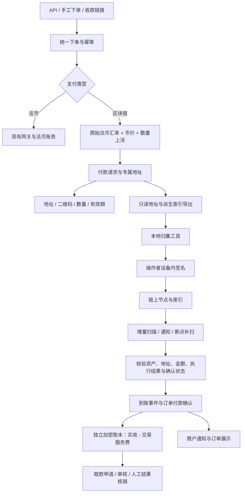

# 区块链收款与本地归集方案

整理日期：2026-11-11。状态：业务规则已按讨论收敛，技术设计待实施与验证。

本文记录新版方案，不表示相关表、接口、页面或工具已经实现。本次只新增设计文档，不修改代码、配置或数据库，不恢复已移除的旧区块链逻辑。旧方案背景见 [D-31](decisions.md#d-31-crypto-payment-amount-mutex)，当前系统以[架构](architecture.md)、[数据库说明](database.md)和执行代码为准。

## 1. 范围与最终业务约定

| 项目 | 已确定规则 |
| --- | --- |
| 资产范围 | BTC、LTC、ETH、USDT-ERC20、USDT-TRC20；后续可扩展网络和资产 |
| 规模 | 每日约 500–1000 单，需考虑地址长期累积和并发建单 |
| 商户下单 | API、手工下单、收款链接仍提交法币交易价格，例如 USD、AUD、GBP |
| 地址 | 一笔付款请求一个地址，永久绑定、不回收、不按金额匹配 |
| 渠道 | 商户可配置自己的支付方式；商户级管理员、平台级管理员可配置权限范围内的渠道并授权商户 |
| 配置 | 支付方式增加“法币支付／区块链支付”Radio；链上参数由配置模板定义，实际值保存到 JSON |
| 报价 | 原始法币汇率折算 USD，再以虚拟币价格计算币数量，最后应用 System Config 中的应付数量上浮比例 |
| 上浮差额 | 全部归商户，不作为平台费用 |
| 服务费 | 仅计提约定的交易服务费，扣费后增加商户加密资产账面余额 |
| 余额 | 按商户、网络、资产分别记账，与现有法币余额完全隔离 |
| 钱包模式 | 不设置“自有／托管／只监控／自动归集”等计算分支，不因钱包控制方不同改变入账公式 |
| 密钥 | 服务器只读，不接收或保存私钥、助记词、扩展私钥、可签名的钱包文件或解密密码 |
| 服务费缴纳 | 账面扣费形成记录；商户每月线下缴费，实际收缴不在本期范围 |
| 取款 | 商户在线申请，平台侧审核、记录人工处理结果；服务器不签名、不广播出款 |
| 归集 | 使用独立本地工具，由操作者自行解锁与签名；服务器不执行归集 |
| 外部服务 | 不使用 Cryptomus、NOWPayments；自建业务系统，可接入只提供节点、行情或索引的基础设施 |

上述“钱包模式不区分”不取消现有支付方式的管理归属、商户授权和数据权限。钱包只读标识、派生规则及地址历史属于技术定位资料，不代表新增资金托管模式。

## 2. 总体结构



服务端与本地工具独立发布。先用地址清单文件交接，是否增加受限的只读同步 API 待实施时确定。服务端只读权限不影响本地工具向节点广播操作者已确认的交易。

## 3. 支付方式与配置模板

### 3.1 复用当前配置体系

现有 [PaymentMethodConfigMap](../app/Models/PaymentMethodConfigMap.php) 的 `fields` 为数组 cast，定义全平台共享模板；[PaymentMethod](../app/Models/PaymentMethod.php) 的 `config` 保存具体参数。当前 [PaymentMethodResource](../app/Filament/Resources/PaymentMethodResource.php) 主要将模板字段渲染为文本输入，需要扩展受控的字段类型与校验，但兼容现有模板。

拟新增支付类型字段 `payment_type`，界面使用 Radio：法币支付／区块链支付。字段名为设计名，实施时按项目约定定稿。历史渠道缺省为法币支付，不改变历史行为。

| 选择 | 表单与执行行为 |
| --- | --- |
| 法币支付 | 保留原模板、站点凭证、商品模式、网关同步及下单链路 |
| 区块链支付 | 仅选择兼容的链上模板；不要求 WordPress 凭证，不同步到支付插件，不执行远端网关建单 |

服务端验证类型与模板匹配，不能只隐藏表单。一个支付方式固定一个网络与资产，避免单个渠道同时承载多种到账单位。

### 3.2 初始模板

| 模板 | 网络 | 资产 | 主网资产精度 |
| --- | --- | --- | --- |
| Bitcoin 收款 | Bitcoin mainnet | BTC 原生资产 | 8 |
| Litecoin 收款 | Litecoin mainnet | LTC 原生资产 | 8 |
| Ethereum 收款 | Ethereum mainnet | ETH 原生资产 | 18 |
| USDT-ERC20 收款 | Ethereum mainnet | 指定官方 USDT 合约 | 6 |
| USDT-TRC20 收款 | TRON mainnet | 指定官方 USDT 合约 | 6 |

网络、主网／测试网、原生／代币、合约和精度由受支持资产注册表约束，不能只信任商户填写的名称、符号或 decimals。上线时核对 [Tether 官方协议与合约列表](https://tether.to/en/supported-protocols/)。测试代币使用独立配置，不复用主网资产身份。

模板可以定义网络、资产、只读派生资料、派生方案、确认策略等字段；RPC 和行情凭证由平台运维配置引用，不混入可授权给商户查看的渠道公开参数。

JSON 结构示例（字段均为拟定，字符串为占位值）：

```json
{
  "config_version": 1,
  "network": "ethereum-mainnet",
  "asset": "USDT",
  "wallet_descriptor": {
    "public_account_id": "public-account-reference",
    "extended_public_key": "PUBLIC_KEY_ONLY_PLACEHOLDER",
    "derivation_profile": "validated-profile-id"
  },
  "confirmation_policy": "ethereum-finalized"
}
```

### 3.3 JSON 与结构化数据的边界

JSON 保存声明式配置；派生计数器、地址绑定、确认状态、余额和流水必须结构化保存，才能加唯一约束、事务锁和索引。

- 同一只读钱包分支被不同渠道引用时，识别为同一个技术派生源，统一分配索引，不各自从 0 开始。
- 账户公钥、派生方案及配置版本确定后不可覆盖历史。修改支付方式只影响新付款请求，旧地址继续监听。
- 复制渠道不复制可造成重复分配的计数器；新引用也不能绕过全局地址唯一约束。
- 区块链只读参数不能传到现有 `/gateway-config` 插件同步逻辑。
- 公开收款页不展示扩展公钥、完整派生清单、节点凭证或商户 API 密钥。

### 3.4 渠道归属与授权

沿用现有 `merchant_id`、`owner_id`、分配 Pivot、`PaymentMethod::forMerchant()` 与编辑权限。平台级管理员和商户级管理员在各自现有权限范围内创建与授权；不新增跨管理员任意授权能力。

已有渠道分配机制见 [MerchantPaymentMethodAssignmentService](../app/Services/MerchantPaymentMethodAssignmentService.php)。撤销授权阻止新下单，不删除原地址、原到账、账本余额和取款记录。普通商户使用已授权渠道不意味着能编辑或导出管理员的整个只读钱包资料。

## 4. 一单一地址与生命周期

“一单一地址”的精确单位是付款请求。一笔业务订单正常只有一个有效请求；明确重新报价或更换资产时可产生后继请求，每个请求使用新的地址，历史请求保留。

1. 在统一建单入口校验商户、金额、渠道和商户订单号幂等。
2. 获取并冻结报价、商户生效服务费快照。
3. 事务内锁定派生计数器、消耗唯一索引，保存地址与订单、商户、渠道绑定。
4. 记录监听起始区块，启动准备扫描／订阅及重叠补扫。
5. 监听可用后才将付款请求展示为可支付；准备失败可重试，不发布未就绪地址。
6. 确认交易累计付足后，落地一次付款事实并可靠记账；通知失败独立重试。

地址一经展示永久绑定，不因过期、软删除、取消或渠道撤销而释放。旧客户同额迟到款仍定位到原请求，不会命中新订单。API 重试沿用原请求和报价，不能暗中生成新地址或重复计费。

同一业务订单多个请求都付款时，只允许一次正常订单入账，后续资金记录为重复／多付款待处理；不跨网络、跨资产直接累加数量。地址命中但资产错误时，不按预期资产记账。

## 5. 报价与交易服务费

### 5.1 最终公式

定义：`A` 为原订单业务规则处理后的法币应付金额，原始 API 请求金额另保留用于幂等；`R` 为未下浮的原币兑 USD 汇率；`P` 为一单位虚拟币的 USD 参考价格；`m` 为应付币数量上浮比例。

```text
V = A × R                         原订单 USD 估值；USD 订单 R = 1
Q_base = V ÷ P                    基础应付币数量
Q_due = ceil_asset(Q_base × (1+m)) 最终客户应付，向上取整到资产最小单位
F = 按约定交易服务费快照计算的币数量
Q_net = 本单核准收款数量 - F        商户净入账
```

这里的上浮作用于“应付币数量”，不直接上调 `USD/BTC` 的分母价格。非 USD 订单不使用现有含汇损下浮的实际汇率报价，也不再按旧汇损反算。USD 订单同样应用虚拟币报价上浮。法币渠道的原汇损规则保持原样。

**上浮部分全部属于商户，仅收取约定交易服务费；不把上浮差额记为平台收入。** 上浮是报价缓冲，不保证持币后的 USD 价值。

### 5.2 完整示例

以下为假设价格，方便核对公式，不代表实时行情：

| 项目 | 数值 |
| --- | --- |
| 法币订单金额 | 200.00 AUD |
| 原始法币汇率 | 1 AUD = 0.50 USD |
| 原订单 USD 估值 | 100.00 USD |
| BTC 参考价格 | 100,000.00 USD/BTC |
| 应付币数量上浮 | 2% |
| 客户应付／核准实收 | 0.00102000 BTC |
| 交易服务费 | 1%，无固定费，即 0.00001020 BTC |
| 商户账面余额增加 | 0.00100980 BTC |

守恒关系：核准实收 = 商户净入账 + 交易服务费。报价上浮不额外拆成平台费用。客户发送交易时由其钱包支付的网络费不作为平台服务费再扣一次。

### 5.3 System Config 与行情

拟定配置项如下，键名及数值范围实施前定稿，不在本文直接指定生产参数：

| 配置 | 规则 |
| --- | --- |
| `crypto.quote_markup_percent` | 全局默认应付数量上浮百分比，例如 `2.0000` 表示 2% |
| `crypto.quote_markup_overrides` | 可选的网络／资产覆盖值，留空继承默认；0 是明确不上浮 |
| `crypto.quote_ttl_seconds` | 报价有效期，可按资产配置 |
| `crypto.max_market_price_age_seconds` | 超过新鲜度阈值拒绝报价 |
| `crypto.price_source_policy` | 行情源优先级、异常偏离阈值及可用性策略 |

原法币汇率复用当前数据源的原始汇率；虚拟币价格需要独立行情源，不能假设现有法币汇率表已经提供 BTC、ETH、LTC。USDT 使用明确的参考价，不永久硬编码为 1 USD。来源、时间、价格单位、上浮和规则版本全部冻结到报价记录；切换来源必须能追溯，不使用未知时间的旧价继续接单。

付款页显示固定币数量和有效期。有效报价内付足后，不因等待确认期间价格变化再次要求补差；过期重报建立新的请求与地址，旧地址继续识别迟到款。临近过期付款、mempool 首次发现、首个上链区块和最终确认的时间口径需在实施前定稿，不把浏览器“我已付款”当成证据。

限时固定报价的模式可参考 [BTCPay 发票说明](https://docs.btcpayserver.org/Users/invoices/)。这是收款报价，不是实际兑换或对冲；账本保留币数量，当前 USD 估值不得覆盖历史报价。

### 5.4 服务费与精度

- 复用商户／渠道生效的约定费率及空值回退规则，保存订单快照；现有解析入口见 [PaymentMethod::configurationForMerchant()](../app/Models/PaymentMethod.php)。
- 建议百分比费用以本单核准收款币数量为基数；若启用现有固定 USD 费用，按同一报价快照的参考 `P` 折算成币。固定费折算和费用舍入是待定技术细节，不额外建立平台报价差收入。
- 计算使用十进制字符串／任意精度整数，不用浮点记账。客户应付向上取最小单位；服务费的舍入方向必须统一定稿并保存版本。
- 大于等于实收的费用不得导致负净入账；报价阶段拦截净额不足的请求。多付款未核准前不擅自纳入费用基数。
- 加密数量按最小单位保存：BTC/LTC 为 8 位，ETH 为 18 位，两个 USDT 为 6 位；不复用 `DECIMAL(15,2)` 存币数量。MySQL `DECIMAL` 最大精度为 65，不能创建 `DECIMAL(78,0)` 来覆盖完整 uint256。建议链上原始数量使用规范化的十进制整数字符串（uint256 最多 78 位），余额／流水采用同一精确方案，应用层以 bcmath 和账户行锁计算；有符号调整单独定义符号与范围，不依赖字符串字典序比较金额。最终存储、汇总查询及约束实施前验证，参见 [MySQL 精确数值说明](https://dev.mysql.com/doc/refman/8.4/en/fixed-point-types.html)。
- 现有自动折扣是否适用于链上订单需要定稿；如启用，应在计算 `A` 前明确落地，不可暗中以汇率变化替代折扣，也不能破坏幂等校验。

## 6. 链上数据如何监听

### 6.1 采用“增量扫描为底座，通知加速”的架构

服务端需要四条网络的只读链适配器：Bitcoin、Litecoin、Ethereum、TRON。ETH 和 ERC20 共用 Ethereum 网络扫描基础设施，但分别解析原生转账和代币事件。

第一版可使用具有所需 RPC／历史索引能力的节点供应商，后续可替换为自建节点。是否自建、供应商及套餐未定；不使用外部支付网关代收资金。普通 RPC、代币索引、内部调用追踪、Webhook 的覆盖范围不同，不能买一个 RPC 套餐就假定所有能力齐全。

| 环节 | 做法 |
| --- | --- |
| 发现 | 分网络持续跟踪区块头；按区块范围拉取交易、日志或索引事件 |
| 加速 | 支持时使用 WebSocket／Webhook 通知，作为需要查询交易的提示 |
| 核验 | 读取交易、执行回执、规范链区块及事件，验证网络、资产、接收地址、数量 |
| 确认 | 保存区块高度／哈希，按网络策略更新确认与最终性 |
| 补扫 | 持久化游标、重叠扫描、分页去重、失败重试，不依赖内存进度 |
| 对账 | 核对链上事件、付款请求、账本与人工取款结果；发现差异保留异常记录 |

不能用“余额变大了多少”直接给订单记账：多笔转入、归集、其他资产和外部转出都可能改变余额。订单收入必须有可定位的链上事件。

### 6.2 各链的数据路径

| 网络／资产 | 识别路径 | 关键核验 |
| --- | --- | --- |
| BTC | 区块完整交易或等效可靠索引，逐笔解析 `vout`，匹配受监控脚本／地址 | 网络、交易哈希、输出序号、输出值、所属规范区块、确认数 |
| LTC | Litecoin 节点或可靠索引，解析普通透明交易输出 | 使用 Litecoin 的网络与地址参数；第一版不开放未经适配的 MWEB 收款 |
| ETH 原生 | 区块交易＋执行回执；内部转入需节点 trace 或等效内部转账索引 | 普通转入要求交易成功；内部价值转移要求调用成功、未回滚，排除重复计算外层转账 |
| USDT-ERC20 | 对受支持合约按区块范围查询 `Transfer` 日志，匹配接收地址 | 合约地址、事件结构、数量、回执成功、区块归属与最终性 |
| USDT-TRC20 | TRON 交易回执及合约事件，或等效 TRC20 历史索引 | 合约、地址规范化、事件位置、执行成功、固化链确认结果 |

Bitcoin 的 `getblock` 可返回区块完整交易信息，见 [官方 RPC 文档](https://developer.bitcoin.org/reference/rpc/getblock.html)；Litecoin 参考其[官方项目](https://github.com/litecoin-project/litecoin)。Ethereum 的区块、回执和日志查询见 [JSON-RPC 文档](https://ethereum.org/developers/docs/apis/json-rpc/)。内部转账追踪不属于每个普通 RPC 都保证提供的能力，选择节点时必须实测；未完成该能力前不得宣称支持所有合约钱包／交易所的 ETH 转入。

TRON 可使用节点 HTTP／Solidity API 或 TronGrid 索引；最终判断以固化链结果及成功回执为依据，不将广播成功当作到账。接口层次见 [TRON 官方 API 说明](https://developers.tron.network/docs/api)。

### 6.3 游标与地址索引

每个网络、数据流保存已完整处理区块高度与哈希；交易、日志、trace 等多条数据流分别记录完成位置，不能让快速的数据流掩盖另一条流的缺口。只有数据完整落库或形成可靠待办后，才推进对应游标。

处理原则：

1. 拉取最新链头及安全／最终确认位置。
2. 从已保存位置按有界范围扫描，遵守 RPC 区块跨度、分页和限流。
3. 将目的地址／脚本与本地地址索引匹配，而非逐个历史地址不停轮询。
4. 将事件持久化，派发核验与确认任务；重复扫描幂等。
5. 检查父区块连续性，落地高度和哈希后再推进游标。
6. 中断后从持久化位置恢复，并重复覆盖一段最近区块。

Ethereum 代币收款可分批过滤目标地址，也可扫描受支持合约后本地匹配，具体方案按流量与供应商限制评估；全链流量可能远高于平台订单量，容量规划不能只按 1000 单估算。

新地址登记时保存起扫区块并重叠补查，解决登记与首次转入之间的竞态。历史过期地址继续保留在地址索引；不用为每个地址维持独立轮询任务。若选地址订阅方案，需核实长期地址数量、过期订阅处理和历史补查能力，不能因费用优化直接丢弃迟到款识别。

### 6.4 事件去重与确认

| 事件 | 业务唯一身份建议 |
| --- | --- |
| BTC／LTC 输出 | 网络＋txid＋vout |
| ETH 普通转入 | 网络＋交易哈希＋普通转入标识 |
| ETH 内部转入 | 网络＋交易哈希＋稳定 trace 路径 |
| ERC20／TRC20 转入 | 网络＋交易哈希＋链适配器规范化事件位置 |

同一交易可以产生多次转入，不能只按 txid 去重。区块归属与接收审计单独保留；出现重组后重新上链时，需要校正事件位置或别名，不能把同一经济转账再算一次。不同索引供应商的 trace／事件序号需规范化。

BTC/LTC 按配置确认数及金额策略处理；ETH 建议明确使用 `finalized` 或经评估的确认策略；TRON 使用固化链语义。具体确认数与大额规则未定，不能一刀切为“看到交易立即成功”。mempool 仅表示发现付款，不增加可用账面余额。

Webhook 验签校验原始 body，按供应商协议做事件防重、防重放；验签只能证明来源，仍需查询链上事实。订阅断线、回调漏发和超时均由游标补扫兜底。

### 6.5 重组、故障与监控

- 保存区块哈希及父哈希；发现分叉时回到共同祖先，撤销孤块上的未确认累计并重新扫描。
- 未入账的孤块事件不再计入付足数量。已入账后出现重组，保存补偿／冲正流水并进入人工资金异常处理，不能删除原账或伪造法币退款／拒付。
- 多笔付款只累计当前有效且满足策略的同请求、同资产事件。重组后重新确认不得重复增加收入。
- 行情故障阻止新报价；节点故障保留付款记录并告警。监听严重落后时停止展示新可支付地址，不能显示系统运行正常。
- 按网络隔离扫描、确认、记账队列；RPC 重试和限流不能长时间占用数据库资金锁。
- 监控最新高度、扫描滞后、各数据流缺口、待确认数量、记账积压、RPC 错误、重组、异常款及报价新鲜度。
- 运维需保留足够的区块／历史查询能力。裁剪节点或套餐缺历史数据时，应有可审计的补查来源，不默认能任意回溯。

## 7. 付款异常与订单状态

| 情况 | 第一版处理原则 |
| --- | --- |
| 足额且符合有效期规则 | 达到确认条件后，一次性确认订单支付并增加净余额 |
| 少付 | 保留已收与待补数量，同一请求可多笔补足，不默认减免 |
| 多付 | 原单按核准数量记账，多出金额单独待核；不重复给订单记收入 |
| 迟到款 | 始终定位原请求，人工确认是否接受、补差或线下退款 |
| 多个请求都付足 | 保留全部转入，但业务订单只有一次正常入账，额外转入人工处理 |
| 错资产／错网络 | 不按预期资产入账；错链可能无法从现有监听直接发现，不承诺自动找回 |
| 失败／回滚交易 | 不计入实收 |
| 确认超时、重组、报价过期争议 | 保留链上事实与审计，进入待处理，不自动覆盖原价或再次扣费 |

支付状态与履约状态分开考虑：链上“已付足且确认”不依赖归集，也不依赖服务费是否实际缴纳。加密订单不进入现有法币结算、保证金、退款扣款或拒付自动记账。主状态与发货、完成的映射需实施前定稿，不借用“法币结算成功”伪造完成记录。

## 8. 独立账本与服务费记录

### 8.1 余额口径

统一按“商户＋网络＋资产”保存账面余额，不按钱包模式拆计算。两个网络的 USDT 不互抵、不跨链取款。现有 USD `merchants.balance` 等字段与 [BalanceService](../app/Services/BalanceService.php) 仅继续管理法币资金。

新增专用加密账务服务，所有加密余额与占用变动统一经该入口，使用事务、账户行锁及唯一幂等键。锁顺序须和现有商户／订单资金操作保持一致。

建议最小余额结构：

```text
账面总余额 = 累计核准净收入 + 调整 - 已核销取款
可申请取款 = 账面总余额 - 取款占用 - 其他已明确的账面冻结
```

第一版不自动继承法币保证金或结算周期。账面余额不代表平台持有等额链上资金，也不等于任一钱包余额；当前钱包估值、实际收缴等不覆盖账本。

### 8.2 入账与幂等

足额确认后，在锁定商户、订单及资产账户的事务内：记录付款事实、保存实收／服务费／净额快照、创建可靠加密记账待办；通知通过可靠待办或提交后派发。服务费记账与净余额入账需要能够恢复且不可重复。

拟用幂等键 `crypto_order_paid:{order_id}`，账本记录净额、服务费及来源请求。重复回调、重复补扫、并发确认、记账重试不再次入账。历史审计使用追加记录；纠错走有理由和权限的调整／冲正，不直接改流水。

### 8.3 线下费用与转账

- 服务费账面计提后，不再从商户净余额扣第二次。每月提供商户、网络、资产维度的费用汇总；实际缴费不在本期自动处理。
- 本地归集属于链上资金位置变化，不增加订单收入，也不自动扣商户账面本金。
- ETH/TRX 手续费补充、钱包间转入和找零应记录为非订单活动，不能仅因命中受监控地址就创建订单收入。
- 不自动把任意链上转出当作取款完成；线下支取通过明确的取款核销或人工调整反映。存在未核销外部支出时提示账链差异，平台审核不能把账面余额当作可立即转出的证明。
- 归集和人工出款的网络费由商户承担，但不得重复计费；链上实际费用与账面扣款分别留依据。

## 9. 取款申请、审核与人工核销

### 9.1 流程

```text
商户申请 → 占用本金和明确的费用预留 → 待审核
    ├─ 驳回／允许撤销 → 释放占用
    └─ 审核通过 → 待人工处理
                      ↓
                线下签名与转账
                      ↓
             登记交易／处理凭证
                      ↓
               核验结果并核销
```

服务器不接收签名密钥、不发起实际出款。审核通过不等于已付款，不立即从账面总余额核销本金；仍占用余额，避免重复申请。

申请保存网络、资产、数量、目标地址、手续费承担方式与可接受上限。费用预留来源和未知实际网络费的处理在实施前定稿；不能借未确定的估算费无限扣款。

### 9.2 审核与完成

- 复用现有管理员／商户范围和 [FinanceSecurity](../app/Filament/Support/FinanceSecurity.php) 的资金动作校验；保存审核人、时间、理由及每次操作日志。
- 审核、驳回、核销、调整各入口重新检查权限与实时余额，不仅在按钮上控制。
- 同一申请完成核销只能扣账一次；驳回和取消释放占用也必须幂等。
- 有链上交易凭证时，读取交易并核对网络、资产、接收地址、数量、成功状态与确认条件；使用输出／事件明细分配到申请，防止一笔转账被重复核销。
- 批量人工出款允许多条申请共享 txid，但每个输出／事件及其金额分配受约束，总核销不得超过可证明转出值。
- 无链上转账或属于线下账务抵扣的处理，使用单独的“人工调整／核销”类型与原因，不伪装成链上已出款；具体可用类型待定。
- 交易待确认、超时或结果不明时保留占用，继续核查，不能一边释放余额一边重复出款。
- 完成后扣本金及最终确认费用、释放多余预留。已完成记录不能删除；纠错追加反向流水。

## 10. 本地归集工具

### 10.1 目标与技术建议

提供统一桌面入口管理多链地址并批量归集，避免要求商户在 MetaMask 等钱包中逐个添加订单账户。倾向 Electron＋TypeScript，最终框架、依赖版本、Windows/macOS 支持范围需技术验证；Tauri 为可评估备选，不将框架选择当作已落地事实。

工具承担钱包级职责。采用经过验证的密钥与交易库，不自创密码算法。Ethereum 可评估 [ethers 的 HD／加密钱包能力](https://docs.ethers.org/v6/api/wallet/)；TRON 使用经验证的链工具；BTC/LTC 按各自网络构造和签署交易。选定具体依赖后核对维护状态、版本与安全公告。

### 10.2 资料与密钥

- 导入平台提供的网络、资产、只读派生源指纹、派生路径、索引、地址及配置版本；不盲目信任文件中的地址和目标。
- 操作者本地创建或导入专用收款钱包；按需支持临时解锁、加密本地文件或硬件签名。现有钱包／硬件对大量派生地址的兼容性尚未验证，不能承诺全部支持。
- 平台只接收公钥资料。导出的扩展公钥必须处在能够继续公钥派生的正确层级，后续路径不能跨越硬化节点；不能用一个普通地址或普通公钥替代整个 HD 分支。
- 签名前本地重新派生并核对每个来源地址；路径不匹配立即停止，不要求把主钱包助记词上传排查。
- 不将解密密钥写入日志、任务记录、浏览器存储、遥测或崩溃上报。内存生命周期尽量缩短，但不宣称托管运行时能保证所有内存副本可靠擦除。
- 初期无需平台账号登录即可导入文件操作；若未来加入同步，仅使用受限只读令牌，不向服务端传密钥。

### 10.3 用户操作

```text
导入地址清单 → 本地解锁钱包 → 查余额 → 填归集地址
    → 展示数量、手续费、目标与执行计划 → 操作者确认
    → 本地逐笔／分批签名广播 → 查询确认 → 导出结果
```

原始交易预览、本地复核与费用上限不能完全依赖平台返回值。软件重启后用不含密钥的任务记录恢复，通过原 txid／nonce／UTXO 查询结果，避免重复转出。

| 资产 | 归集处理 |
| --- | --- |
| BTC／LTC | 选择可用 UTXO、估算费率、构造批量交易；验证找零地址、锁定已选输入、处理粉尘与手续费过高 |
| ETH | 每个普通地址独立发送，预留 Gas 上限；可能剩余少量 ETH，不承诺一次清零 |
| USDT-ERC20 | 查 USDT/ETH → 从操作者控制的手续费账户按需补 ETH → 确认 → 转出 USDT → 经济合理时回收剩余 ETH |
| USDT-TRC20 | 检查账户状态、资源、TRX → 按需准备 → 转出 USDT → 单独处理剩余资产／资源 |

ERC20 的补 ETH、转 USDT、回收 ETH 可能各产生费用；从多个普通账户批量操作不等于合并为一笔免 Gas 交易。手续费账户同样由操作者本地授权，服务器不代付、不签名。Ethereum 费用机制见 [Gas 官方说明](https://ethereum.org/developers/docs/gas/)，TRON 见[资源模型](https://developers.tron.network/docs/resource-model)。

### 10.4 归集教程与安全交付

BTC、LTC、ETH、USDT-ERC20、USDT-TRC20 各提供完整教程：创建／备份、导出只读资料、匹配地址、小额试收、费用准备、归集、查交易、失败恢复与设备丢失恢复。每种流程指定经过验证的软件与版本，不以通用“导入助记词”替代步骤。

教程和兼容性测试是交付要求，本文不代表教程已经编写完毕。不能承诺 imToken 或其他单个现成钱包已覆盖公钥导出、海量地址管理和批量归集全流程。

工具只加载随安装包发布的本地界面，不远程加载可操作密钥的业务代码；隔离 UI、签名和网络权限，使用窄化 IPC。安装包签名、更新验证、依赖固定与审核、无密钥日志及恢复测试是正式发布门槛。参考 [Electron 安全指南](https://www.electronjs.org/docs/latest/tutorial/security)。本地签名减少服务器接触密钥的风险，不等于免除软件错误或供应链风险。

## 11. 数据结构建议

下列为拟新增结构，表名并未创建，实施时再核对项目规则与最终索引。不是只增加一个“一单一交易”的大 JSON 附表。

| 拟定结构 | 关系与关键数据 |
| --- | --- |
| 支付方式类型／模板元数据 | 支付方式类型、模板兼容类型；链上声明参数仍在现有 JSON |
| `crypto_public_accounts` | 只读派生源、指纹、路径方案、版本、原子分配计数器；不引入钱包模式枚举 |
| `crypto_addresses` | 派生源、索引、网络、地址／脚本、起扫区块、永久绑定 |
| `crypto_payment_requests` | 订单、商户、渠道、地址、资产、报价及服务费快照、应付最小单位、有效期、累计确认数量 |
| `crypto_chain_events` | 网络、资产、txid、输出／事件位置、收发地址、数量、区块哈希高度、执行与确认结果；可不关联订单 |
| `crypto_scan_cursors`／区块检查点 | 网络与数据流的连续处理位置、区块哈希、补扫及恢复信息 |
| `crypto_asset_balances` | 商户＋网络＋资产唯一；总余额、取款占用、其他明确冻结 |
| `crypto_ledger_entries` | 精确数量、余额变动、业务类型、唯一幂等键、来源订单／取款／调整、审计 |
| `crypto_accounting_tasks` | 可靠入账／冲正待办、状态、重试、下次执行时间、脱敏错误 |
| `crypto_service_fee_records` | 原始服务费规则、计提数量、订单、商户和月度汇总依据 |
| `crypto_withdrawals`／处理明细 | 申请、费用预留、审核、占用、人工结果、链上证据与金额分配 |

数据库必须约束同派生分支索引唯一、网络地址绑定唯一、链上事件业务身份唯一、商户资产账户唯一、记账幂等键唯一。地址及金融审计不能因软删除释放唯一性。费用和提款必须可追溯到原配置快照，不读取最新模板回算历史。

独立账本按商户聚合，不按钱包模式分余额；实际收款地址和渠道来源仍保留供对账。一个链上交易可能关联多个事件、多个订单或多条人工核销，使用明细关联，不能在订单 `transaction_id` 只存一个哈希就认为数据完整。

## 12. 现有系统接入与展示

| 现有位置 | 拟改动与保护边界 |
| --- | --- |
| [OrderCreationService](../app/Services/OrderCreationService.php) | 保留统一入口、金额校验、商户订单号幂等和渠道锁定；按支付类型创建网关支付或链上付款请求 |
| [OrderPaymentStatusService](../app/Services/OrderPaymentStatusService.php) | 整理可复用的付款事实确认和通知，不能伪造 WP 回调使链上款流入法币记账 |
| [OrderAccountingService](../app/Services/OrderAccountingService.php) | 保留法币职责；加密走独立账务服务及可靠待办 |
| [OrderLifecycleService](../app/Services/OrderLifecycleService.php) | 增加明确的资金类型边界，避免加密订单等待不存在的法币结算或触发法币退款／拒付 |
| [PaymentPageController](../app/Http/Controllers/PaymentPageController.php) | 区块链展示地址、二维码、数量和确认状态；保留公开页权限、Host、Turnstile、频率与 CSRF 边界 |
| [OrderStatsAggregator](../app/Services/OrderStatsAggregator.php) | 明确法币／加密过滤，独立资产统计；可展示 USD 报价估值但不加进法币余额 |
| [现有 API 协议](../doc/api.md) | 原币法币价格与签名兼容；新增支付类型、资产、网络和金额信息采用扩展字段，准确字段实施前定稿 |

`orders.amount/currency` 保留法币交易价格，不把上浮后的币值写回商品金额；`original_amount` 继续按原语义用于幂等。`converted_amount` 如保留报价 USD 基准，必须明确加密类型和统计过滤；现有 `settlement_amount` 不存 BTC/ETH 数量，不用于加密入账。原 `exchange_rate` 与汇损字段的链上订单赋值需实施前统一，不能界面显示下浮汇率却实际按原始汇率报价。

当前文档存在一处历史描述差异：[database.md](database.md) 的 `pay_url` 说明仍提到加密单，但当前 [PaymentPageController](../app/Http/Controllers/PaymentPageController.php) 没有新版链上页面分支。该句不能作为已实现依据；本文仅登记差异，不为迎合旧描述恢复旧逻辑。

### 12.1 页面展示

| 位置 | 展示 |
| --- | --- |
| 客户付款页 | 法币订单金额、最终应付币数量、网络、地址、二维码、有效期、报价说明、已收与待补、确认进度；付款前明确上浮规则 |
| 订单列表 | 原交易金额及法币、USD 估值、支付资产网络、链上实收、服务费、净入账；原法币列按类型切换取值与单位 |
| 订单详情 | 原始汇率、币价、数量上浮、行情时间／来源、完整报价和费用快照、全部链上事件 |
| 商户资产页 | 按网络／资产的账面总余额、占用、可申请取款、流水；明确不是钱包实时余额 |
| 费用与取款页 | 月度服务费计提、申请、审核、人工处理、证据及核销记录 |

当前参考 USD 估值独立计算，不能覆盖历史报价，也不能把 BTC、ETH、USDT 数量直接相加。商户净入账必须显示资产对应精度，不固定两位小数；未付款的预计净额与实际已入账明确区分。

### 12.2 其他入口的约束

- 指定渠道的现有域名规则依赖 WP 站点域名，链上渠道需定义等效授权规则，不能直接把域名校验整体关闭；不改变现有法币策略。
- 原网关主动补查、WooCommerce 商品准备、插件日志、退款拒付动作按支付类型分流，不对链上订单调用插件。
- 法币人工资金动作同时增加服务端类型校验，不能仅隐藏按钮。加密人工核销、调整使用独立权限和 TOTP。
- 邮件、Telegram、商户回调可复用调度能力，但需展示正确的法币订单价格与加密收款单位，不能复用默认 USD 文案。
- API、CLI、监听队列无登录用户时必须显式限定商户；网络扫描可全平台执行，但匹配后以永久绑定解析归属并重新核对。

## 13. 测试、容量与实施顺序

### 13.1 测试环境

| 网络 | 测试路径 |
| --- | --- |
| Ethereum | 本地开发链验证故障；Sepolia 公共联调，使用测试 ETH 与测试 ERC20 |
| TRON | Nile／Shasta 联调，使用测试 TRX 与明确的测试 TRC20 |
| Bitcoin | Regtest 控制出块、双花与重组；Signet 公共联调 |
| Litecoin | Regtest 本地验证；Litecoin Testnet 公共联调 |

测试币不代表真实 USDT。需覆盖主网目标代币特有的执行行为；最终用独立专用钱包做受控小额主网验收，不使用商户生产助记词。测试配置独立，拒绝主网／测试网混用。

Ethereum 网络选择参考[官方网络说明](https://ethereum.org/developers/docs/networks/)；TRON 测试币参考[官方指引](https://developers.tron.network/docs/getting-testnet-tokens-on-tron)。

### 13.2 验收重点

1. 并发、重试、同派生源跨渠道引用、钱包配置更换均不重复分配地址；原地址能恢复。
2. USD 与非 USD 报价、数量上浮、费用、精度和历史快照正确，原法币汇损不误用或重复扣除。
3. 重复回调、分页重叠、漏通知、队列失败、停机恢复、重组均不漏款或重复记账。
4. 多输出、多事件、ETH 内部转账、假代币、执行失败、少付、多付、迟到、多个请求重复付款得到正确结果。
5. 加密到账前后法币余额、法币金融流水和法币保证金不变；链上归集不重复形成收入。
6. 提款占用、并发申请、驳回、重复审核、重复核销、批量出款证据分配与权限隔离正确。
7. 本地工具逐链验证地址派生、资金转出、Gas／资源不足、断点恢复和助记词／文件备份恢复；服务端日志中没有签名密钥。
8. 原普通下单、幂等补单、收款链接、网关回调、退款拒付、结算、统计及商户授权回归通过。
9. MySQL 独立测试库验证事务、精确整数、唯一约束与并发；不能把 SQLite 结果当作生产迁移验证。

按一单一个地址估算，每年新增约 18万–36.5万个地址，重新报价会更多。地址索引、历史查询和独立队列必须按长期规模设计；不为每个历史地址创建持续轮询任务。节点全链扫描开销、内部调用追踪和 RPC 费用需单独实测。

### 13.3 实施顺序建议

1. 定稿只读派生兼容方案、事件身份、报价与费用舍入、确认与过期策略、人工核销类型。
2. 新增类型、模板、只读派生记录和地址分配；验证账户恢复，保留原法币功能。
3. 逐网络完成扫描、补扫、重组和确认，建立付款请求及独立账本。
4. 接入订单页面、商户通知、统计分流、费用汇总与取款审核。
5. 完成本地工具与五类资产教程，公共测试链全流程联调。
6. 小额主网验证后按商户开关灰度开放。

新增迁移按正常前向演进，不重建生产库、不恢复已删除旧迁移。发布清理配置／服务缓存并核对 Provider 注册，避免旧 Provider 缓存引用已不存在的类。产生金融审计后以向前修复为主，不靠删表回滚抹掉账务。

## 14. 实施前待定项

这些细节不改变本文已确认业务口径，但尚未完成选择或验证：

- 行情源、节点／索引供应商、自建范围、RPC 限额与实际成本。
- 各链公钥导出、派生方案及本地钱包兼容性；不能假设普通钱包自动暴露 xpub。
- 各资产报价有效期、确认策略、临近过期付款与确认超时规则。
- 报价／服务费／固定费的精确舍入、异常行情阈值、自动折扣是否适用。
- 多付款、迟到款的人工核准及线下退款操作权限。
- 取款费用预留、人工核销类型、地址变更确认及线下支取差异处理。
- 链上订单主状态、履约完成语义、API 扩展字段、统计与现有限额使用的 USD 估值基准。
- 本地工具技术栈与平台版本、依赖库、分发与安全审核；完整归集教程待实际验证后编写。

本文不提供生产迁移命令、密钥导入命令或可直接执行的出款操作。开发和上线需要另行明确授权，不能将设计文档视为已经完成实现或测试。
