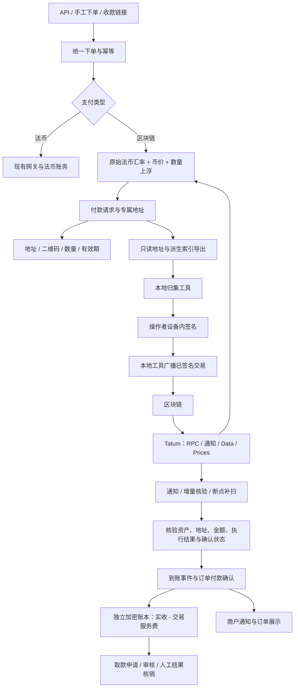

# 区块链收款与本地归集方案

整理日期：2026-11-11；更新：2026-11-12。修订：采用 Tatum 数据与报价接口，归集保持自研本地签名。状态：服务端已接统一建单、付款页与重开流程，默认关闭，真实链和生产验证待完成。

本文记录新版目标方案，不能将全部章节视为已实现。用户已授权开始开发，目前工作区新增支付类型、精确报价、永久地址绑定、付款请求、规范化事件身份及独立净额账务基础；实现边界见下一节。未在业务库执行迁移，未恢复旧区块链逻辑。旧方案背景见 [D-31](decisions.md#d-31-crypto-payment-amount-mutex)，当前系统以[架构](architecture.md)、[数据库说明](database.md)和执行代码为准。各链的归集步骤见[本地归集操作教程](../doc/blockchain-local-sweep-guide.md)，其中工具界面名称为设计名称，待实现后逐项验证。

### 当前工作区进度与使用限制

- 已编码：支付类型、五类资产精确报价、永久地址绑定、事件身份及独立净额账务；后台类型 Radio／JSON 模板、只读公钥与共享派生计数、Tatum 地址／行情读取及缓存；第三批增加订阅代次、HMAC 回调入口、可靠线索接收、查回／创建／取消客户端、到期维护与保守退订保护，以及后台可编辑的必要参数。第四批接通 ETH 直接转账／USDT ERC20 核验和可靠收件消费；第五批增加 BTC／LTC 标准交易及 USDT TRC20 核验；第六批增加逐块历史发现、冷地址持续补查、ETH 内部调用核验和订单原子入账，见第 6.9–6.11 节。对应迁移和测试见[数据库第 8 节](database.md#8-新版区块链收款基础当前工作区待集成)。
- `prepareAllocated()` 可先预留索引，经 Tatum 比对本地恢复地址并派生，再获取 USD 行情准备报价。该过程已用模拟接口联调，未使用真实凭证验证。USDT 正式合约受注册值约束，测试合约由运维白名单配置；接口支持和资产配置通过不等于真实链监听通过。请求仍先处于 `preparing`，没有监听准备完成流程就不能展示为可支付。
- 第七批已实现统一建单、本地付款页和异步重开／重新报价（见第 6.12 节）。第八批已实现后台独立余额、入账凭证、链上明细及取款审核／人工账务核销（见第 9.3 节）。第九批已实现订单币种／净额／汇率展示、按资产服务费汇总、异常款人工接受与冲正（见第 9.4 节）。尚未实现：链上出款凭证自动核验、本地工具及教程网页；按最新约定，自动化归集在交易测试完成之后开发。已有扫描器可从 RPC 读取整块数据并生成补查证明，独立任务在核验完成后原子入账；实际钱包、Tatum 套餐、归档／trace 权限、全部测试链、MySQL 锁竞争及长期地址规模的吞吐仍未实测。新开关默认关闭，不能据模拟测试直接开放收款。UTXO 的 coinbase／MWEB／过大输入集合暂不自动处理。
- 链上候选由 `CRYPTO_CHECKOUT_ENABLED` 及订阅／核验／历史／入账开关共同控制，默认不加入路由。开启后创建本地付款链接，链上单不进入 WordPress 建品或插件建单。基础迁移不自动创建／启用链上渠道，不填入生产时长或费率；报价缺配置或行情时间无效时拒绝准备。
- 初始计算规则 `due_ceil_fee_total_ceil_v1`：应付数量向上取最小单位，百分比费以核准应付数量为基数，固定 USD 费按同一币价折算，两项合计后向上取整；净额必须为正。自动入账只接受已验证且确认的事件累计恰好等于应付，规范链区块时间在请求创建至到期之间；有效期内上链、到期后确认仍可入账，其他差异转后续人工流程。详见 [D-33](decisions.md#d-33-新版区块链基础分阶段接入与精确账务)。

## 1. 范围与最终业务约定

| 项目 | 已确定规则 |
| --- | --- |
| 资产范围 | BTC、LTC、ETH、USDT-ERC20、USDT-TRC20；后续可扩展网络和资产 |
| 规模 | 每日约 500–1000 单，需考虑地址长期累积和并发建单 |
| 商户下单 | API、手工下单、收款链接仍提交法币交易价格，例如 USD、AUD、GBP |
| 地址 | 一笔付款请求一个地址，永久绑定、不回收、不按金额匹配 |
| 渠道 | 商户可配置自己的支付方式；商户级管理员、平台级管理员可配置权限范围内的渠道并授权商户 |
| 配置 | 支付方式增加“法币支付／区块链支付”Radio；链上参数由配置模板定义，实际值保存到 JSON |
| 报价 | 原始法币汇率折算 USD，再以虚拟币价格计算币数量，最后应用 System Config 中的应付数量上浮比例 |
| 上浮差额 | 全部归商户，不作为平台费用 |
| 服务费 | 仅计提约定的交易服务费，扣费后增加商户加密资产账面余额 |
| 余额 | 按商户、网络、资产分别记账，与现有法币余额完全隔离 |
| 钱包模式 | 不设置“自有／托管／只监控／自动归集”等计算分支，不因钱包控制方不同改变入账公式 |
| 密钥 | 服务器只读，不接收或保存私钥、助记词、扩展私钥、可签名的钱包文件或解密密码 |
| 服务费缴纳 | 账面扣费形成记录；商户每月线下缴费，实际收缴不在本期范围 |
| 取款 | 商户在线申请，平台侧审核、记录人工处理结果；服务器不签名、不广播出款 |
| 归集 | 使用独立本地工具，由操作者自行解锁与签名；服务器不执行归集 |
| 归集教程 | 管理后台提供独立网页版分步教程，覆盖五类资产及测试流程，方便商户按流程操作；网页引导与本地签名工具分开 |
| 外部服务 | 链上交易数据、到账通知、核验补查与虚拟币报价使用 Tatum；第一版不自建四条链节点，不使用 Cryptomus、NOWPayments |
| Tatum 资金权限 | 不使用 KMS、Smart Wallets、Virtual Accounts、Gas Pump 或远程私钥签名；Tatum 不承载商户内部账本 |
| 即时订阅期限 | System Config 配置时长，到期由后台取消 Tatum 即时订阅；付款链接重开时按订单状态补查并恢复，历史地址后台检测继续保留 |

上述“钱包模式不区分”不取消现有支付方式的管理归属、商户授权和数据权限。钱包只读标识、派生规则及地址历史属于技术定位资料，不代表新增资金托管模式。

## 2. 总体结构



服务端与本地工具独立发布。服务器经 Tatum 读取链上事实，自己完成地址分配、报价规则、商户记账与审核。先用地址清单文件交接，是否增加受限的只读同步 API 待实施时确定。本地工具可经 Tatum 节点读取和广播已签名交易，但不使用服务端密钥代签；凭证边界见第 6.7 节。

## 3. 支付方式与配置模板

### 3.1 复用当前配置体系

现有 [PaymentMethodConfigMap](../app/Models/PaymentMethodConfigMap.php) 的 `fields` 为数组 cast，定义全平台共享模板；[PaymentMethod](../app/Models/PaymentMethod.php) 的 `config` 保存具体参数。当前 [PaymentMethodResource](../app/Filament/Resources/PaymentMethodResource.php) 主要将模板字段渲染为文本输入，需要扩展受控的字段类型与校验，但兼容现有模板。

拟新增支付类型字段 `payment_type`，界面使用 Radio：法币支付／区块链支付。字段名为设计名，实施时按项目约定定稿。历史渠道缺省为法币支付，不改变历史行为。

| 选择 | 表单与执行行为 |
| --- | --- |
| 法币支付 | 保留原模板、站点凭证、商品模式、网关同步及下单链路 |
| 区块链支付 | 仅选择兼容的链上模板；不要求 WordPress 凭证，不同步到支付插件，不执行远端网关建单 |

服务端验证类型与模板匹配，不能只隐藏表单。一个支付方式固定一个网络与资产，避免单个渠道同时承载多种到账单位。

### 3.2 初始模板

| 模板 | 网络 | 资产 | 主网资产精度 |
| --- | --- | --- | --- |
| Bitcoin 收款 | Bitcoin mainnet | BTC 原生资产 | 8 |
| Litecoin 收款 | Litecoin mainnet | LTC 原生资产 | 8 |
| Ethereum 收款 | Ethereum mainnet | ETH 原生资产 | 18 |
| USDT-ERC20 收款 | Ethereum mainnet | 指定官方 USDT 合约 | 6 |
| USDT-TRC20 收款 | TRON mainnet | 指定官方 USDT 合约 | 6 |

网络、主网／测试网、原生／代币、合约和精度由受支持资产注册表约束，不能只信任商户填写的名称、符号或 decimals。上线时核对 [Tether 官方协议与合约列表](https://tether.to/en/supported-protocols/)。测试代币使用独立配置，不复用主网资产身份。

模板可以定义网络、资产、只读派生资料、派生方案、确认策略等字段；RPC 和行情凭证由平台运维配置引用，不混入可授权给商户查看的渠道公开参数。

JSON 结构示例（字段均为拟定，字符串为占位值）：

```json
{
  "config_version": 1,
  "network": "ethereum-mainnet",
  "asset": "USDT",
  "wallet_descriptor": {
    "public_account_id": "public-account-reference",
    "extended_public_key": "PUBLIC_KEY_ONLY_PLACEHOLDER",
    "derivation_profile": "validated-profile-id"
  },
  "confirmation_policy": "ethereum-finalized"
}
```

### 3.3 JSON 与结构化数据的边界

JSON 保存声明式配置；派生计数器、地址绑定、确认状态、余额和流水必须结构化保存，才能加唯一约束、事务锁和索引。

- 同一只读钱包分支被不同渠道引用时，识别为同一个技术派生源，统一分配索引，不各自从 0 开始。
- 账户公钥、派生方案及配置版本确定后不可覆盖历史。修改支付方式只影响新付款请求，旧地址继续监听。
- 复制渠道不复制可造成重复分配的计数器；新引用也不能绕过全局地址唯一约束。
- 区块链只读参数不能传到现有 `/gateway-config` 插件同步逻辑。
- 公开收款页不展示扩展公钥、完整派生清单、节点凭证或商户 API 密钥。

### 3.4 渠道归属与授权

沿用现有 `merchant_id`、`owner_id`、分配 Pivot、`PaymentMethod::forMerchant()` 与编辑权限。平台级管理员和商户级管理员在各自现有权限范围内创建与授权；不新增跨管理员任意授权能力。

已有渠道分配机制见 [MerchantPaymentMethodAssignmentService](../app/Services/MerchantPaymentMethodAssignmentService.php)。撤销授权阻止新下单，不删除原地址、原到账、账本余额和取款记录。普通商户使用已授权渠道不意味着能编辑或导出管理员的整个只读钱包资料。

### 3.5 当前代码采用的配置与只读派生方式

当前新增 [CryptoPaymentTemplatesSeeder](../database/seeders/CryptoPaymentTemplatesSeeder.php)，只补缺失的五类模板，不覆盖已保存内容；尚未在业务库执行。后台 Radio、模板类型与服务端校验一致，已有支付方式／模板不能切换类型。链上字段仍保存到 `payment_methods.config`，当前采用平铺格式，版本在服务端规范化为字符串：

```json
{
  "config_version": "1",
  "network": "ethereum-sepolia",
  "asset": "ETH",
  "extended_public_key": "PUBLIC_XPUB_PLACEHOLDER",
  "derivation_profile": "tatum-v3-ethereum-v1",
  "recovery_address_0": "LOCALLY_RECOVERED_ADDRESS_0",
  "recovery_address_1": "LOCALLY_RECOVERED_ADDRESS_1",
  "confirmation_policy": "ethereum-configured-v1"
}
```

占位值不能实际保存。只接受 Base58Check 校验有效的 `xpub/tpub` 公钥，不接受 `xprv/tprv`、助记词、普通地址替代公钥、私钥、节点凭证或未知配置键；当前不自动转换 `ypub/zpub`、原始 TRON 十六进制公钥或任意钱包路径。`confirmation_policy` 目前只是受控引用，真实确认配置和执行器尚未接入，不能理解为已经验证最终性。

四链目前采用 Tatum v3 的只读公钥地址接口，不调用 `/wallet` 或 `/wallet/priv`。扩展公钥会通过 HTTPS 发送给 Tatum，接口依据见 [BTC](https://docs.tatum.io/reference/btcgenerateaddress)、[LTC](https://docs.tatum.io/reference/ltcgenerateaddress)、[ETH](https://docs.tatum.io/reference/ethgenerateaddress)、[TRON](https://docs.tatum.io/reference/trongenerateaddress)。公钥不会赋予签名能力，但会暴露相应地址分支；本地工具也必须实现一致的恢复路径，不能把两个地址比对成功当成全部钱包兼容性和独立密码学派生验证已经完成。

使用专用且未被其他收款流程占用的分支，由本地钱包独立导出索引 0、1 的校验地址。每次新分配先预留索引（订单从 2 开始），在数据库事务之外逐个比对恢复地址，再请求目标索引地址；超时、比对失败或行情失败不回收已预留索引，重试同一分配键沿用原预留。当前每个新分配最多进行三次正常派生读取，失败重试还会产生调用，应计入 Credits。是否使用新分支、目标地址是否已有链上历史仍是开放付款前的检查项，不自动把现有钱包历史余额认作订单收款。

Tatum 凭证只从 `config/services.php` 对应环境变量读取：`TATUM_API_KEY` 用于行情和正式网络只读请求，`TATUM_TESTNET_API_KEY` 用于测试网络地址请求，实际权限需账号联调。`CRYPTO_TEST_ERC20_CONTRACT`／`CRYPTO_TEST_TRC20_CONTRACT` 是平台测试合约白名单，不放正式 USDT 合约或签名密钥。主网 USDT 合约按 [Tether 官方列表](https://tether.to/en/supported-protocols/)约束，测试资产不会被视为正式 USDT。

行情通过 [v4 symbol 接口](https://docs.tatum.io/reference/getexchangerate)明确请求 USD，拒绝错误币种／价格单位、浮点数响应、缺失时间、未来或过旧行情。按资产共享最多十秒缓存，每次读取再核对来源时间；过旧时重新获取，失败不退回旧价。HMAC 回调和内部订阅管理的当前边界见第 6.8 节，以太坊核验见第 6.9 节；尚未创建真实订阅或完成真实链联调。

## 4. 一单一地址与生命周期

“一单一地址”的精确单位是付款请求。一笔业务订单正常只有一个有效请求；明确重新报价或更换资产时可产生后继请求，每个请求使用新的地址，历史请求保留。

1. 在统一建单入口校验商户、金额、渠道和商户订单号幂等。
2. 获取并冻结报价、商户生效服务费快照。
3. 事务内锁定派生计数器、消耗唯一索引，保存地址与订单、商户、渠道绑定。
4. 记录监听起始区块，启动准备扫描／订阅及重叠补扫。
5. 监听可用后才将付款请求展示为可支付；准备失败可重试，不发布未就绪地址。
6. 确认交易累计付足后，落地一次付款事实并可靠记账；通知失败独立重试。

地址一经展示永久绑定，不因过期、软删除、取消或渠道撤销而释放。旧客户同额迟到款仍定位到原请求，不会命中新订单。API 重试沿用原请求和报价，不能暗中生成新地址或重复计费。

同一业务订单多个请求都付款时，只允许一次正常订单入账，后续资金记录为重复／多付款待处理；不跨网络、跨资产直接累加数量。地址命中但资产错误时，不按预期资产记账。

## 5. 报价与交易服务费

### 5.1 最终公式

定义：`A` 为原订单业务规则处理后的法币应付金额，原始 API 请求金额另保留用于幂等；`R` 为未下浮的原币兑 USD 汇率；`P` 为一单位虚拟币的 USD 参考价格；`m` 为应付币数量上浮比例。

```text
V = A × R                         原订单 USD 估值；USD 订单 R = 1
Q_base = V ÷ P                    基础应付币数量
Q_due = ceil_asset(Q_base × (1+m)) 最终客户应付，向上取整到资产最小单位
F = 按约定交易服务费快照计算的币数量
Q_net = 本单核准收款数量 - F        商户净入账
```

这里的上浮作用于“应付币数量”，不直接上调 `USD/BTC` 的分母价格。非 USD 订单不使用现有含汇损下浮的实际汇率报价，也不再按旧汇损反算。USD 订单同样应用虚拟币报价上浮。法币渠道的原汇损规则保持原样。

**上浮部分全部属于商户，仅收取约定交易服务费；不把上浮差额记为平台收入。** 上浮是报价缓冲，不保证持币后的 USD 价值。

### 5.2 完整示例

以下为假设价格，方便核对公式，不代表实时行情：

| 项目 | 数值 |
| --- | --- |
| 法币订单金额 | 200.00 AUD |
| 原始法币汇率 | 1 AUD = 0.50 USD |
| 原订单 USD 估值 | 100.00 USD |
| BTC 参考价格 | 100,000.00 USD/BTC |
| 应付币数量上浮 | 2% |
| 客户应付／核准实收 | 0.00102000 BTC |
| 交易服务费 | 1%，无固定费，即 0.00001020 BTC |
| 商户账面余额增加 | 0.00100980 BTC |

守恒关系：核准实收 = 商户净入账 + 交易服务费。报价上浮不额外拆成平台费用。客户发送交易时由其钱包支付的网络费不作为平台服务费再扣一次。

### 5.3 System Config 与行情

拟定配置项如下，键名及数值范围实施前定稿，不在本文直接指定生产参数：

| 配置 | 规则 |
| --- | --- |
| `crypto.quote_markup_percent` | 全局默认应付数量上浮百分比，例如 `2.0000` 表示 2% |
| `crypto.quote_markup_overrides` | 可选的网络／资产覆盖值，留空继承默认；0 是明确不上浮 |
| `crypto.quote_ttl_seconds` | 报价有效期，可按资产配置 |
| `crypto.max_market_price_age_seconds` | 超过新鲜度阈值拒绝报价 |
| `crypto.price_source_policy` | 行情源优先级、异常偏离阈值及可用性策略 |

原法币汇率复用当前数据源的原始汇率；虚拟币价格采用 Tatum Prices API，明确指定 `basePair=USD`，不能沿用其默认 EUR，也不能假设现有法币汇率表已经提供 BTC、ETH、LTC。USDT 使用明确的参考价，不永久硬编码为 1 USD。同一资产行情共享缓存，按注册表确认资产身份，不能仅凭不受控符号选币。来源、时间、价格单位、上浮和规则版本全部冻结到报价记录；未知时间或过旧价格停止生成新报价，故障时不擅自切换未约定的来源。接口依据见 [Tatum 行情文档](https://docs.tatum.io/reference/getexchangerate)。

付款页显示固定币数量和有效期。有效报价内付足后，不因等待确认期间价格变化再次要求补差；过期重报建立新的请求与地址，旧地址继续识别迟到款。临近过期付款、mempool 首次发现、首个上链区块和最终确认的时间口径需在实施前定稿，不把浏览器“我已付款”当成证据。

限时固定报价的模式可参考 [BTCPay 发票说明](https://docs.btcpayserver.org/Users/invoices/)。这是收款报价，不是实际兑换或对冲；账本保留币数量，当前 USD 估值不得覆盖历史报价。

### 5.4 服务费与精度

- 复用商户／渠道生效的约定费率及空值回退规则，保存订单快照；现有解析入口见 [PaymentMethod::configurationForMerchant()](../app/Models/PaymentMethod.php)。
- 建议百分比费用以本单核准收款币数量为基数；若启用现有固定 USD 费用，按同一报价快照的参考 `P` 折算成币。固定费折算和费用舍入是待定技术细节，不额外建立平台报价差收入。
- 计算使用十进制字符串／任意精度整数，不用浮点记账。客户应付向上取最小单位；服务费的舍入方向必须统一定稿并保存版本。
- 大于等于实收的费用不得导致负净入账；报价阶段拦截净额不足的请求。多付款未核准前不擅自纳入费用基数。
- 加密数量按最小单位保存：BTC/LTC 为 8 位，ETH 为 18 位，两个 USDT 为 6 位；不复用 `DECIMAL(15,2)` 存币数量。MySQL `DECIMAL` 最大精度为 65，不能创建 `DECIMAL(78,0)` 来覆盖完整 uint256。建议链上原始数量使用规范化的十进制整数字符串（uint256 最多 78 位），余额／流水采用同一精确方案，应用层以 bcmath 和账户行锁计算；有符号调整单独定义符号与范围，不依赖字符串字典序比较金额。最终存储、汇总查询及约束实施前验证，参见 [MySQL 精确数值说明](https://dev.mysql.com/doc/refman/8.4/en/fixed-point-types.html)。
- 现有自动折扣是否适用于链上订单需要定稿；如启用，应在计算 `A` 前明确落地，不可暗中以汇率变化替代折扣，也不能破坏幂等校验。

## 6. 链上数据如何监听

### 6.1 Tatum 提供数据，系统保留可靠核验与补扫

服务端需要四条网络的只读链适配器：Bitcoin、Litecoin、Ethereum、TRON。ETH 和 ERC20 共用 Ethereum 网络扫描基础设施，但分别解析原生转账和代币事件。

第一版已选择 Tatum，不自建四条链节点。所需产品能力如下；套餐与额度仍待确认，不能把普通 RPC 专用 Key 当作包含所有通知／Data API 的套餐。

| Tatum 能力 | 本方案用途 |
| --- | --- |
| Notifications | 订单地址转入通知，加速发现 BTC、LTC、ETH、ERC20、TRC20 转账 |
| RPC Nodes | 区块、交易、回执、规范链归属及确认结果核验 |
| Data／历史交易 API | 按地址／区块范围查询、分页补扫、停机恢复；逐链核实接口范围 |
| 内部交易通知与查询 | ETH 合约／交易所等产生的内部价值转入；主网和测试网覆盖分别验证 |
| Prices API | BTC/USD、LTC/USD、ETH/USD、USDT/USD 参考行情，系统自行应用数量上浮 |

官方通知支持列表包含四条目标主网，Ethereum 主网包含内部交易事件，但测试网不保证完全相同。接口依据见 [Notifications 支持范围](https://docs.tatum.io/reference/notifications-supported-chains)及[内部交易查询](https://docs.tatum.io/reference/getinternaltransactionsblockchainsapi)。文档支持不替代账号实际权限与实测。供应商通过适配器接入，事件、地址、报价和账本仍存本地，不因选择 Tatum 放弃未来替换能力。

| 环节 | 做法 |
| --- | --- |
| 发现 | 分网络持续跟踪区块头；按区块范围拉取交易、日志或索引事件 |
| 加速 | 支持时使用 WebSocket／Webhook 通知，作为需要查询交易的提示 |
| 核验 | 读取交易、执行回执、规范链区块及事件，验证网络、资产、接收地址、数量 |
| 确认 | 保存区块高度／哈希，按网络策略更新确认与最终性 |
| 补扫 | 持久化游标、重叠扫描、分页去重、失败重试，不依赖内存进度 |
| 对账 | 核对链上事件、付款请求、账本与人工取款结果；发现差异保留异常记录 |

不能用“余额变大了多少”直接给订单记账：多笔转入、归集、其他资产和外部转出都可能改变余额。订单收入必须有可定位的链上事件。

### 6.2 各链的数据路径

| 网络／资产 | 识别路径 | 关键核验 |
| --- | --- | --- |
| BTC | 区块完整交易或等效可靠索引，逐笔解析 `vout`，匹配受监控脚本／地址 | 网络、交易哈希、输出序号、输出值、所属规范区块、确认数 |
| LTC | Litecoin 节点或可靠索引，解析普通透明交易输出 | 使用 Litecoin 的网络与地址参数；第一版不开放未经适配的 MWEB 收款 |
| ETH 原生 | 区块交易＋执行回执；内部转入需节点 trace 或等效内部转账索引 | 普通转入要求交易成功；内部价值转移要求调用成功、未回滚，排除重复计算外层转账 |
| USDT-ERC20 | 对受支持合约按区块范围查询 `Transfer` 日志，匹配接收地址 | 合约地址、事件结构、数量、回执成功、区块归属与最终性 |
| USDT-TRC20 | TRON 交易回执及合约事件，或等效 TRC20 历史索引 | 合约、地址规范化、事件位置、执行成功、固化链确认结果 |

Bitcoin 的 `getblock` 可返回区块完整交易信息，见 [官方 RPC 文档](https://developer.bitcoin.org/reference/rpc/getblock.html)；Litecoin 参考其[官方项目](https://github.com/litecoin-project/litecoin)。Ethereum 的区块、回执和日志查询见 [JSON-RPC 文档](https://ethereum.org/developers/docs/apis/json-rpc/)。内部转账追踪不属于每个普通 RPC 都保证提供的能力，选择节点时必须实测；未完成该能力前不得宣称支持所有合约钱包／交易所的 ETH 转入。

各链由 Tatum RPC／Data 接入并保留底层链语义；不得因供应商统一字段而省略资产和事件核验。TRON 最终判断以固化链结果及成功回执为依据，不将广播成功当作到账。接口语义参见 [TRON 官方 API 说明](https://developers.tron.network/docs/api)。不因选定 Tatum 就假定其 TRON JSON-RPC 暴露全部 HTTP／Solidity 方法，联调时逐项确认可用路径。

### 6.3 游标与地址索引

每个网络、数据流保存已完整处理区块高度与哈希；交易、日志、trace 等多条数据流分别记录完成位置，不能让快速的数据流掩盖另一条流的缺口。只有数据完整落库或形成可靠待办后，才推进对应游标。

处理原则：

1. 拉取最新链头及安全／最终确认位置。
2. 从已保存位置按有界范围扫描，遵守 RPC 区块跨度、分页和限流。
3. 将目的地址／脚本与本地地址索引匹配，而非逐个历史地址不停轮询。
4. 将事件持久化，派发核验与确认任务；重复扫描幂等。
5. 检查父区块连续性，落地高度和哈希后再推进游标。
6. 中断后从持久化位置恢复，并重复覆盖一段最近区块。

Ethereum 代币收款可分批过滤目标地址，也可扫描受支持合约后本地匹配，具体方案按流量与供应商限制评估；全链流量可能远高于平台订单量，容量规划不能只按 1000 单估算。

新地址登记时保存起扫区块并重叠补查，解决登记与首次转入之间的竞态。历史过期地址继续保留在地址索引；不用为每个地址维持独立轮询任务。若选地址订阅方案，需核实长期地址数量、过期订阅处理和历史补查能力，不能因费用优化直接丢弃迟到款识别。

### 6.4 事件去重与确认

| 事件 | 业务唯一身份建议 |
| --- | --- |
| BTC／LTC 输出 | 网络＋txid＋vout |
| ETH 普通转入 | 网络＋交易哈希＋普通转入标识 |
| ETH 内部转入 | 网络＋交易哈希＋稳定 trace 路径 |
| ERC20／TRC20 转入 | 网络＋交易哈希＋链适配器规范化事件位置 |

同一交易可以产生多次转入，不能只按 txid 去重。区块归属与接收审计单独保留；出现重组后重新上链时，需要校正事件位置或别名，不能把同一经济转账再算一次。不同索引供应商的 trace／事件序号需规范化。

BTC/LTC 按配置确认数及金额策略处理；ETH 建议明确使用 `finalized` 或经评估的确认策略；TRON 使用固化链语义。具体确认数与大额规则未定，不能一刀切为“看到交易立即成功”。mempool 仅表示发现付款，不增加可用账面余额。

Tatum Webhook 按 API Key 开启 HMAC，读取 `x-payload-hash`，按官方协议计算 HMAC-SHA512 并进行 Base64 比较。原始 body 在请求内保留用于验签；当前落库只保存摘要和白名单线索，不归档任意完整请求或签名／凭证。官方示例要求无额外空白的 JSON 序列化，不能排序字段、浮点转换大整数或修改转义后自认为等价。当前实现先验原字节，再仅移除字符串外 JSON 空白，保存匹配模式；通过官方固定样例及数字／转义测试，但不声称完整模拟 JavaScript 的所有序列化行为，仍须真实账号样例联调。见 [Tatum 验签说明](https://docs.tatum.io/docs/authenticating-notification-webhooks)。

通知仅证明消息来源；网络、资产、地址、交易位置与确认条件仍需通过 Tatum 链上查询核验。同一供应商通知加查询不是独立多源共识，不宣称消除了供应商数据错误。协议未提供可签名时间戳／nonce 时，不凭空声称具备时间窗口防重放，依赖事件幂等、规范链核验和账本唯一键避免重放入账。

合法通知先可靠持久化后快速响应，再由队列处理；丢通知、重试耗尽与超时均由补扫兜底，不能只依赖 Tatum 的重投。发送者／接收者字段按网络和事件类型规范化，不对所有事件直接把 `address` 当收款方。

### 6.5 重组、故障与监控

- 保存区块哈希及父哈希；发现分叉时回到共同祖先，撤销孤块上的未确认累计并重新扫描。
- 未入账的孤块事件不再计入付足数量。已入账后出现重组，保存补偿／冲正流水并进入人工资金异常处理，不能删除原账或伪造法币退款／拒付。
- 多笔付款只累计当前有效且满足策略的同请求、同资产事件。重组后重新确认不得重复增加收入。
- 行情故障阻止新报价；节点故障保留付款记录并告警。监听严重落后时停止展示新可支付地址，不能显示系统运行正常。
- 按网络隔离扫描、确认、记账队列；RPC 重试和限流不能长时间占用数据库资金锁。
- 监控最新高度、扫描滞后、各数据流缺口、待确认数量、记账积压、RPC 错误、重组、异常款及报价新鲜度。
- 运维需保留足够的区块／历史查询能力。裁剪节点或套餐缺历史数据时，应有可审计的补查来源，不默认能任意回溯。

### 6.6 地址订阅生命周期与费用

#### 6.6.1 三类时间分别配置

订阅时长由本系统维护，通过后台调度调用 Tatum 取消接口实现；不依赖未经核实的 Tatum 原生 TTL，也不依赖客户浏览器打开才能执行退订。下列为原设计配置，当前已实现键与部署初值见第 6.8 节。

| 配置 | 用途与规则 |
| --- | --- |
| `crypto.quote_ttl_seconds` | 客户应付币数量的报价有效期，沿用第 5.3 节，保存到付款请求 |
| `crypto.subscription_ttl_seconds` | 每次即时订阅激活后的目标保留时长，保存激活和到期时间快照 |
| `crypto.subscription_ttl_overrides` | 可选的网络／资产级时长覆盖，缺省继承全局；明确校验正整数与允许范围 |
| `crypto.confirmation_timeout_seconds` | 已发现付款的确认等待期；不因即时订阅取消而删除已发现交易或停止确认 |
| `crypto.subscription_reopen_max_renewals` | 可选的每付款请求自动恢复次数上限，防止公开链接被刷而持续增加开销 |
| `crypto.history_scan_interval_seconds` | 历史地址增量发现／补查的调度间隔，可按网络配置；不等于逐地址轮询间隔 |

记录 `quote_expires_at`、`subscription_activated_at`、`subscription_expires_at`、`first_seen_at`／首次上链及确认时间，各自有独立语义。System Config 修改只影响之后创建或明确续期的订阅，不批量改写已保存的到期时间，也不更改原报价。

订阅期限应覆盖当前正在向客户展示的有效报价。若配置时长短于报价剩余时间，保留到报价结束，或阻止该组合配置／停止展示可支付状态，不能让仍显示可付款的页面悄然失去即时监听。续期次数上限与报价展示同样协调，不以硬上限切断已经承诺的监听时段。具体默认值、最大值和已发现交易的保护期实施前定稿。

#### 6.6.2 状态与记录

每个网络地址、事件类型和凭证引用维护唯一的逻辑监控记录；一笔付款请求关联其监控。保存当前及历史 Tatum 订阅 ID、订阅代次／版本、目标地址、事件类型、创建状态、激活／到期时间、取消时间、最后完整扫描区块高度与哈希、交接区块、恢复次数、重试时间及错误。

拟定状态：`preparing`（准备）、`active`（即时订阅中）、`cancelling`（取消中）、`cold`（已退订、后台检测）、`restoring`（补查与恢复中）、`error`（需重试）。这些是监听状态，不替代订单付款状态；已付款订单的地址仍有后续转入识别需求。

创建失败时请求保持准备中，重试先查询／查回同一逻辑订阅，不无限重复创建。HTTP 超时可能意味着 Tatum 已完成请求，必须核对远端状态再重试。保留历史 ID，便于识别取消前已在途的通知，不把旧 ID 从审计里删除。

#### 6.6.3 到期取消即时订阅

1. 后台定时查找已到期的 `active` 记录，用短事务和版本校验认领任务，不在资金事务里等待外部 HTTP。
2. 记录当前完整补扫游标和链头检查点，确认覆盖该地址的历史检测路径正常、没有未处理的交接缺口。不能为了省费先删除唯一可发现转账的路径。
3. 对已经发现但未确认、部分付款或正在恢复的请求，继续交易确认与补款处理。可延迟退订，或在经验证的后台检测已接管后取消；不得删除待确认事件或把它变成未付款。
4. 调用 `DELETE /v4/subscription/{id}` 取消该代次订阅。Tatum 提供的取消接口见[官方文档](https://docs.tatum.io/reference/deletesubscription)。重复取消／远端已不存在先核实后按幂等结果处理；失败不能在本地假记为已取消。
5. 成功后保存取消结果、交接检查点，转为 `cold`；失败保留错误并退避重试、告警。取消期间的延迟回调仍需按历史订阅关联、验签及链上核验处理，并由事件唯一键防止重复。
6. 退订后的地址继续保留永久订单绑定，由后台检测新增转入；已付款、已取消、过期、软删除的订单地址不能从地址索引回收。

#### 6.6.4 客户重新打开付款链接

公开页面先校验付款 token、订单状态、渠道和应用可用性及访问频率，显示最新状态。恢复动作由服务器控制，不能把 Tatum 凭证交给浏览器，也不能在每次资源加载／页面刷新时无条件创建订阅。实施时可使用受保护的准备动作配合状态查询；保留现有公开页安全边界，具体路由未定。

```text
客户打开付款链接
        ↓
校验请求，读取付款状态与监控状态
        ↓
补查旧请求退订期间的交易，推进已有待确认事件
        ├─ 已付足／等待确认 → 展示结果或确认进度，不再要求付款
        ├─ 少付／迟到／多付／结果冲突 → 展示待处理状态，按规则处理
        ├─ 订单不允许继续付款 → 只展示状态，不恢复收款
        ├─ 未付款，原报价有效 → 对原地址恢复订阅并补齐交接窗口
        └─ 未付款，原报价失效 → 明确重新报价，新请求／新地址准备就绪后展示
```

- 已有健康的有效订阅直接复用，不因普通刷新重新创建或无限滑动延长到期时间。
- 原报价有效且允许恢复时，对同一地址重建即时订阅，保存新的订阅 ID、代次及期限；原报价、地址绑定与商户订单号不变。
- 原报价过期时，访问本身不自动重启旧报价。先查旧请求有无款项；确认无冲突且订单仍允许付款后，由明确的继续付款动作创建新报价、新请求、新地址。旧地址仍按迟到款规则检测；不把旧地址换给其他订单。
- 所有付款入口共用订单行锁和“一次正常入账”约束。旧请求在新报价准备期间收到款，要重新检查并阻止错误的二次付款展示；已产生的额外付款进入异常款处理。
- 渠道撤销授权、禁用或订单取消不抹掉历史收款，但可以阻止重新报价和继续收款；取款权益与历史账本保留。
- 退订、补查或恢复订阅失败时显示“正在核对付款／暂不可付款”等明确状态，不展示未就绪的可支付地址，也不无限阻塞页面请求；由后台任务继续并由页面查询状态。

#### 6.6.5 退订空档与重新订阅窗口的补查

重新订阅只恢复之后的通知，不假设 Tatum 会重放退订期间发生的转账。补查以最后完整处理的区块为起点，不能直接跳到当前高度。

1. 认领补查任务，读取旧游标 `H0`（高度＋哈希），按网络保留一定重叠区间；无游标时从该地址最初起扫检查点开始，而不是只查“最近几条”。
2. 固定本轮链头／目标检查点 `H1`，使用 Tatum RPC／Data 按范围和分页读取。ETH 普通、内部转入及代币日志分别保证完整性；BTC/LTC 读输出；TRC20 查目标合约事件。
3. 将命中事件持久化并核验规范链、资产、地址、数量与执行结果；分页完整落地后才推进对应游标。当前仍未确认的转账保存并继续跟踪，不因扫描到链头就宣称全部已入账。
4. 历史补查完成且仍需即时监听时，建立新订阅，再读取检查点 `H2`，重叠补查 `H1` 到 `H2`，覆盖“先查历史、后建立订阅”的竞态。通知并发到达也进入同一事件与记账幂等入口。
5. 订阅已存在时也需补齐未覆盖区间。补查过久则保持准备状态，由有界分页任务恢复；不能为展示页面而把游标强行标为已追上。
6. 最后再次校验订单、监控版本和报价状态，确认无收款冲突后才展示可付款信息。

客户可能保存地址后直接付款且永不重开链接。因此 `cold` 地址必须由独立调度的连续增量扫描／可靠历史索引检测；页面重开只是增加即时补查，不是唯一追回入口。检测覆盖所有历史地址，但不意味着给每个地址每分钟发一个请求；具体链数据流沿用第 6.3 节。

补查发现的款按原请求报价和时间规则判定：有效付款推进确认，过期款进入迟到款审核；不能拿当前行情回算成新订单收入。余额变化只由核验后的链上事件驱动，不从余额差值猜测漏款。发生重组时回退规范链检查点，按第 6.5 节处理。

#### 6.6.6 并发、恢复与费用

退订任务和页面恢复可能并发：任务绑定监控代次、旧订阅 ID 和乐观版本，不能读取最新 ID 后误删刚创建的新订阅。远端创建／取消与本地事务不能原子提交，应采用可靠任务和状态回查：创建超时先查回结果；本地写入失败则回收孤立订阅；发现远端订阅已被并发退订则重新准备，不能仅以本地 `active` 判断可付款。

外部请求前后重新校验代次与订单状态，不持有商户／资金锁等待 Tatum。补查、Webhook、续期与到期任务都依赖数据库约束和幂等，不把进程内锁当作唯一保护。公开链接恢复动作增加按 token、IP、地址的限流和冷却，超出上限保留后台发现能力，不能因防刷漏掉真实付款。

截至本次核对，官方文档列出活跃 Alert 每天 50 Credits、每次发送通知 50 Credits，见[通知计费](https://docs.tatum.io/docs/notifications-pricing)；套餐价格以实际账号为准，不承诺固定月费。订阅维护、回调重试、转出／手续费补充等额外事件、行情、RPC 与历史查询均纳入预算。

短于一天的订阅、同日取消后重建的计费边界需要向 Tatum 确认，不假定按秒折算或每次恢复免费。历史补查和订阅节省的净成本需实测，不能只按少了多少活跃订阅推算。监控月度 Credits、活跃订阅、退订失败、重复／孤立订阅、补查滞后、恢复次数与每单消耗；未经套餐权限和长期补扫验证，不开放生产收款。

### 6.7 凭证、隐私与资金权限

- 服务端统一管理 Tatum 项目凭证，不要求每个商户注册才能收款；生产／测试隔离，凭证不存公开渠道 JSON，不展示到付款页。
- 明确向 Tatum 提供的资料包括收款地址、查询交易和请求元数据；只读接入仍涉及钱包活动隐私，不发送客户完整资料、助记词或私钥。
- 平台 Tatum API Key 不能打包到本地软件或导出清单。建议本地工具使用操作者自己配置的 Tatum 凭证；如提供平台只读代理，必须按商户限权、限流、限制方法，不能成为通用 RPC 或代签接口。
- 本地广播使用本地配置的节点凭证发送已签名交易；服务器不代签，也不执行归集广播。Tatum API Key 与钱包私钥是不同凭证。
- 不启用 Tatum KMS、MPC Smart Wallets、Virtual Accounts 或 Gas Pump。普通派生地址继续使用，不因选定数据服务更换成 Gas Pump 合约地址。

### 6.8 当前第三批代码的落地边界（未开放收款）

内部订阅入口为 `CryptoAddressMonitorService`，按商户、请求及监控代次管理；同一代次固定回调 UUID、API Key 指纹与订阅 ID。创建前查回匹配订阅，创建超时后先查回，不盲目重复 POST；远端 HTTP 不占用金融事务。已暂停但身份匹配的远端订阅会被识别并报健康异常，不能当作不存在再建。有效期从激活时计算且覆盖报价截止时间，重复调用不滑动延长。

客户端采用 [v4 创建订阅](https://docs.tatum.io/reference/createsubscriptionv4)、[列表查回](https://docs.tatum.io/reference/getsubscriptionsv4)、[单条查询](https://docs.tatum.io/reference/getsubscriptionv4)、[取消订阅](https://docs.tatum.io/reference/deletesubscription)及 [HMAC 配置](https://docs.tatum.io/reference/enablewebhookhmac)。HMAC 配置作用于对应 API Key，应使用专用项目凭证，并与已有订阅的密钥保持一致；不能为本系统启用验签而破坏其他系统的回调。正式与测试凭证、HMAC 密钥分开配置。

回调路由为 `POST /api/webhooks/tatum/{environment}/{monitor}`，独立验签、限流且限制请求大小。验签算法参照 [Tatum 官方说明](https://docs.tatum.io/docs/authenticating-notification-webhooks)：先验原始 body，再允许只移除 JSON 字符串外空白的兼容方式，记录使用的模式；不改键顺序、字符串转义或数字表示。已用官方固定样例测试，仍须用实际账号回调联调。只记录 body 摘要及白名单交易线索，按监控代次与摘要去重；交易哈希不等于最终链上经济事件身份。旧代次、已退订地址的迟到回调仍可接收，但不会直接改余额。

`TATUM_SUBSCRIPTIONS_ENABLED` 默认关闭；启用还需独立 HTTPS 的 `TATUM_WEBHOOK_BASE_URL` 及对应环境 HMAC 密钥。2026-11-12 新增[配置数据迁移](../database/migrations/2026_11_12_163459_add_crypto_defaults_to_system_configs.php)，普通 `migrate` 即可补齐以下七项，并填充旧 Seeder 留下的 `NULL`／空字符串；已有非空值（包括 `0`）及管理员元数据保留。`CryptoSettingsSeeder` 使用相同初值补缺，仍不覆盖已有记录：

| 配置键（均以 `crypto.` 开头） | 保存规则／初值 |
| --- | --- |
| `quote_markup_percent` | 0–100，最多四位小数，保留十进制字符串；默认 `0`，不上浮，不自动采用联调示例的 2% |
| `quote_ttl_seconds` | 正整数秒，最大 9,999,999；默认 `3600`（1 小时） |
| `max_market_price_age_seconds` | 同上；默认 `300`（5 分钟） |
| `subscription_ttl_seconds` | 同上；默认 `7200`（2 小时），实际订阅期限覆盖报价截止时间 |
| `subscription_ttl_overrides` | 初始 `{}`，按受支持的 `网络:资产` 配正整数秒；独立 JSON 对象编辑器，不转成列表 |
| `subscription_reopen_max_renewals` | 0–999,999，默认 `3`；已有 `0` 保留，需在后台改大才能恢复订阅；不跳过补查和有效期检查 |
| `history_scan_interval_seconds` | 正整数秒，最大 9,999,999；默认 `300`，用于历史扫描健康门槛，不改变每分钟扫描调度 |

部署新代码并核对目标数据库后执行：

```bash
php artisan migrate --force --no-interaction
```

不需要为这七项再执行总 `DatabaseSeeder`／`SystemConfigSeeder`。首次部署仍需按部署步骤初始化区块链权限及支付模板；迁移不创建支付方式、不调用 Tatum、不修改环境变量或既有报价／账务，不自动打开收款开关。Tatum Key、HMAC、回调域名、确认数、创世区块哈希和测试代币合约仍由部署者单独提供并联调。迁移提交后逐项清除配置缓存；回滚本迁移保留配置数据，不删除管理员后续修改的参数。上述默认值是初始化基线，正式收款前仍须按真实链及业务需求验收。

`crypto:maintain-subscriptions --limit=5` 每分钟后台调度，处理有界批次与失败重试。到期退订必须先有新鲜的连续历史扫描检查点、补查覆盖证明，且无待处理回调或未核验／确认事件；条件不满足时保留订阅并记录原因。恢复新代次仍需原报价有效、补查完成及次数许可。第三批当时没有扫描器写入这些证明；第六批已补入扫描器和关闭扫描时禁止退订的保护，实际链上交接仍需联调，见第 6.11 节。

本节记录第三批边界：当时仅形成 `pending` 收件记录。之后增加的核验、历史扫描和订单支付／通知编排见第 6.9–6.11 节；付款链接恢复仍未完成。订阅激活也不会把请求发布为可付款。真实 Tatum 套餐／网络权限、五类资产测试链、实际 MySQL 约束与锁竞争仍待验收；本阶段不应开启正式收款。

### 6.9 当前以太坊核验与收件消费（第四批，未开放收款）

本节保留第四批实现时的边界；第六批补充内部转账、持续历史检查和支付编排，见第 6.11 节。

服务分为只读 `TatumEvmRpcClient`、独立观察 `CryptoEvmVerificationService` 与持久化消费 `CryptoReceiptVerificationService`。仅允许固定的 `ethereum-mainnet`／`ethereum-sepolia` 网关与四个查询方法，禁止签名、发交易和任意主机；超时、限次重试、不跟随重定向，HTTP 在本地金融事务外完成。接口依据见 [Tatum 交易收据](https://docs.tatum.io/reference/rpc-ethereum-eth_gettransactionreceipt)、[区块查询](https://docs.tatum.io/reference/rpc-ethereum-eth_getblockbynumber)和 [Ethereum JSON-RPC](https://ethereum.org/developers/docs/apis/json-rpc/)。

核验顺序如下：

1. 按显式商户 ID 重查收件、监控、请求与永久地址绑定，不从回调读取所属商户或记账金额。以太坊网络 ID 必须匹配；交易、收据与规范链区块的哈希、高度、交易位置必须一致。
2. ETH 当前仅处理顶层直接转入，排除失败、零额、转出、转给自身和合约创建；内部调用转入需要后续 trace／Data 适配，当前不能承诺支持。
3. USDT 从冻结合约的 [ERC20 Transfer](https://eips.ethereum.org/EIPS/eip-20) 日志解析接收者及 uint256 数量，按日志位置区分多笔。拒绝移除日志、重复位置、错误地址填充和区块／交易矛盾，不根据代币名称或回调金额识别 USDT。正式合约固定，测试合约来自准备请求时的受控配置快照。
4. 同时满足冻结的最小确认数和 `finalized` 高度覆盖后才设置事件确认时间；最后再查一次原高度的规范链区块，防止查询过程中切链。缺少 finalized 支持／信息时拒绝确认。数量用 bcmath 从十六进制逐位转换，拒绝浮点、非规范数量和溢出。
5. 先持久化链上事件，再更新收件处理状态；按请求加分布式锁，并在商户 → 订单 → 请求 → 收件 → 事件的事务锁顺序内落库。重复投递不生成重复经济事件。迟到、起扫前记录或同身份金额冲突转 `review`；原金额不重写。

新增独立开关 `TATUM_VERIFICATION_ENABLED=false`。运维可用 `CRYPTO_ETHEREUM_MIN_CONFIRMATIONS`／`CRYPTO_SEPOLIA_MIN_CONFIRMATIONS` 明确配置 1–100,000 的确认数；默认空，不擅自选择生产安全阈值。请求准备时把 `payment_config_snapshot` 与版本为 `evm-finalized-v1` 的 `verification_policy` 冻结到报价 JSON，之后修改渠道／环境配置不改变旧单标准。缺少旧快照的请求保留准备状态、核验失败，不在消费时补当前配置，也不修改不可变历史报价。其他链暂不套用以太坊策略。

`crypto:verify-receipts --limit=25` 每分钟消费到期的 `pending`／`confirming`，保存次数、检查时间、下次时间及固定错误码。批次检查 45 秒启动预算；正在进行的有界 RPC 允许完成，因此这不是进程硬超时。等待确认按次数逐步延后至最多五分钟，故障最多一小时重试。最终确认后不无限轮询该收件，新的投递仍触发独立核验；第四批当时尚无冷扫描。第六批已增加冷地址逐块扫描、分叉检测与复核标记（见第 6.11 节），第九批增加人工冲正；真实链监控效果仍待验收，运维异常告警仍待实现。每次正常转入核验通常包含七个查询，轮询次数、历史检查及高峰吞吐须计入 Credits 与容量实测。

发现规范区块变化时撤销相关事件确认并标记孤块，等待重新入块；原身份数量不变时可恢复事件。已记账请求出现重组／交易暂不可查会转审核，保留已记账标记，不自动修改任何余额。消费结果不把请求改为可支付或已支付，也不调用账务服务；入账入口另行禁止存在 pending／confirming／review 收件或未核验／未确认的有效事件，防止只取一部分已确认金额后过早记账。订单状态／通知和可靠账务编排仍属后续开发。

### 6.10 BTC／LTC 与 TRC20 核验（第五批，未开放收款）

本节记录第五批核验器；第六批在这些核验器外增加历史发现和自动记账，见第 6.11 节。

`CryptoReceiptVerificationService` 复用收件锁、重试、租户绑定及落库事务，将冻结策略分派给 `CryptoUtxoVerificationService` 和 `CryptoTronVerificationService`。新 `TatumChainReadClient` 只允许六个固定网络主机及少量查询方法，不调用钱包生成、签名或广播。请求锁期限调整为十分钟，覆盖受限的历史输入查询；调度的 45 秒预算只控制是否启动下一条核验，不能中断正在进行的有界 HTTP。

#### 6.10.1 BTC／LTC 标准 UTXO

- 根据冻结的创世区块哈希、节点链标识及同步状态检查网络；通过 `validateaddress` 核对原地址及输出脚本。查询原始交易、所在规范区块与交易成员，最后重读链高及原高度哈希计算确认数，不信任回调或 JSON 小数金额。
- `CryptoUtxoTransaction` 有界解码 legacy／SegWit，金额直接读取小端 uint64 字节；去除 witness 后重新计算 txid，规则依据 [BIP 144](https://github.com/bitcoin/bips/blob/master/bip-0144.mediawiki)。拒绝截断、非规范 CompactSize、重复输入、未知扩展和多余尾部。输出按 `vout:{索引}` 保持稳定身份，按币种检查总输出上限；零额或其他脚本不计入。
- 对匹配输出进一步读取输入引用的历史交易、重算 ID、定位 prevout；如果订单地址参与花出，本次返回该地址的输出不作为新付款。该规则排除常见归集找零，不支持把混合自有输入／外部输入的联合交易自动分解为净收入。
- 标准查询路径约八次固定 RPC 加每个不同输入来源一笔查询。每次最多核对十六个不同输入交易，超过预算、coinbase、LTC MWEB 或暂不支持的序列化保持失败／待核验，不按默认值放行；人工处置界面仍待开发。分页历史扫描不在本适配器内。
- [Bitcoin 原始交易查询](https://developer.bitcoin.org/reference/rpc/getrawtransaction.html)在不指定区块时依赖交易索引；[Tatum Litecoin 接口](https://docs.tatum.io/reference/rpc-litecoin-getrawtransaction)标记为归档方法。必须实测套餐对当前交易、所有历史 prevout、区块与地址校验的访问权限和 Credits；找不到交易不等于交易失败，也不能跳过输入查询后自动入账。

#### 6.10.2 USDT TRC20

- 校验收款地址和冻结合约的 Base58Check，规范化节点日志中的 20／21 字节地址；主网 USDT 仍固定为官方合约。地址编码参考 [TRON 账户说明](https://developers.tron.network/docs/account)，交易 ID 从节点返回的 `raw_data_hex` 字节进行 SHA-256 核对，见[编码规则](https://developers.tron.network/docs/encoding)。本系统只读这些字节，不签名、不广播。
- FullNode 收据必须匹配交易 ID、规范区块高度／时间及成员，交易执行结果与收据一致。只解析冻结合约的 Transfer 日志，数量为 uint256，按交易内 `log:{索引}` 去重；原生 TRX 燃料补充、转出、零额、自转与其他合约不计入 USDT。
- 达到冻结确认数后，还要 Solidity 视图覆盖目标高度、同一固化区块及固化收据包含相同转入；随后重查规范区块。依据 [TRON 确认语义](https://developers.tron.network/docs/confirmation-semantics)，FullNode 可查到交易不代表已固化，Solidity 空结果也不证明失败；缺少固化证据继续等待。
- 完整成功路径通常九次只读请求；重组／两视图区块冲突交给现有孤块和重试处理，不凭区块数猜固化。真实测试代币、节点返回格式、延迟和费用仍需 Shasta 联调，模拟日志不能替代真实测试。

#### 6.10.3 冻结配置与剩余边界

新增策略 `utxo-canonical-v1`／`tron-solidified-v1`，仍写入请求 `quote_snapshot.verification_policy`。BTC、LTC 各自的主／测试网络与 TRON 主网／Shasta 都需显式填写最小确认数（1–100,000）和 64 位创世区块哈希；环境键见 `.env.example` 的 `CRYPTO_*_MIN_CONFIRMATIONS`、`CRYPTO_*_GENESIS_HASH`。全部默认空，旧请求缺少快照时不动态补值。创世标识应按已选定的网络从可信资料独立核对，不能把任意供应商当前返回值直接当成可信配置；Bitcoin 测试网络版本也必须匹配所选网关。

新代码没有新增数据迁移，沿用事件和收件表。三种核验器都不发布付款要求、不改订单付款事实、不调用余额服务；完整历史发现／规范链持续审计、ETH 内部调用、订单与账务编排、付款页面及真实链验收仍未完成。因此五类资产有核验代码不等于五类资产已经可以上线收款。

### 6.11 历史补查、冷地址与自动入账（第六批，未开放收款）

`CryptoBlockHistoryService` 从固定 Tatum RPC 读取完整区块，`CryptoHistoryScanService` 持久化连续游标和待核验线索。扫描包含已经退订、过期、已入账及审核中的请求，不依赖付款链接被打开。每个网络独立调度；同一下一高度的一批请求共用区块读取，最多 500 个请求一批。地址和商户来自永久绑定，不通过相同金额寻找订单。新地址从自己的 `scan_from_block` 补起，不继承其他地址的完成记录。

| 网络 | 历史发现 | 最终入账证据 |
| --- | --- | --- |
| BTC／LTC | `getblockhash` 与 `getblock(..., 2)`，校验高度、父哈希、交易数量、连续输出位置和接收地址；不把 JSON 小数当金额 | 仍经原始交易字节、prevout、规范区块和确认深度核验 |
| Ethereum | 完整交易区块、按区块哈希的 `eth_getLogs`；有 ETH 请求时读取整块 `callTracer`，要求每笔交易都有对应 trace | 独立交易收据、冻结合约／trace、规范区块、深度与 finalized |
| TRON | 区块全部交易 ID 与 `gettransactioninfobyblocknum` 全部收据一一匹配，再解析 TRC20 接收地址 | 原交易哈希、FullNode 与 Solidity 固化收据及确认深度 |

接口依据：[Tatum BTC 整块读取](https://docs.tatum.io/reference/rpc-btc-getblock)、[LTC 整块读取](https://docs.tatum.io/reference/rpc-litecoin-getblock)、[Ethereum 整块 trace](https://docs.tatum.io/reference/rpc-ethereum-debug_traceblockbynumber)、[TRON 全部区块收据](https://developers.tron.network/reference/gettransactioninfobyblocknum)。RPC 成功响应也必须满足完整列表／成员校验；错误对象不能冒充空列表。完整块读完后再校验一次规范块哈希，失败不推进游标，也不声称冷扫描健康。

新准备的 EVM 报价冻结 `verification_policy.internal_transfers=true`。ETH 核验使用 `debug_traceTransaction` 的 `callTracer`，核对顶层发起方、接收方和金额，再按调用树提取成功的价值转移；撤销的父调用及其子调用、DELEGATECALL／STATICCALL 的表面 value、自转和零值均不计收入。顶层保持 `native:0`，内部使用 `trace:{调用路径}`；同一次 trace 不再次叠加顶层金额。帧数／深度有界，缺少完整 trace 不静默回退。参见 [Geth callTracer](https://geth.ethereum.org/docs/developers/evm-tracing/built-in-tracers)。历史旧请求未冻结内部转账能力时不修改报价，阻止完整扫描，需后续显式处置。

扫描进度与线索在同一请求事务内提交；HTTP 不占资金锁。历史线索复用收件表，`signature_mode=history_rpc` 表示 RPC 扫描来源，不冒充已验签 webhook。摘要包含请求、交易和块哈希，重复扫描去重；重新入块可创建新的核验线索。扫描到本轮链头后才更新各订阅代次的补查／冷扫描证明；缺页、超限、网络或父哈希不符会清除健康证明并重试。连续保留最近 64 个块哈希，发现分叉后查共同祖先、撤销孤块确认并重新排队；超出窗口从原起扫点重查并进入审核。已记账后重组保留原流水和付款事实、标记资金异常，不自动冲正；第九批已提供人工冲正与差额欠额处理，见第 9.4 节。

`CryptoSettlementService` 作为可靠可重跑的记账消费者，定时扫描付款请求。只有历史覆盖新鲜且完整、没有待核验／确认／审核线索、所有有效事件均确认、币数量恰好付足且链上时间在报价有效期内，才在同一个商户 → 订单 → 请求事务中调用 `CryptoBalanceService`，增加扣除约定服务费后的对应网络资产余额，并由 `OrderPaymentStatusService::confirmCryptoPayment()` 写付款时间、最后付足交易标识和订单状态。多笔交易详情保留在事件表，订单上的单个交易号不代表全部付款明细。付款时间取付足的最后一笔链上时间；UTC 链上时间在落库前转系统时区，避免数据库无时区字段重新解释后偏移。

账本、请求入账标记、订单事实和首次商户通知记录一起成功或回滚；通知及事件提交后派发。已入账请求可重新投递滞留超过五分钟的同一通知记录，以恢复提交后队列故障，不新增收入／首次通知记录。通知是可重试投递，接收方仍须按订单幂等处理。法币网关回调和主动查询不再接受链上订单；链上订单不创建法币结算记录或进入法币即时结算等待状态。

未足额保持 `partial`，已上链但确认不足保持 `confirming`；到期未足额、迟到、超额、已付款后再转入和证据变化进入 `review` 并保存原因。正常转账可在报价到期后完成确认；已取消的业务订单不会仅因链上收到钱自动复活。审核请求和已付款地址继续扫描，异常款暂不自动退回、不签名出款。

隔离测试环境配置并运行：

```dotenv
CRYPTO_HISTORY_ENABLED=true
# 明确填写允许的链头年龄，1–86400 秒；留空会拒绝扫描及自动记账
CRYPTO_HISTORY_MAX_HEAD_AGE_SECONDS=
TATUM_VERIFICATION_ENABLED=true
CRYPTO_SETTLEMENT_ENABLED=true
```

`CRYPTO_HISTORY_MAX_HEAD_AGE_SECONDS` 不留隐含生产默认值；当前为全局阈值，需结合 BTC 较长出块间隔与其他链延迟测试后确定。它限制节点链头的新鲜度；System Config 的 `crypto.history_scan_interval_seconds` 控制到达链头后的下次扫描及证明健康窗口，两者不能互相替代。节点即使不断返回同一陈旧高度，也不能一直刷新健康证明。新开关默认 `false`，本次未修改实际 `.env`。

```bash
php artisan crypto:scan-history ethereum-sepolia --limit=100 --no-interaction
php artisan crypto:verify-receipts --limit=25 --no-interaction
php artisan crypto:settle-payments --limit=100 --no-interaction
php artisan crypto:maintain-subscriptions --limit=5 --no-interaction
```

`scan-history` 的网络参数也支持 bitcoin-mainnet／bitcoin-testnet、litecoin-mainnet／litecoin-testnet、ethereum-mainnet、tron-mainnet／tron-shasta。调度每分钟按网络分别执行，带共享缓存锁、防重叠和失败日志；正常退出后断点保留。扫描每次默认最多 100 个区块批次、最大 200；记账默认 100 个请求、最大 500。命令在 45 秒后不再启动新一批，正在进行的有限 RPC／事务允许完成，不是进程硬超时。

本批自动化测试覆盖无回调发现、冷地址继续转入、多个商户共用块读取、断点重试、缺失收据／trace、规范链分叉、ETH 内部转账、UTC 时间口径、足额原子入账、重复处理、部分付款、通知存储失败回滚和队列重投。真实验收需在独立库使用实际测试链重复以下步骤：停止回调后付款 → 执行扫描／核验／记账 → 检查原订单和净额余额 → 重跑确认只有一笔收入 → 到期退订后再次转入原地址，确认进入原请求的异常处理。生产 MySQL 事务竞争、Tatum 全链能力和收费仍需验证。

容量限制：当前采用按请求游标合并的有界批次，超过 500 个同高地址会分批，长期冷地址积累仍会增加数据库写入及重复区块查询；尚未用 18万–36.5万地址验证吞吐，不能承诺按此实现即可支撑全年规模。开放生产前须实测扫描滞后、trace 响应大小、RPC 超时、Credits 和任务完成时间，必要时演进为全网络共享游标加独立地址补查，保持相同入账门槛。本批当时尚未接付款页面、统一建单与重开；第七批实现见下节。取款见第 9.3 节，异常款人工处理见第 9.4 节，本地归集仍待完成。


### 6.12 统一下单、付款页与重开（第七批，默认关闭）

本批代码位于 `OrderCreationService`、`CryptoCheckoutService`、`CryptoCheckoutPresenter` 与 `CryptoPaymentPageController`。新增 `crypto_checkouts` 附表及请求 `replaces_request_id`，未在业务库执行迁移。开启 `CRYPTO_CHECKOUT_ENABLED` 前必须具备前六批全部凭证、明确的费率／报价时间／行情时效／确认策略／历史新鲜度与订阅配置，订阅、核验、历史、入账开关也必须开启。

1. **统一建单**：API、手工下单、收款链接沿用原入口、商户单号幂等和选路。指定链上渠道的三个回跳域名校验采用订单应用 `website`，法币规则不变；共享渠道仍通过 `forMerchant()` 授权。原始商品保存，链上不调用远端建品或插件 `/pay`。`pay_url/payment_url` 指向配置的 `APP_URL/payment/{token}`，下单成功表示准备任务已保存，不表示地址已经可付款。一个渠道固定网络／资产，建议每种资产独立支付组，页面不切换资产。
2. **金额**：原法币金额与自动折扣规则保留。USD 参考值按原始汇率；汇损字段归零，不沿用法币下浮。下单在附表冻结交易服务费百分比和固定 USD 费，后续重新报价保持此合同费率，使用新行情及当时的报价上浮配置。真正应付、费用和净入账保存在独立请求与币账本，旧法币净入账字段不装币数量。
3. **准备与显示**：`crypto:prepare-checkouts --limit=5` 每十秒后台运行，分批、限时启动下一步、失败持久重试。预留公钥索引、只读派生、行情报价、创建本地监控记录；补查至 H1，再查回／建立订阅；清空已完成标记并补到 H2，再核对远端订阅和订单状态才标记 `ready`。历史扫描可按明确商户＋请求定向推进，仍使用同一网络互斥和连续游标，不跳块。缺口较大时停留“核对中”，由后续任务继续。
4. **链接重开**：GET 展示页面且不创建订阅；页面通过带 CSRF 的 POST 提交 `open`，携带当前 `request_id`。有效且健康的订阅复用、不滑动延长期限；冷地址先完成空档补查，再创建新代次并补查交接窗口。远端订阅已不存在时记录为冷地址，再按次数上限恢复；暂停或无法核实健康时不显示地址。
5. **报价过期**：普通重开只补查并展示过期状态。客户明确点击“获取新报价和新地址”提交 `requote`；所有旧请求完整覆盖、无已发现款项／待核验线索／审核且链头时间越过旧有效期后才生成后继。每单最多 50 个历史报价，超过后不可再自动报价；后台历史检测不受此上限影响。同一旧报价只有一个后继，旧标签页请求会被拒绝。创建报价与更新当前指针原子提交，失败重试不复用别的订单地址。
6. **到账竞争**：历史旧地址来款会阻止新付款信息展示；所有请求继续走原核验、迟到款及一次正常收入约束。不同请求不能拼凑金额；自动入账同时检查同单其他请求没有收款冲突且完整补查。回调收件也使用商户→订单→请求锁。发现部分付款或确认中的款项时先显示核对状态，不提供新报价；第一版补款需联系商户，不自动提供追加付款指令。
7. **公开页面**：法币原价、网络／资产、应付币数量、数量上浮说明、到期时间、已收／已确认／剩余数量及地址二维码。二维码仅含地址，客户必须另行核对资产、网络和金额。页面初始、接口失联、过期、未就绪时隐藏可支付地址，HTML/API 不返回 xpub、配置或 Tatum 凭证。Host 限定 `APP_URL`，响应禁止缓存／外发 Referer，写入通过 CSRF；只读接口每 IP 240／token 120 次每分钟，准备接口每 IP 30／token 6 次每分钟，普通重开另有 30 秒冷却且不重置正在进行的任务。

新增公开路由：`GET /payment/{token}/crypto` 读取状态，`POST /payment/{token}/crypto` 提交 `{action: open|requote, request_id: 当前请求ID或首次null}`。商户签名创建／查询接口增加 `payment_type` 和可选 `crypto_payment`，协议见[API 文档](../doc/api.md)。支付成功后的商户通知仍复用既有可靠通知和兼容订单状态；独立币账的后台展示与取款不在本批实现。

隔离环境验收步骤：创建一个链上渠道的 API／手工／收款链接订单 → 打开付款页（先核对中）→ 执行准备、历史扫描、核验及入账命令 → 看到 ready 后按展示网络转入测试币 → 检查订单付款事实和扣服务费后的独立余额。再分别测试关闭回调后付款重开、冷地址恢复、过期后显式重新报价、两个旧标签页并发、订阅交接中来款、历史 RPC 故障、订阅暂停／被远端删除、撤销授权和取消订单。自动化覆盖见 `CryptoCheckoutTest`、`CryptoOrderCreationTest` 及既有链上测试；真实链、浏览器操作和 MySQL 并发仍需验收，默认开关保持关闭。

## 7. 付款异常与订单状态

| 情况 | 第一版处理原则 |
| --- | --- |
| 足额且符合有效期规则 | 达到确认条件后，一次性确认订单支付并增加净余额 |
| 少付 | 保留已收与待补数量，同一请求可多笔补足，不默认减免 |
| 多付 | 原单按核准数量记账，多出金额单独待核；不重复给订单记收入 |
| 迟到款 | 始终定位原请求，人工确认是否接受、补差或线下退款 |
| 多个请求都付足 | 保留全部转入，但业务订单只有一次正常入账，额外转入人工处理 |
| 错资产／错网络 | 不按预期资产入账；错链可能无法从现有监听直接发现，不承诺自动找回 |
| 失败／回滚交易 | 不计入实收 |
| 确认超时、重组、报价过期争议 | 保留链上事实与审计，进入待处理，不自动覆盖原价或再次扣费 |

支付状态与履约状态分开考虑：链上“已付足且确认”不依赖归集，也不依赖服务费是否实际缴纳。加密订单不进入现有法币结算、保证金、退款扣款或拒付自动记账。主状态与发货、完成的映射需实施前定稿，不借用“法币结算成功”伪造完成记录。

## 8. 独立账本与服务费记录

### 8.1 余额口径

统一按“商户＋网络＋资产”保存账面余额，不按钱包模式拆计算。两个网络的 USDT 不互抵、不跨链取款。现有 USD `merchants.balance` 等字段与 [BalanceService](../app/Services/BalanceService.php) 仅继续管理法币资金。

新增专用加密账务服务，所有加密余额与占用变动统一经该入口，使用事务、账户行锁及唯一幂等键。锁顺序须和现有商户／订单资金操作保持一致。

建议最小余额结构：

```text
账面总余额 = 累计核准净收入 + 调整 - 已核销取款
可申请取款 = 账面总余额 - 取款占用 - 其他已明确的账面冻结
```

第一版不自动继承法币保证金或结算周期。账面余额不代表平台持有等额链上资金，也不等于任一钱包余额；当前钱包估值、实际收缴等不覆盖账本。

### 8.2 入账与幂等

足额确认后，在锁定商户、订单及资产账户的事务内：记录付款事实、保存实收／服务费／净额快照、创建可靠加密记账待办；通知通过可靠待办或提交后派发。服务费记账与净余额入账需要能够恢复且不可重复。

拟用幂等键 `crypto_order_paid:{order_id}`，账本记录净额、服务费及来源请求。重复回调、重复补扫、并发确认、记账重试不再次入账。历史审计使用追加记录；纠错走有理由和权限的调整／冲正，不直接改流水。

### 8.3 线下费用与转账

- 服务费账面计提后，不再从商户净余额扣第二次。每月提供商户、网络、资产维度的费用汇总；实际缴费不在本期自动处理。
- 本地归集属于链上资金位置变化，不增加订单收入，也不自动扣商户账面本金。
- ETH/TRX 手续费补充、钱包间转入和找零应记录为非订单活动，不能仅因命中受监控地址就创建订单收入。
- 不自动把任意链上转出当作取款完成；线下支取通过明确的取款核销或人工调整反映。存在未核销外部支出时提示账链差异，平台审核不能把账面余额当作可立即转出的证明。
- 归集和人工出款的网络费由商户承担，但不得重复计费；链上实际费用与账面扣款分别留依据。

## 9. 取款申请、审核与人工核销

### 9.1 流程

```text
商户申请 → 占用本金和明确的费用预留 → 待审核
    ├─ 驳回／允许撤销 → 释放占用
    └─ 审核通过 → 待人工处理
                      ↓
                线下签名与转账
                      ↓
             登记交易／处理凭证
                      ↓
               核验结果并核销
```

服务器不接收签名密钥、不发起实际出款。审核通过不等于已付款，不立即从账面总余额核销本金；仍占用余额，避免重复申请。

申请保存网络、资产、数量、目标地址、手续费承担方式与可接受上限。本期由申请人明确填写同币种费用上限，默认为 0；本金加上限一起占用，核销时不得超过上限。不自动将 ETH／TRX 等其他资产的链上燃料费折算记入该资产；不能借未确定的估算费无限扣款。

### 9.2 审核与完成

- 复用现有管理员／商户范围和 [FinanceSecurity](../app/Filament/Support/FinanceSecurity.php) 的资金动作校验；保存审核人、时间、理由及每次操作日志。
- 审核、驳回、核销、调整各入口重新检查权限与实时余额，不仅在按钮上控制。
- 同一申请完成核销只能扣账一次；驳回和取消释放占用也必须幂等。
- 有链上交易凭证时，读取交易并核对网络、资产、接收地址、数量、成功状态与确认条件；使用输出／事件明细分配到申请，防止一笔转账被重复核销。
- 批量人工出款允许多条申请共享 txid，但每个输出／事件及其金额分配受约束，总核销不得超过可证明转出值。
- 无链上转账或属于线下账务抵扣的处理，使用单独的“人工调整／核销”类型与原因，不伪装成链上已出款；第八批仅提供此“人工账务核销”路径；链上出款凭证核验与输出分配仍待后续实现。
- 交易待确认、超时或结果不明时保留占用，继续核查，不能一边释放余额一边重复出款。
- 完成后扣本金及最终确认费用、释放多余预留。已完成记录不能删除；纠错追加反向流水。

### 9.3 当前后台实现（第八批，仅人工账务核销）

本节描述当前工作区已编码行为，不表示正式数据库已迁移或真实链已验收。

**入口与权限**

- 平台后台与商户后台的加密资产页面统一归入“虚拟币资金”，法币页面继续归入“资金管理”。
- “虚拟币资金 → 加密资产余额”：按商户、网络、资产列出总额／当前取款占用／可申请数量；可跳转该账户入账凭证并发起取款。币数量完整展示到资产精度，不转浮点或统一显示为 USD。
- “加密入账凭证”：实收、交易服务费、净额、前后总余额、关联订单／付款请求；详情列出原法币、原始汇率、币价、上浮比例和服务费快照。仍保留每单唯一收入凭证。
- “链上交易明细”：交易哈希、事件／输出位置、订单地址、网络与资产、数量、区块、核验／确认／失效时间、付款请求状态及异常原因；只读，不以“链上确认”代替“已入账”。
- “加密资产取款”：查看申请、平台审核与人工核销、全部操作记录。各项权限独立：`crypto_finance.view`、`crypto_withdrawals.request`、`crypto_withdrawals.review`、`crypto_withdrawals.confirm`。后两项还要求平台侧身份；普通商户即使获授对应权限也不能审核／核销。商户级管理员只处理当前归属自己的商户，超管跨商户。
- 所有页面服务端限定商户，匿名和 Observer 不可访问；资金提交重新读取用户状态、权限与商户归属，并调用 `FinanceSecurity` 的 TOTP，不能以按钮显示代替授权。

**状态与资金**

| 操作 | 状态 | 总余额与占用 |
| --- | --- | --- |
| 申请 | `pending` | 占用本金＋申请人填写的同币种费用上限；检查可申请余额，保存 UUID 幂等键 |
| 审核通过 | `approved` | 保持总额与占用，不触发出款 |
| 申请人撤销 | `pending → cancelled` | 释放全部本次占用；只能本人撤销待审核单 |
| 平台驳回 | `pending/approved → rejected` | 释放全部本次占用；已审核单须确认未在线下支付，结果不明时不得释放 |
| 人工核销 | `approved → completed` | 凭证编号与说明必填，实际费用不得超出授权上限；扣本金＋实际同币种费用，释放余款 |

`CryptoBalanceService` 统一修改币账，先锁商户及对应申请／账户，余额、状态、不可修改的操作记录同事务提交。重复申请键只接受同一申请人及相同内容；重复审核／终态请求拒绝，不重复扣款或释放。发生存储错误时全部回滚。收入被标复核或其链上证据变为未确认／失效时，暂停该资产的新申请、通过和核销；不自动冲正或混入法币退款。

**本期核销的确切含义**

界面明确显示“线下凭证编号（未经链上验证）”和“确认人工核销”，用户须确认已核对线下处理。它是账务确认，不是 `txid` 自动核验，不证明链上已经转出。第 9.2 节的链上凭证读取、批量输出／事件分配、反向纠错及自动账链差异计算不属于本批实现。手续费按同一资产记账；其他币种的 Gas／资源费用不自动折算。地址做本地格式校验（TRON 另校验 Base58Check）；BTC／LTC 校验和、EVM 混合大小写校验及地址实际归属由线下钱包复核，不调用外部出款 API。

**部署及后台验收**

1. 在独立测试库先执行新增迁移，核对 `crypto_withdrawals`、`crypto_withdrawal_events` 和原币账数据。代码发布后按现有部署流程运行前向迁移；不要在正式库使用 `migrate:fresh` 或删表回滚。
2. 运行 `php artisan db:seed --class=PermissionSeeder --no-interaction` 补齐权限、清权限缓存并更新平台商户级管理员角色；它不自动改写已有商户角色。通过现有角色管理给目标账号分配上述权限。新建商户的默认财务角色包含查看和申请；已有自定义角色及已保存的角色模板保持原配置。
3. 新入口会在迁移后依权限展示；审计与人工取款不依赖收款开关，暂停链上收款仍应能够查账。生产开通收款仍按第 13 节单独验收。
4. 使用测试商户 A／B、平台商户级管理员和超管，核对各菜单、网络筛选、精确币量、关联订单、完整明细、只读限制和角色撤销后的立即拒绝。
5. 从测试收入发起本金＋费用上限申请，检查可申请减少、总额不变；平台审核后金额不变；录入线下测试凭证并核销，核对本金＋实际费用的扣减及未用费用释放。另测撤销、驳回、错误／重放 TOTP、重复点击、超额申请、费用超上限及两个网络 USDT 的隔离。期间不得出现签名或出款 HTTP 调用。
6. 自动化入口：`php artisan test --compact tests/Feature/CryptoWithdrawalTest.php tests/Feature/Filament/CryptoFinanceTest.php`。覆盖结果以开发记录为准；SQLite 不能代替 MySQL 多进程并发测试，真实浏览器操作另验。


### 9.4 订单展示、费用汇总与异常款处理（第九批）

**已编码，当前工作区未提交，真实测试链与生产 MySQL 尚未验收。**

订单列表新增入账资产／网络，净入账显示完整币精度；未记账显示“尚未入账”，不再把法币占位零显示成链上净额。汇率列可展开，详情展示原法币→USD、币价 USD 和付款数量上浮快照。服务费列与筛选汇总按原收入及最新人工处理后的值计算，同资产不同网络分别合计。原币金额、原始汇率 USD 成交额和曾支付笔数保留历史含义，重组后的净额另列；观察者入口不新增真实加密财务明细。

“虚拟币资金 → 区块链异常款处理”按订单查看历史报价、永久地址、有效期、补查时间和处理审计，支持筛选待复核／少付记录。平台侧操作者必须同时具有 `crypto_finance.view` 和 `crypto_payments.reconcile`，商户级管理员仅处理当前名下商户。提交再查当前身份／权限，要求 TOTP、原因和确认勾选；商户只读。

处理流程：

1. 核对全部历史地址，必要时点击“重新补查／核验”。系统将收件重新排队并清除覆盖完成标记，保持待复核；运行中的历史扫描和核验任务随后读取链上数据，不直接改账。
2. 补查完整且新鲜、所有非孤块转入满足确认要求后，打开“确认收款／纠正账务”。窗口展示当前发现数量、原净额、拟确认服务费和净额；提交时重新校验证据指纹，变化则要求重新查看。
3. 迟到／少付／多付可明确接受全部实际收款；支持 `pending` 和 `expired` 未付款订单首次确认，仍只产生一笔正常收入及一次首次通知。多个历史报价地址有款时，只有本人工流程可以按整单合并；取消订单不会自动恢复。
4. 已入账订单按当前规范链实收计算差额，追加调整记录；全失效则冲回净额与服务费，重新确认后可追加恢复。保留原始收入和 `paid_at`，不再次发送首次支付通知，不将其伪装成链上退款。
5. 账户未占用余额不足冲正时保存“待抵扣欠额”，不破坏进行中的取款占用。欠额清零前不能申请、审批或核销取款；后续新收入、撤销或驳回释放的余额先抵欠额。每一步同时保存总额、占用、欠额和操作人审计。

费用实现口径：使用首次入账报价的冻结百分比、固定 USD 费和币价；未入账则使用最早有款报价。按累计实际收款计算一次固定费、一次总额向上取整，人工处理费用上限为实际收款，净额最低为零。普通正常报价仍要求净额大于零。全额冲正撤销费用，恢复时不会重复计费。同一交易事件的金额身份改变、未知网络或其他未分类核验错误继续阻断处理，需先修复／重新核验事实，不提供覆盖核验结果的按钮。本次未增加任意手填调账金额、部分接受／差额退款按钮；不收私钥、不签名、不实际退款或出款。服务费汇总是当前筛选订单的调整后累计值，月度账单生成与收费不在本批实现。

部署需执行新迁移 `2026_11_12_001838_add_crypto_payment_reconciliation.php`，并以现有权限发布流程运行 `PermissionSeeder`、配置自定义角色。不要为已有生产财务记录回滚这些审计表。钱包自动化归集、教程网页按最新要求留到真实交易测试通过以后。

测试／验收补充：

- 本地隔离测试：`php artisan test --compact tests/Feature/CryptoPaymentReconciliationTest.php tests/Feature/Filament/CryptoOrderPresentationTest.php`；关联原取款与订单／统计测试一并回归。
- 每个测试网络依次支付正常金额、少付、多付、过期后到账，确认原法币价格不变、净币额和服务费精确、待核验时不能确认，商户及非归属管理员不能处理。
- 打开处理弹窗后再发一笔转入，旧弹窗必须被拒；重复提交同一申请键不得重复入账。重新报价后向旧地址转账，仍回到原订单，所有历史地址都须补查完整。
- 重新补查后人工确认，检查原收入只保留一条、处理审计追加、重新打开订单和筛选汇总能看到最新值；同为 USDT 的 ERC20/TRC20、测试网／主网不得合并。
- 链重组应在可控隔离链／RPC 仿真环境触发，不尝试操纵公共测试网。覆盖未取款、有占用、已线下核销三种状态；全冲正后分别验证余额／欠额／占用，以及释放和新收入抵欠额。链恢复再确认后只恢复差额。
- 检查原法币余额未变、曾支付统计保留、原凭证未改、没有外部签名／转账调用。公共测试网仍需验证真实 Tatum 回调、历史补查和确认行为，模拟测试不替代这些验收。


## 10. 本地归集工具

### 10.1 目标与技术建议

提供统一桌面入口管理多链地址并批量归集，避免要求商户在 MetaMask 等钱包中逐个添加订单账户。倾向 Electron＋TypeScript，最终框架、依赖版本、Windows/macOS 支持范围需技术验证；Tauri 为可评估备选，不将框架选择当作已落地事实。

工具承担钱包级职责。采用经过验证的密钥与交易库，不自创密码算法。Ethereum 可评估 [ethers 的 HD／加密钱包能力](https://docs.ethers.org/v6/api/wallet/)；TRON 使用经验证的链工具；BTC/LTC 按各自网络构造和签署交易。选定具体依赖后核对维护状态、版本与安全公告。

### 10.2 资料与密钥

- 导入平台提供的网络、资产、只读派生源指纹、派生路径、索引、地址及配置版本；不盲目信任文件中的地址和目标。
- 操作者本地创建或导入专用收款钱包；按需支持临时解锁、加密本地文件或硬件签名。现有钱包／硬件对大量派生地址的兼容性尚未验证，不能承诺全部支持。
- 平台只接收公钥资料。导出的扩展公钥必须处在能够继续公钥派生的正确层级，后续路径不能跨越硬化节点；不能用一个普通地址或普通公钥替代整个 HD 分支。
- 签名前本地重新派生并核对每个来源地址；路径不匹配立即停止，不要求把主钱包助记词上传排查。
- 不将解密密钥写入日志、任务记录、浏览器存储、遥测或崩溃上报。内存生命周期尽量缩短，但不宣称托管运行时能保证所有内存副本可靠擦除。
- 初期无需平台账号登录即可导入文件操作；若未来加入同步，仅使用受限只读令牌，不向服务端传密钥。

### 10.3 用户操作

```text
导入地址清单 → 本地解锁钱包 → 查余额 → 填归集地址
    → 展示数量、手续费、目标与执行计划 → 操作者确认
    → 本地逐笔／分批签名广播 → 查询确认 → 导出结果
```

原始交易预览、本地复核与费用上限不能完全依赖平台返回值。软件重启后用不含密钥的任务记录恢复，通过原 txid／nonce／UTXO 查询结果，避免重复转出。

| 资产 | 归集处理 |
| --- | --- |
| BTC／LTC | 选择可用 UTXO、估算费率、构造批量交易；验证找零地址、锁定已选输入、处理粉尘与手续费过高 |
| ETH | 每个普通地址独立发送，预留 Gas 上限；可能剩余少量 ETH，不承诺一次清零 |
| USDT-ERC20 | 查 USDT/ETH → 从操作者控制的手续费账户按需补 ETH → 确认 → 转出 USDT → 经济合理时回收剩余 ETH |
| USDT-TRC20 | 检查账户状态、资源、TRX → 按需准备 → 转出 USDT → 单独处理剩余资产／资源 |

ERC20 的补 ETH、转 USDT、回收 ETH 可能各产生费用；从多个普通账户批量操作不等于合并为一笔免 Gas 交易。手续费账户同样由操作者本地授权，服务器不代付、不签名。Ethereum 费用机制见 [Gas 官方说明](https://ethereum.org/developers/docs/gas/)，TRON 见[资源模型](https://developers.tron.network/docs/resource-model)。

### 10.4 归集教程与安全交付

BTC、LTC、ETH、USDT-ERC20、USDT-TRC20 各提供完整教程：创建／备份、导出只读资料、匹配地址、小额试收、费用准备、归集、查交易、失败恢复与设备丢失恢复。每种流程指定经过验证的软件与版本，不以通用“导入助记词”替代步骤。

已另行整理[本地归集操作教程](../doc/blockchain-local-sweep-guide.md)，按五类资产给出准备、预览、签名、广播、结果核对及异常恢复流程。教程对应自研工具的目标操作，不代表软件或实测已交付；实现后必须补齐版本、实际界面和验证记录。不能承诺 imToken 或其他单个现成钱包已覆盖公钥导出、海量地址管理和批量归集全流程。

工具只加载随安装包发布的本地界面，不远程加载可操作密钥的业务代码；隔离 UI、签名和网络权限，使用窄化 IPC。安装包签名、更新验证、依赖固定与审核、无密钥日志及恢复测试是正式发布门槛。参考 [Electron 安全指南](https://www.electronjs.org/docs/latest/tutorial/security)。本地签名减少服务器接触密钥的风险，不等于免除软件错误或供应链风险。

### 10.5 管理后台网页版归集教程（已确认需求，待实现）

归集教程作为后台独立网页交付，不能只提供仓库 Markdown 或让商户自行查文档。本地签名和广播仍在桌面工具执行；教程网页不承担钱包签名职责。

| 页面要求 | 交付内容 |
| --- | --- |
| 独立入口 | 商户后台提供“资金归集教程”入口，管理员后台可访问；支付方式相关页面可按资产跳转对应教程。最终菜单位置和路由实施时确定 |
| 分资产导航 | BTC、LTC、ETH、USDT-ERC20、USDT-TRC20 独立章节／页面，明确区分两个 USDT 网络，不要求安装五个品牌钱包 |
| 分步指引 | 按准备钱包与备份、核对网络、下载工具、导出清单、本地导入解锁、查余额与费用、预览确认、签名广播、结果核对与恢复依次展示 |
| 测试与正式操作 | 显著标识当前教程环境，分别列出测试币获取、Tatum 测试监听验证与主网操作差异，防止照着测试步骤发送正式资金 |
| 图文与版本 | 提供真实界面截图、工具版本、支持的平台、更新日期、预计结果及常见错误；未验证内容明确标注，不把设计图当操作截图 |
| 相关入口 | 提供经过核验的本地工具下载与版本／签名校验说明、对应网络浏览器与官方测试资料；有权限时提供地址清单导出入口 |
| 异常处理 | 可直接定位到补 ETH／TRX、资源不足、交易 pending、失败回执、重复广播预防、设备更换及钱包恢复说明 |
| 操作边界 | 明确线下归集不改变平台账面余额，取款完成仍需要独立审核与核销；完成阅读不代表交易成功 |

静态教程正文以[归集教程源文档](../doc/blockchain-local-sweep-guide.md)为统一维护依据，网页版本应复用或受控同步同一内容，不形成长期互相矛盾的两套手册。内容更新、下载链接和截图均随对应工具版本验证。沿用项目中文／英文组织方式，第一版各语言覆盖范围实施时明确。

访问须登录并通过后台页面权限；不将教程做成无鉴权的公开付款页。通用教程可共享，任何动态商户信息、渠道信息或地址导出必须再次校验商户／管理员范围。能阅读教程不代表有权导出管理员共享钱包的完整地址、公钥资料或其他商户订单地址。

网页不提供助记词、私钥、加密钱包文件或解锁密码的输入／上传框，不嵌入会获取这些资料的第三方页面，也不展示 Tatum 服务端 API Key。需要输入敏感钱包资料的步骤，明确提示在本地工具操作，不能让商户误以为应当在后台填写。

网页验收包括：商户能找到并按五类资产的步骤完成测试；图文与实际工具一致；网络和版本提示清楚；无权限下载／导出被服务端拒绝；未登录、跨商户和伪造参数不能读取地址清单；浏览网页、下载清单不会创建归集交易、泄漏密钥或修改余额。后台页面、静态内容与本地工具分别测试，不要求商户阅读技术实现细节才能操作。

## 11. 数据结构建议

下列为目标结构，并非均已实现；当前基础迁移的实际表与约束见[数据库第 8 节](database.md#8-新版区块链收款基础当前工作区待集成)，其余在后续阶段新增。不是只增加一个“一单一交易”的大 JSON 附表。

| 拟定结构 | 关系与关键数据 |
| --- | --- |
| 支付方式类型／模板元数据 | 支付方式类型、模板兼容类型；链上声明参数仍在现有 JSON |
| `crypto_public_accounts` | 只读派生源、指纹、路径方案、版本、原子分配计数器；不引入钱包模式枚举 |
| `crypto_addresses` | 派生源、索引、网络、地址／脚本、起扫区块、永久绑定 |
| `crypto_payment_requests` | 订单、商户、渠道、地址、资产、报价及服务费快照、应付最小单位、有效期、累计确认数量 |
| `crypto_chain_events` | 网络、资产、txid、输出／事件位置、收发地址、数量、区块哈希高度、执行与确认结果；可不关联订单 |
| `crypto_scan_cursors`／区块检查点 | 网络与数据流的连续处理位置、区块哈希、补扫及恢复信息 |
| `crypto_address_monitors` | Tatum 当前／历史订阅 ID、代次与版本、冷热状态、激活／到期／取消时间、恢复次数、起扫／交接检查点、分流补查位置、错误及重试状态 |
| `crypto_asset_balances` | 商户＋网络＋资产唯一；总余额、取款占用、其他明确冻结 |
| `crypto_ledger_entries` | 精确数量、余额变动、业务类型、唯一幂等键、来源订单／取款／调整、审计 |
| `crypto_accounting_tasks` | 可靠入账／冲正待办、状态、重试、下次执行时间、脱敏错误 |
| `crypto_service_fee_records` | 原始服务费规则、计提数量、订单、商户和月度汇总依据 |
| `crypto_withdrawals`／处理明细 | 申请、费用预留、审核、占用、人工结果、链上证据与金额分配 |

数据库必须约束同派生分支索引唯一、网络地址绑定唯一、链上事件业务身份唯一、商户资产账户唯一、记账幂等键唯一。地址及金融审计不能因软删除释放唯一性。费用和提款必须可追溯到原配置快照，不读取最新模板回算历史。

独立账本按商户聚合，不按钱包模式分余额；实际收款地址和渠道来源仍保留供对账。一个链上交易可能关联多个事件、多个订单或多条人工核销，使用明细关联，不能在订单 `transaction_id` 只存一个哈希就认为数据完整。

## 12. 现有系统接入与展示

| 现有位置 | 拟改动与保护边界 |
| --- | --- |
| [OrderCreationService](../app/Services/OrderCreationService.php) | 保留统一入口、金额校验、商户订单号幂等和渠道锁定；按支付类型创建网关支付或链上付款请求 |
| [OrderPaymentStatusService](../app/Services/OrderPaymentStatusService.php) | 整理可复用的付款事实确认和通知，不能伪造 WP 回调使链上款流入法币记账 |
| [OrderAccountingService](../app/Services/OrderAccountingService.php) | 保留法币职责；加密走独立账务服务及可靠待办 |
| [OrderLifecycleService](../app/Services/OrderLifecycleService.php) | 增加明确的资金类型边界，避免加密订单等待不存在的法币结算或触发法币退款／拒付 |
| [PaymentPageController](../app/Http/Controllers/PaymentPageController.php) | 区块链展示地址、二维码、数量和确认状态；保留公开页权限、Host、Turnstile、频率与 CSRF 边界 |
| [OrderStatsAggregator](../app/Services/OrderStatsAggregator.php) | 明确法币／加密过滤，独立资产统计；可展示 USD 报价估值但不加进法币余额 |
| [现有 API 协议](../doc/api.md) | 原币法币价格与签名兼容；新增支付类型、资产、网络和金额信息采用扩展字段，准确字段实施前定稿 |

`orders.amount/currency` 保留法币交易价格，不把上浮后的币值写回商品金额；`original_amount` 继续按原语义用于幂等。`converted_amount` 如保留报价 USD 基准，必须明确加密类型和统计过滤；现有 `settlement_amount` 不存 BTC/ETH 数量，不用于加密入账。原 `exchange_rate` 与汇损字段的链上订单赋值需实施前统一，不能界面显示下浮汇率却实际按原始汇率报价。

当前文档存在一处历史描述差异：[database.md](database.md) 的 `pay_url` 说明仍提到加密单，但当前 [PaymentPageController](../app/Http/Controllers/PaymentPageController.php) 没有新版链上页面分支。该句不能作为已实现依据；本文仅登记差异，不为迎合旧描述恢复旧逻辑。

### 12.1 页面展示

| 位置 | 展示 |
| --- | --- |
| 客户付款页 | 法币订单金额、最终应付币数量、网络、地址、二维码、有效期、报价说明、已收与待补、确认进度；付款前明确上浮规则 |
| 订单列表 | 原交易金额及法币、USD 估值、支付资产网络、链上实收、服务费、净入账；原法币列按类型切换取值与单位 |
| 订单详情 | 原始汇率、币价、数量上浮、行情时间／来源、完整报价和费用快照、全部链上事件 |
| 商户资产页 | 按网络／资产的账面总余额、占用、可申请取款、流水；明确不是钱包实时余额 |
| 费用与取款页 | 月度服务费计提、申请、审核、人工处理、证据及核销记录 |

当前参考 USD 估值独立计算，不能覆盖历史报价，也不能把 BTC、ETH、USDT 数量直接相加。商户净入账必须显示资产对应精度，不固定两位小数；未付款的预计净额与实际已入账明确区分。

### 12.2 其他入口的约束

- 指定渠道的现有域名规则依赖 WP 站点域名，链上渠道需定义等效授权规则，不能直接把域名校验整体关闭；不改变现有法币策略。
- 原网关主动补查、WooCommerce 商品准备、插件日志、退款拒付动作按支付类型分流，不对链上订单调用插件。
- 法币人工资金动作同时增加服务端类型校验，不能仅隐藏按钮。加密人工核销、调整使用独立权限和 TOTP。
- 邮件、Telegram、商户回调可复用调度能力，但需展示正确的法币订单价格与加密收款单位，不能复用默认 USD 文案。
- API、CLI、监听队列无登录用户时必须显式限定商户；网络扫描可全平台执行，但匹配后以永久绑定解析归属并重新核对。

## 13. 测试、容量与实施顺序

### 13.1 测试环境

**Tatum 支持测试链监听，但 RPC、Notifications、Data 和 Wallet SDK 是不同能力，不能相互推断。** 截至 2026-11-11，官方 [Notifications 支持列表](https://docs.tatum.io/reference/notifications-supported-chains)明确列出 Ethereum Sepolia、TRON Shasta、Bitcoin Testnet、Litecoin Testnet。下表为文档核对结果，不代表已经拿实际账号完成订阅或转账测试。

| 钱包／资产 | 首选 Tatum 通知联调网络 | 已知支持与限制 | 其他测试 |
| --- | --- | --- | --- |
| BTC | Tatum 当前列出的 Bitcoin Testnet，具体代际以实际发现接口为准 | 普通 BTC 转入通知可联调；不能把 Testnet3／Testnet4／Signet 混为同一条链 | Regtest 做可控出块、双花和重组；Testnet4／Signet RPC 可另行测试 |
| LTC | Litecoin Testnet | 普通透明 LTC 输出通知；不测试未适配的 MWEB 收款 | Regtest 做冲突、重组和批量 UTXO 场景 |
| ETH | Ethereum Sepolia | 普通原生转入通知；官方矩阵不支持内部交易通知 | 本地开发链验证内部调用与回滚，Data／trace 能力单独实测 |
| USDT-ERC20 | Ethereum Sepolia＋测试 ERC20 合约 | 测试合约转入需实测事件订阅与余额／回执；不是主网 USDT | 模拟目标代币行为，不能把测试代币当真实 Tether |
| USDT-TRC20 | TRON Shasta＋测试 TRC20 合约 | 官方通知测试网列 Shasta；需要测试 TRX 及测试代币 | Nile 可做 TRON 补充测试，不因 Wallet SDK 支持就认定 Notifications 也支持 |

Ethereum 测试网选择参考[官方网络说明](https://ethereum.org/developers/docs/networks/)，TRON 参考 [Tatum Shasta 说明](https://docs.tatum.io/docs/tron-testnet-shasta-performance-expectations)。测试教程的逐资产步骤见[本地归集教程第 2–6 节](../doc/blockchain-local-sweep-guide.md)。

#### 13.1.1 先查能力，再选测试链

1. 在隔离测试环境配置 Tatum 凭证、测试商户、链上支付方式与独立数据库／队列／账本；不使用生产助记词，不让测试金额进入正式余额。
2. 请求 `GET /v4/subscription/chains`，记录返回日期、`chain`、`testnet`、可用事件类型及 `finality` 等选项。该列表不按套餐过滤，能出现在列表中不等于当前账号一定有权限，仍须试建订阅。见[官方能力发现接口](https://docs.tatum.io/reference/getsupportedalertchains)。
3. 将选定网络映射到该产品接受的标识，再创建测试地址的 `ADDRESS_EVENT` 或实际支持的原生／代币转入订阅。保存返回 ID 并核对订阅查询结果，不能只看 API HTTP 成功。
4. 对同一网络核验 RPC／Data 端点、链身份和最新区块。Bitcoin 使用 `getblockchaininfo`、创世块等核对具体链；Ethereum 校验 chain ID；TRON 核对所选测试网络与回执。水龙头、钱包、节点、订阅必须在同一条链。
5. BTC 官方提供 Testnet、Testnet4 和 Signet RPC，但通知列表未明确逐项承诺后两者；若能力发现或实际订阅不支持目标网络，就只把它用于 RPC／本地工具测试，不伪称通知已通过。参见 [Tatum Bitcoin 网络列表](https://tatum.io/chain/bitcoin)。
6. Litecoin 测试 RPC 与主网分开，参见 [Tatum Litecoin 网络列表](https://tatum.io/chain/litecoin)；TRON 通知优先选 Shasta，不默认使用 Nile。

#### 13.1.2 Tatum 通知联调的统一操作

1. 创建单独的测试发送钱包、收款派生钱包、归集目标和所需手续费账户；本地保存密钥，只向平台提交公钥资料。
2. 获取对应链测试币。优先使用官方网络文档或 Tatum 水龙头索引指向的服务，先验证其网络；不购买测试币、不提交助记词。领取限制可能变化，无法领币时记录阻塞，不宣称已测试。
3. 为测试 API Key 开启 HMAC，部署可从公网访问的测试 HTTPS 回调，密钥不放 URL；测试回调与生产入口隔离。启用和验证规则按第 6.4 节。
4. 创建一笔测试订单，固定一份测试报价以便计算预期净额；Tatum 实时价格查询另做集成检查。测试币无真实 USD 价值，不因调用了主网行情就记入正式资金。
5. 等待地址订阅与补扫准备完成，从测试发送钱包付足，保存交易哈希、预期数量和当时区块位置。
6. 记录收到的真实通知、签名验证、规范化事件和链上查询结果，核对目的地址、资产合约、最小单位与执行状态。至少一次必须是实际测试链发送触发的通知；手工模拟 POST 不算真实监听通过。
7. 达到确认策略前不增加可用账面余额；达到策略后核对订单、服务费和净入账，确认只增加一次。
8. 本地工具按逐资产测试步骤归集；核对目标到账、费用和恢复行为，平台不因归集再次增加收入或扣账。
9. 记录实际 Credits 和订阅数量；完成测试后删除不用的测试订阅，保留测试证据和地址记录，不能删除正式地址监控。

测试币入口参考 [Tatum 水龙头索引](https://docs.tatum.io/docs/testnet-faucets)、[Ethereum 网络与水龙头](https://ethereum.org/developers/docs/networks/)、[TRON 测试币指引](https://developers.tron.network/docs/getting-testnet-tokens-on-tron)。测试 TRC20 可按官方指引领取或自行部署；测试 ERC20 可部署六位精度的模拟代币，合约地址写入测试资产配置。

#### 13.1.3 必测的失败与差异

- **验签与重放**：修改真实回调的金额／地址或移除签名应拒绝；原通知重复投递和链上重扫不得重复入账。真实样例只在隔离测试工具中保存，凭证脱敏。
- **漏通知**：在测试环境临时拒收／暂停消费者，发送测试款，恢复后由重投或补扫找回；分别记录谁追回，不能把重投误当成补扫测试。
- **历史地址**：先验证替代扫描已覆盖，再删除某测试地址的即时订阅，随后向旧地址付款；必须通过扫描发现并归到原请求，否则冷热交接不通过。
- **订阅生命周期**：用较短测试时长验证后台自动退订、取消失败重试、原报价有效时重开恢复、报价失效时新请求／新地址、无重开情况下的后台迟到款发现，以及 H1/H2 交接区间付款。重复刷新、两个页面并发、退订与恢复竞争、旧通知延迟到达均不得重复订阅、漏款或重复入账；旧代次任务不得删除新订阅。
- **ETH 内部转账**：Sepolia 内部通知不受官方支持，不能把没收到通知当作我方回调故障。用测试合约触发内部 ETH 转入，验证本地解析与可用 Data／trace 补查；测试网 Data 能否返回完整内部调用需实际确认，不能从主网能力推断。必要时用只读主网历史样例验证查询和解析，仍不等于真实主网通知端到端测试。见 [Tatum 内部交易查询](https://docs.tatum.io/reference/getinternaltransactionsblockchainsapi)。
- **错误资产**：同名测试代币、错误合约、错误网络不能命中目标资产；不能因为回调 `symbol=USDT` 就给 USDT 余额加钱。
- **执行失败／重组**：失败代币转账不入账；Regtest／本地开发链模拟重组和替换，公共测试网正常转账不能代替可控故障测试。Tatum 不会监听我们本地 Regtest，使用本地适配器／录制事件测试，和 Tatum 联调证据分开记录。
- **网络波动**：Shasta 停顿、节点滞后、限流和水龙头缺币需记录实际条件；测试网不提供生产可用性承诺，不以测得延迟直接预测主网 SLA。

#### 13.1.4 测试证据与放行

每类资产保存：工具版本、测试网络确切标识、RPC 链身份、Tatum 账号／套餐引用（不含凭证）、订阅 ID、事件类型、测试合约、转入与归集 txid、区块哈希、验签和确认结果、预期／实际净入账、费用和测试日期。未覆盖项标为“未验证／供应商不支持／环境阻塞”，不标成功。

官方文档对免费额度和旧 v3 示例可能存在不同描述，以当前 Dashboard 和 v4 实际权限为准；免费不等于无限测试，测试订阅和请求也计入额度。本文未调用带凭证 API、创建订阅、领取测试币或执行真实交易，所有步骤是后续测试要求。

测试币不代表真实 USDT。需覆盖主网目标代币特有的执行行为；最终用独立专用钱包做受控小额主网验收，不使用商户生产助记词。测试配置独立，拒绝主网／测试网混用。

Ethereum 网络选择参考[官方网络说明](https://ethereum.org/developers/docs/networks/)；TRON 测试币参考[官方指引](https://developers.tron.network/docs/getting-testnet-tokens-on-tron)。

### 13.2 验收重点

1. 并发、重试、同派生源跨渠道引用、钱包配置更换均不重复分配地址；原地址能恢复。
2. USD 与非 USD 报价、数量上浮、费用、精度和历史快照正确，原法币汇损不误用或重复扣除。
3. 重复回调、分页重叠、漏通知、队列失败、停机恢复、重组均不漏款或重复记账。
4. 多输出、多事件、ETH 内部转账、假代币、执行失败、少付、多付、迟到、多个请求重复付款得到正确结果。
5. 加密到账前后法币余额、法币金融流水和法币保证金不变；链上归集不重复形成收入。
6. 提款占用、并发申请、驳回、重复审核、重复核销、批量出款证据分配与权限隔离正确。
7. 本地工具逐链验证地址派生、资金转出、Gas／资源不足、断点恢复和助记词／文件备份恢复；服务端日志中没有签名密钥。
8. 原普通下单、幂等补单、收款链接、网关回调、退款拒付、结算、统计及商户授权回归通过。
9. MySQL 独立测试库验证事务、精确整数、唯一约束与并发；不能把 SQLite 结果当作生产迁移验证。

按一单一个地址估算，每年新增约 18万–36.5万个地址，重新报价会更多。地址索引、历史查询和独立队列必须按长期规模设计；不为每个历史地址创建持续轮询任务。节点全链扫描开销、内部调用追踪和 RPC 费用需单独实测。

### 13.3 实施顺序建议

1. 定稿只读派生兼容方案、事件身份、报价与费用舍入、确认与过期策略、人工核销类型。
2. 新增类型、模板、只读派生记录和地址分配；验证账户恢复，保留原法币功能。
3. 逐网络完成 Tatum 通知、查询、补扫、重组和确认，验证签名与账号覆盖，建立付款请求及独立账本。
4. 接入订单页面、商户通知、统计分流、费用汇总与取款审核。
5. 完成本地工具、管理后台独立网页归集教程与五类资产测试指引，公共测试链全流程联调；教程界面、下载与权限一起验收。
6. 小额主网验证后按商户开关灰度开放。

新增迁移按正常前向演进，不重建生产库、不恢复已删除旧迁移。发布清理配置／服务缓存并核对 Provider 注册，避免旧 Provider 缓存引用已不存在的类。产生金融审计后以向前修复为主，不靠删表回滚抹掉账务。

### 13.4 开发完成后的测试与交付流程（待执行）

本节是开发交付时执行的验收流程，不表示测试已经通过。顺序为：自动化回归 → 五类资产测试链全流程 → 异常与恢复 → 取款和本地归集 → 容量验证 → 主网小额验收 → 少量商户灰度。各阶段保留证据，失败项修复并复测后再放行；供应商不支持或环境阻塞的关键能力不能当作已通过。

#### 13.4.1 准备环境与自动化回归

1. 记录待测代码版本、迁移版本、本地工具版本，以及确认数、报价有效期、订阅时长、费用和舍入规则。第 14 节中影响预期结果的待定项必须先确定；不能测试后再修改预期来迎合实际结果。
2. 准备独立测试数据库、缓存、队列、调度、回调域名和 Tatum 凭证；检查实际数据库连接、`DB_URL` 和配置缓存，测试命令不得连接业务库。使用测试商户 A／B、商户级管理员与平台管理员，覆盖不同归属和授权范围。
3. 运行新增链上功能的自动化测试及受影响的现有回归测试。开发交付时附实际测试文件、可复现命令、通过／失败数与环境；不预先假定测试类名或以旧版 `--filter=Crypto` 结果作为新版覆盖证明。
4. 回归 API、手工下单、公开收款链接、商户订单号幂等、渠道授权、网关回调、退款拒付、结算和统计。验证链上订单不会进入法币入账、保证金或反向扣款流程。
5. 在独立 MySQL 测试库验证新增迁移、唯一约束、事务回滚、并发地址分配、并发入账和取款占用；SQLite 测试结果单独记录，不能替代这些验证。正式库不重建，不为验收清空金融审计记录。

自动化测试可固定行情、时间并模拟外部故障，验证计算与状态边界；真实 Tatum 通知和链上转账在下一阶段另验，二者不能互相代替。

#### 13.4.2 商户测试链操作流程

按第 13.1 节先确认账号和网络能力，再对 BTC、LTC、ETH、USDT-ERC20、USDT-TRC20 分别执行以下步骤。报价测试矩阵覆盖五类资产与 USD／AUD／GBP 的组合，收款入口覆盖 API、手工下单和公开收款链接。

| 步骤 | 操作 | 预期结果／核对证据 |
| --- | --- | --- |
| 1 | 按模板配置测试网络、资产、只读钱包资料和支付方式，授权测试商户 | JSON 保存后可正确回显；只有授权商户可使用；服务器未接收签名密钥 |
| 2 | 提交订单，打开付款页；另建一笔相同金额订单并刷新原页 | 不同付款请求地址不同，刷新不重复建请求；地址和派生记录可恢复 |
| 3 | 保存报价快照，用十进制／最小单位独立计算预期值 | 原始法币按未下浮汇率转 USD，再按币价和数量上浮计算应付；精度、向上取整、费用及有效期与快照一致 |
| 4 | 等订阅和补查准备完成，从测试发送钱包转入应付数量 | 转入发生在配置的网络和资产；保存 txid、目标地址、数量、区块和真实通知记录 |
| 5 | 观察发现交易、等待确认和确认完成三个阶段 | 验签及链上核验通过；未达确认条件不增加可用余额，完成后只入账一次 |
| 6 | 核对订单列表、详情、独立账本和商户通知 | 原法币金额、报价、实收、服务费和净入账可追溯；上浮差额归商户，不列为平台服务费 |
| 7 | 对比付款前后资产余额和法币余额快照 | 只增加对应商户、网络、资产的净额；法币余额／流水／保证金及其他资产余额不变 |

测试网络不支持的能力按第 13.1.3 节补充验证并标明边界，不能把本地开发链成功写为 Tatum 端到端成功。涉及行情波动的测试分别验证固定快照的计算正确性和真实行情获取／过期处理。

#### 13.4.3 异常、到期退订与恢复验收

以下用例在隔离环境中可控触发，每项记录触发时刻、付款请求和订阅代次、补查范围、最终状态与账本条数。涉及迟到、多付、重复付款的处理按第 7 节及实施前确认的规则验收，不能直接按正常足额付款自动加账。

| 场景 | 操作 | 必须满足的结果 |
| --- | --- | --- |
| 少付／多付／分笔付 | 分别少付、多付及分两笔转入，覆盖精度边界 | 实收可核对，按约定规则累计或转人工；不重复计费／入账 |
| 同额与迟到款 | 新旧订单金额相同，旧请求过期后向旧地址付款 | 永久关联旧请求，不按金额匹配新订单；同一订单不重复形成正常收入 |
| 重复与伪造通知 | 重投真实通知、同时启动重扫，篡改或移除签名 | 合法重复事件只产生一次账务效果；伪造通知被拒绝 |
| 订阅到期 | 缩短测试 TTL，保持后台调度运行，另模拟取消超时 | 查询确认远端订阅已取消；失败可重试并可见，不只修改本地状态 |
| 退订期间付款且不重开 | 退订成功后转账，始终不访问付款链接 | 后台发现并归属原请求，按迟到款规则处理；不依赖客户重开才能找款 |
| 有效报价重开 | 报价仍有效、订阅已到期时重新打开页面 | 先补查空档，再恢复原地址的监听；不重复创建有效订阅 |
| 失效报价重开 | 报价过期后打开页面并明确继续付款 | 原请求保留；新报价使用新请求／新地址，旧款不被迁移匹配 |
| H1／H2 交接与并发 | 在补查和恢复订阅交界付款，并发刷新、执行旧退订任务 | 重叠补查无漏款；旧任务不能取消新代次订阅，重叠事件不重复入账 |
| 已付／取消状态重开 | 打开已付、确认中及已取消订单 | 展示正确状态，不恢复无效付款要求、不因访问复活取消订单 |
| 丢通知／停机／限流 | 暂停接收或队列，制造 API 超时、限流，再恢复 | 重投与主动补查分别有证据；持久化任务可恢复，最终无漏账／重复账 |
| 错误资产／执行失败／重组 | 按第 13.1.3 节构造事件及可控链环境 | 不把假代币或失败交易记为成功；重组按确认及异常规则留痕处理 |

#### 13.4.4 取款、本地归集与教程验收

1. 使用独立测试余额申请取款，验证指定资产占用、并发申请不超额、驳回解占用、重复操作幂等。商户不能越权查看或处理他人申请，审核入口保留权限及资金安全校验。
2. 审核通过后仍为待人工处理，不能直接标记已出款。先在测试链线下转账，再登记交易凭证并核销；核对网络、资产、金额、费用与完成状态，重复凭证不能重复核销。实际出款测试与普通钱包归集分开记录。
3. 从管理后台“资金归集教程”网页进入，按[逐资产教程](../doc/blockchain-local-sweep-guide.md)分别完成 BTC／LTC 的 UTXO 归集、ETH 手续费预留、ERC20 补 ETH 后转代币、TRC20 激活／资源及 TRX 准备。核对目标实际到账和费用，而非只看工具显示成功。
4. 模拟余额不足、补手续费失败、广播超时、关闭工具及重启恢复；先查交易状态再重试，不重复补手续费或重复转账。验证备份恢复后可找到原派生地址并处理余额。
5. 核对浏览器、服务器请求和日志中没有私钥、助记词、解密密码；教程的测试／主网标识、截图、版本和下载校验与实际工具一致。未登录、越权及跨商户地址导出均应拒绝。
6. 普通归集只改变链上地址资金分布，不增加或扣除商户账面本金；取款核销按独立账本规则处理。两者都不得触发法币账务。

#### 13.4.5 容量、主网小额与灰度

容量测试先模拟每日 500–1000 单及约定峰值并发，包含历史地址累积、集中退订、恢复订阅、补查分页、积压队列和重复事件。记录建单响应、队列延迟、补查覆盖滞后、数据库／服务器资源、订阅数量及 Tatum Credits。与供应商的真实联调按账号限额执行，不能用模拟接口吞吐量推断真实额度；可接受阈值在测试前确认。

完成前述阶段后，用独立专用钱包对五类主网资产分别做受控小额收款、确认、净额对账及本地归集；涉及 USDT 时核对正式合约。真实行情、主网确认、通知、历史查询及手续费分别留证，不使用商户生产助记词。费用过高或能力受限时记录未完成项，不以测试链结果替代主网结果。

最后仅向少量商户开放，通过开关限制范围并观察订单、漏款补查、账务差异、队列和费用。异常时可暂停新建链上付款请求，但保留已有地址发现、确认、补查和审计；不得通过停止监听或删表回滚来停止风险。灰度观察时长和放量条件在上线前确定。

#### 13.4.6 验收记录与交付条件

每个用例使用下列记录格式；真实通知、查询响应及日志只保留脱敏证据，不含 API Key 或签名密钥。

| 用例编号／场景 | 代码／工具版本及环境 | 商户／订单／付款请求 | 网络／资产／合约 | 订阅代次与 ID／txid／区块 | 操作与预期 | 实际状态／账本／费用 | 证据位置 | 结果／问题单／复测日期 |
| --- | --- | --- | --- | --- | --- | --- | --- | --- |
| 待执行 | 待填写 | 待填写 | 待填写 | 无订阅或交易时注明不适用 | 待填写 | 待填写 | 脱敏日志、截图或测试报告 | 未执行 |

放行要求：五类资产的收款和归集均有对应证据；报价及费用可独立复算；迟到款无误配、事件不重复入账、退订期间到账可发现；独立账本与法币隔离、取款及租户权限通过；受影响的原功能回归通过。关键能力缺失、资金差异或未解释的漏款属于阻塞项。

开发交付物包括实际自动化测试命令和报告、逐项人工验收记录、未验证项与处理结论、最终后台网页教程及匹配版本的本地工具说明。本节约定后续完整验收流程；当前基础代码的实际自动化验证见[开发记录](development-log.md)，不代表已完成链上联调或真实交易。

## 14. 实施前待定项

这些细节不改变本文已确认业务口径，但尚未完成选择或验证：

- Tatum 套餐权限、逐网络接口版本、历史与内部交易覆盖、RPC 限额和实测 Credits；订阅／确认等待时长默认值、恢复上限、短期退订重建计费及历史扫描的完整交接。
- 各链公钥导出、派生方案及本地钱包兼容性；不能假设普通钱包自动暴露 xpub。
- 各资产报价有效期、确认策略、临近过期付款与确认超时规则。
- 报价／服务费／固定费的精确舍入、异常行情阈值、自动折扣是否适用。
- 多付款、迟到款的人工核准及线下退款操作权限。
- 取款费用预留、人工核销类型、地址变更确认及线下支取差异处理。
- 链上订单主状态、履约完成语义、API 扩展字段、统计与现有限额使用的 USD 估值基准。
- 本地工具技术栈与平台版本、依赖库、分发与安全审核；现有流程教程需随软件补齐截图、具体版本和逐链实测，不将设计按钮当成可用功能。

本文不提供生产迁移命令、密钥导入命令或可直接执行的出款操作。开发和上线需要另行明确授权，不能将设计文档视为已经完成实现或测试。
