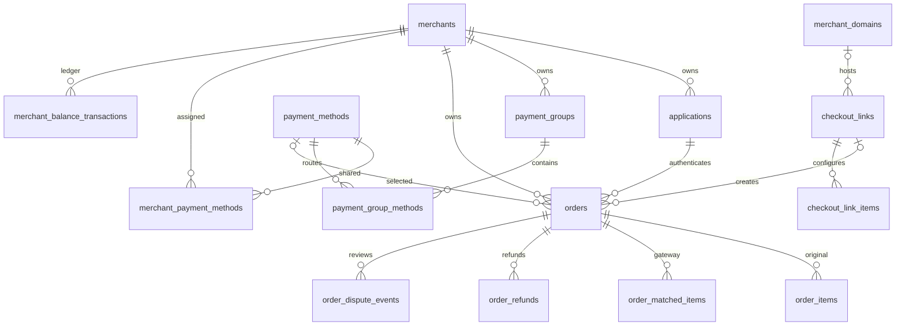

# 数据库与重要模型

核对日期：2026-11-11。结构依据是 [database/migrations/](../database/migrations/) 的完整迁移链，运行语义依据是 [app/Models/](../app/Models/) 和 [app/Services/](../app/Services/)。本文不替代字段级迁移定义，也不代表已核验生产库。

## 1. 核心关系



图为核心关系摘要；具体外键、可空与删除策略以迁移为准。`payment_methods.merchant_id` 还支持商户直接拥有渠道（系统级渠道该字段为 NULL）。

支付方式备注：迁移 `2026_11_11_120955_add_remark_to_payment_methods_table` 新增 `payment_methods.remark`（可空 `TEXT`），后台限制 5,000 字符；不回填历史记录、不修改订单和资金数据。渠道新增分配由 `MerchantPaymentMethod` 检查管理员边界，已有跨管理员分配不在本次批量清理。

## 2. 租户、身份和渠道

| 表 / 模型 | 关键语义 |
|---|---|
| `merchants` / `Merchant` | 商户主体；`owner_id` 为所属平台管理员；余额均为 USD；`default_*` 保存默认手续费/保证金，`settlement_mode/days` 保存默认结算模式/周期 |
| `users` / `User` | `is_super_admin`、`merchant_id` 区分超管、商户级管理员和商户用户；范围入口为 `manageableMerchantIds()` |
| `roles`、权限相关表 | Spatie 权限；商户角色有商户归属，平台共享角色另有范围。定义见 `app/Support/Permissions.php` 与 `PermissionSeeder` |
| `applications` / `Application` | 商户接入身份、`app_id`、加密 `api_key`、应用网站与邮件/广告配置；含 `is_auto_discount_enabled`、`is_logistics_tracking_enabled`（均仅影响新单） |
| `payment_methods` / `PaymentMethod` | 渠道、站点、网关配置、限额、费率、商品模式及连续建单失败保护。`merchant_id=NULL` 表示系统级渠道；`owner_id` 标识维护者；网关参数保存在 `config`，由配置模板定义字段 |
| `merchant_payment_methods` | 系统级渠道分配给商户的多对多表；不是所有订单的商户归属表 |
| `merchant_payment_settings` | 商户与可使用渠道的独立财务配置，交易/退款/拒付手续费、保证金比例/锁定天数、结算模式/周期；金融 NULL 继承渠道默认值，结算 NULL 继承商户默认值，0 为显式零值 |
| `merchant_logistics_tracking_settings` | 商户物流跟踪：选用 `driver`、可选 `base_url`、encrypted `api_token` / `webhook_secret`、公开 `webhook_token`；每商户至多一条有效记录 |
| `payment_groups` / `PaymentGroup` | 商户的路由组，`group_key` 在该商户未删除记录内唯一 |
| `payment_group_methods` | 组内渠道，`group_id`/`method_id`，`priority` 为分流权重 |
| `payment_method_config_maps`、`payment_method_profiles` | 网关字段模板及渠道资料附表；profile 每渠道至多一条 |
| `observers`、`observer_payment_methods` | 独立观察者账户与允许查看的渠道；展示缩放不修改账务金额 |

支付方式新增可空 `display_name`（最长 100 字符），`method_name` 保留原名称。商户交易列表及渠道筛选优先读取展示名称，空值/空白回退原名称；平台账号（含商户级管理员）继续显示原名称。自有、共享及软删除渠道沿用原授权范围；无渠道关联的订单回退已有渠道代码。迁移只新增字段，不回填或改写历史订单。

`PaymentMethod::forMerchant()` 的含义是“商户可使用”，包含自有与已分配渠道；不能用普通商户外键过滤替代。`site_products.merchant_id` 也可为空，商品实际按支付渠道关联，避免假设所有业务模型均有非空商户 ID。

迁移 [2026_11_03_223806_add_failure_limits_to_payment_methods_table](../database/migrations/2026_11_03_223806_add_failure_limits_to_payment_methods_table.php) 新增 `payment_methods.max_failed_times`（可空 unsigned integer，默认 NULL）和 `consecutive_failed_times`（unsigned integer，默认 0）。前者大于等于 1 时覆盖系统阈值，NULL 由 `PaymentMethod::maxFailedTimes()` 动态继承 `system_configs` 的 `payment.max_failed_times`（默认 5）；后者记录该渠道跨商户的连续建单失败次数，不按商户、支付组或订单单独分桶，也不统计客户后续支付失败状态。

`OrderCreationService` 调用 `PaymentMethodFailureService`，在同一事务先锁原订单、再锁渠道，确认商户、渠道和远端引用仍匹配后记录最终建单或商品准备失败；有链接、已收款或已离开 `pending/failed` 的结果不增加次数。每次创建调用最多增加一次，不按内部 HTTP 重试次数增加。有效 `pay_url` 成功落库时清零；幂等直接返回、校验或风控拒绝不修改计数。达到有效阈值即停用 `is_active`，不自动换渠道，成功清零也不恢复启用。新列从 0 开始，不从历史订单或日志回推旧失败次数，不影响已有余额、金融快照或资金流水；复制渠道不复制累计次数。

人工核验后通过 `PaymentMethod` 模型将 `is_active` 从 false 改为 true 时，`updating` 事件在同次保存中将 `consecutive_failed_times` 设为 0，开始新的连续失败计数；普通编辑、启用状态未变及新建不触发这次重置。编辑页仅提交主动修改的启用状态，保存时先锁定并重新读取渠道，避免旧页面误启用或重复清掉新失败。运行计数使用 `saveQuietly()` 保留其自身计数/清零规则。人工重新启用的补充无需新增数据库字段或迁移，不需要批量清空存量渠道计数。

迁移和 [PaymentFailureSettingsSeeder](../database/seeders/PaymentFailureSettingsSeeder.php) 都只补齐缺失的 `payment.max_failed_times`，不覆盖已保存配置；[SystemConfigSeeder](../database/seeders/SystemConfigSeeder.php) 调用该专用 Seeder。配置默认值采用数字类型、`payment` 分组。部署必须执行新增迁移；回滚移除新增渠道列但保留系统配置，避免删除管理员后续调整的值。规则见 [D-25](decisions.md#d-25-渠道连续建单失败达到阈值自动停用)。

本功能首次上线时，执行原有失败保护迁移即可同时新增两个渠道字段并补缺默认配置：

```bash
php artisan migrate --force --no-interaction --path=database/migrations/2026_11_03_223806_add_failure_limits_to_payment_methods_table.php
```

若该迁移已经执行，人工重新启用清零只需部署更新后的代码，无需再次变更表结构。专用 Seeder 可按需安全重跑以补缺配置，但正常执行上述迁移后并非必需，也不需要重跑完整 `SystemConfigSeeder`：

```bash
php artisan db:seed --class=PaymentFailureSettingsSeeder --force --no-interaction
```

以上为上线操作说明，不代表已在正式数据库执行。

迁移 `2026_11_03_173100` 为商户新增 `default_fee_percent`、`default_fee_fixed`、`default_refund_fee`、`default_chargeback_fee`、`default_reserve_percent`、`default_reserve_days`（均默认 0），为独立配置新增可空 `settlement_mode`、`settlement_days`。比例保留 4 位小数，USD 费用保留 2 位。新分配系统级渠道时，分配与复制商户默认值在同一事务完成；`merchant_payment_settings(merchant_id,payment_method_id)` 的唯一配置存在时保留，不因重新分配或商户默认值变化而覆盖。保存商户时会为该商户既有有效分配中缺失的配置补齐默认值；已有记录（含空值或 0）和历史订单不改写，也不自动扫描全平台。自有渠道仍沿用原有覆盖/渠道默认规则。

商户编辑页的“授权支付渠道”弹窗取消系统渠道授权时，在同一事务删除当前 `(merchant_id,payment_method_id)` 独立配置及分配关系、清理该商户支付组引用；重复取消也清理该组合残留配置。其他商户及其他渠道的配置不变，重新授权按商户最新已保存的默认值新建配置，不回写订单财务快照。该清理仅用于此弹窗的明确取消动作，旧支付方式编辑页及直接 Pivot 解除关系仍保留配置；不批量删除历史未授权配置。见 [D-27](decisions.md#d-27-商户编辑页集中授权系统支付渠道)。

支付组内的加入、移出和权重修改只写 `payment_group_methods`，移出不改变 `merchant_payment_methods` 或 `merchant_payment_settings`。新选择默认权重 100，重复加入保留已有权重；权重限 1–2,147,483,647 整数，对应 MySQL signed integer。创建页的渠道与权重暂存为 `[{id,priority}]`，提交时按当前商户重新核对全部渠道可用性，在同一事务创建组并写入每项权重；非法列表或授权变化不留下半成组。支付组编辑主表单不再同步渠道关系。`payment_groups.merchant_id` 仅创建时确定，创建后不支持跨商户转移；编辑保存入口及模型实例更新均校验不可变，不因伪造归属提交清除成员或修改权重。未添加数据库触发器，直接 SQL 或绕过模型事件的批量更新不属于业务入口。见 [D-28](decisions.md#d-28-支付组内支付方式常驻双栏管理)。

商户不再要求填写联系方式。历史 `contact_person`、`contact_phone`、`contact_email` 列保留原结构与已有值；`Merchant` 模型为未提供的字段统一使用空字符串缺省值，普通创建和入驻向导共用这一行为。后台表单不再收集这些字段，编辑已有商户不会清空历史联系方式；管理员登录账号和订单客户邮箱仍独立使用。

付款链接邮件仅使用 `applications.sender_email` / `sender_name` / `mail_driver` / 加密 `mail_credentials`，正文使用应用的 `payment_link_mail_template`，留空使用系统默认模板。`payment_methods` 中同名五列保留历史数据及凭证解密兼容，但已退出批量赋值、配置界面和邮件配置选择；复制渠道时也不复制这五列。此变更无需新增迁移，不自动把渠道邮件设置复制给应用。

商户网站物流回传使用 `applications.is_shipment_sync_enabled`（默认 false）和可空 `shipment_sync_url`（最长 2048 字符）；开启时必须提供完整 HTTPS 接口地址，路径及 query 原样使用。每次发送读取当前应用配置及已有加密 `api_key`，不增加独立凭证。新增字段与回传表由迁移 `2026_11_03_153030_add_merchant_shipment_sync_configuration` 引入，不自动生成历史订单回传记录。

## 3. 订单及金额快照

`orders` / [Order](../app/Models/Order.php) 是中心模型：

| 字段组 | 语义与限制 |
|---|---|
| `order_no` | 稳定的本地系统订单号，商户 API、通知及后台继续使用；通过生成器与唯一约束处理碰撞 |
| `gateway_order_no` | 可空、唯一的当前网关引用，保留历史切换生成的值；重试始终沿用，NULL 时由 `gatewayOrderReference()` 回退 `order_no` |
| `merchant_id` + `merchant_order_no` | 未软删订单的幂等键。重复请求比较 `currency` 和原始请求金额 `original_amount`（历史订单为空时回退 `amount`），并非校验所有明细字段一致 |
| `application_id`、`payment_group_id` | 建单应用与支付组 |
| `payment_method_id`、`payment_method` | 锁定的渠道 ID 与代码快照；后续重试不换渠道，历史空 ID 只补齐同一渠道关联；当前渠道代码在未删除渠道中全局唯一，历史解析复用 `paymentMethodConfig()` |
| `designated_payment_method_key` | 记录本次是否显式指定渠道，区别于普通组内路由 |
| `source`、`platform`、`checkout_link_id` | 入口来源（`api`/`manual`/`checkout_link`）、平台类型、可选的收款链接关联 |
| `currency`、`subtotal`、`shipping_fee`、`discount`、`tax`、`amount` | 订单原币种金额；公式容差当前为 0.01，商品小计按两位小数核对 |
| `converted_currency`、`converted_amount`、各 `*_converted` | 下单时折算金额，结算基准 USD；成交额统计使用 `converted_amount`。列精度 `decimal(15,2)`，按两位小数保存 |
| `original_exchange_rate`、`exchange_rate`、`surcharge_*` | 市场汇率、实际汇率与汇损快照；不能用当前汇率回算历史单 |
| `fee_percent_amount`、`fee_fixed_amount`、`settlement_amount` | 首次建单保存的交易手续费与净入账快照；百分比手续费与净额保留两位小数，千分位直接舍去，不四舍五入，也不取整到整数美元；重试不重算，支付入账使用 `settlement_amount` |
| `settlement_mode`、`settlement_days` | 首次建单优先保存该商户/渠道的独立起算方式与周期，空值回退商户默认；重试不重算，NULL 标记历史单，不补建结算记录 |
| `reserve_percent`、`reserve_days`、`refund_fee_snapshot`、`chargeback_fee_snapshot` | 首次建单保存的保证金及反向手续费快照；重试不重算，历史反向手续费快照为 NULL 时沿用原渠道规则 |
| `refunded_amount` | 累计退款原币种金额，不是 USD |
| `accept_language` | 浏览器语言偏好列表，nullable VARCHAR(255)；统一建单入口最多保留 255 字符，避免请求头导致建单失败 |
| `shipping_state`、`shipping_city` | 收款链接按 PayPal `admin_area_1` / `admin_area_2` 语义保存：省州按国家转换为官方代码或名称，城市保存城镇名称；服务端与 Google 回填共用映射。其他入口协议保持原有语义，详见[收款链接地址规则](../doc/checkout-link.md#地址字段与-paypal-rest) |
| `pay_url`、`wp_order_id`、`transaction_id` | 远端收银台链接、WordPress 订单 ID、网关交易号。缺少 `pay_url` 的本地单可能需要补建远端。加密单的 `pay_url` 为本站 `/payment/{token}` |
| `payment_link_token`、`send_mail`、`payment_link_sent_at` | 订单级付款链接与邮件意图/发送时间，不等同于 `checkout_links.slug` |
| `normal_status` | 可空正常阶段快照，主要兼容旧单人工已完成在争议往返后的恢复；新单仍以真实结算及有效物流事实推导，不替代结算审计 |
| `gateway_status`、`gateway_status_updated_at`、`gateway_status_version` | 最近接受的标准化网关状态、网关事件时间及本地递增版本；用于区分网关事实和订单主状态，并防止旧回调或查询结果覆盖新事实；新增列不回填历史事件 |
| `paid_at`、`failed_at` | 首次支付/失败时间；插件支付时间按 UTC 解析后转系统时区，首次写入后不覆盖 |
| `pending_status_query_count`、`pending_status_last_queried_at` | 定时补查已领取次数（默认 0）和最近领取时间（默认 NULL）；创建满 30/90 分钟各一次，最多两次，调用网关前原子递增，失败也计次；手工查询不占用 |

金额计算应保持十进制字符串/bcmath；数据库金额多为 `decimal`，模型用相应 decimal cast。远端 JSON 或现存风控部分代码有 float 转换，不应据此将账务计算改为浮点运算。

网关建单或明确的商品准备失败后立即返回；后续同商户订单号重试仅对无链接、未收款的 `pending/failed` 订单沿用原渠道补建。每次重新检查原渠道启用、未软删及商户授权，普通路由还检查原支付组有效、组内成员关系和当前风控；不合格返回 `NO_AVAILABLE_PAYMENT_METHOD`，即使存在其他可用渠道也不另选。指定渠道按保存 ID 及三个 URL 重新检查，不合格返回 `PAYMENT_METHOD_NOT_AVAILABLE` 或域名错误；不采纳新请求改变原模式、支付组、key 或 URL。

重试保留同一本地订单、付款 token、原始商品、应付金额、汇率、首次自动折扣、财务快照和远端引用，并复用 CREATE/COPY 此前已创建的商品。历史空 `payment_method_id` 仅补齐同一渠道关联，不产生新网关引用或财务快照。写入付款链接仍在订单行锁内核对当前引用/渠道；建单前及失败后重新检查收款、链接和状态，保留已得到的结果。支付创建、查询、日志和物流继续使用当前引用；兼容历史切换数据的旧回调/查询隔离、迁移 `2026_10_28_142012` 的可空引用/唯一约束及来源日志均保留。本次不新增迁移或批量改写历史数据。详见 [D-24](decisions.md#d-24-网关建单失败立即返回与原渠道重试)。

历史漏配汇损的专用纠错入口 `orders:recalculate-surcharge` 是修改汇率快照的显式例外：保留 `original_exchange_rate` 和手续费金额，更新实际汇率、汇损、订单折算字段及净入账；原币金额、原台账均不改。仅处理已入账无退款/争议订单，必须保留命令生成的新旧快照审计报告；余额由人工另记调整流水，历史统计按受影响日期补算。详见[汇损补算](../doc/order-surcharge-recalculation.md)。

商品数据分为四层：

- `order_items`：商户传入的原始明细及折算单价。
- `order_matched_items`：支付站点实际接收的明细、来源变体及自动创建信息。
- `site_products` / `site_product_variations`：按渠道同步的站点商品/变体快照，用于匹配与复制。
- `replace_keywords`：`COPY` 模式所用的商户商品名称替换规则。

`order_matched_items.product_name` 使用非空 `TEXT` 保存站点商品名称快照，避免站点商品名（`site_products.name` 最多 500 字符）或远端创建响应的长名称在建单时超出旧 255 字符列。原始 `order_items` 与 `checkout_link_items` 的名称长度和输入协议保持 255 字符。新增迁移 `2026_10_16_153313` 仅扩容匹配快照名称；如含超过 255 字符的名称（包括软删除记录），回滚会拒绝缩回旧列宽，避免截断历史数据。

### 支付方式进货单（2026-10-19，当前工作区）

`purchase_orders` 是独立的本地进货留档，不参与 `orders` 支付状态、商户余额或成交统计。通过 `payment_method_id` 关联支付方式，`created_by` 保留生成用户；两者的物理删除受外键限制，关系包含软删除记录。`order_no` 固定 19 位（`33` 加 17 位随机数字），`transaction_id` 为下单时间 `YmdHis` 加 20 位随机数字，各有独立唯一约束。

`ordered_at` 可设置；`paid_at` 为下单后 1 秒至 1 小时，`shipped_at` 为付款后 1–2 天，`received_at` 为发货后 3–5 天，均按系统时区保存模拟时间。`currency` 固定 `CNY`，`subtotal` 为商品明细之和，`total = subtotal + shipping_fee - discount`；默认运费/优惠分别为商品合计的 3%–8% / 10%–20%，允许手动编辑非负金额，优惠不超过商品合计。

`purchase_orders.perks_words` 为可空 JSON 数组，`null` 表示尚未初始化（包括迁移前的历史订单），空数组表示已初始化且不展示权益。生成进货单时不选权益词；启用的超级管理员首次打开采购页或详情页时，在事务行锁内从 10 个候选词中随机选取 4–8 个并保存，保持候选原有顺序且不重复。后续访问复用保存的数组，不重新随机；初始化不改变 `updated_at`、金额或商品快照。

`purchase_order_items` 保存商品名称（优先中文翻译）、SKU、USD 原价 `source_price = site_products.price_min`、人民币 `unit_price`、数量和行金额 `subtotal`；单价按 USD 原价 × 7 × 0.3 四舍五入两位小数。金额列为 `decimal(20,2)`，计算使用 bcmath，修改源商品不回写快照。商品物理删除仅将可空 `site_product_id` 置空；进货单物理删除才级联删除其明细，后台不提供删除入口。

采购页面沿用上述快照，图片和供需方资料没有额外保存快照：分别读取 `site_products.image_url` 和支付方式当前档案，商品关联不存在或图片地址不安全时显示占位。编辑运费/优惠后重新打开或刷新采购页面会显示最新金额；页面首次读取只初始化权益词。

采购订单详情的收货人/手机号使用档案 `legal_representative_name` / `legal_representative_phone`，收货地址取 `stock_addresses` 字符串数组中首个非空地址（无可用值时回退 `company_address`）。卖家联系人与供货商名称分别使用 `supplier_contact_person`、`supplier_name`，其他卖家资料同样读取当前档案；这些字段不是进货时的快照，修改档案后页面会变化。采购单尚无物流公司和运单号字段，详情页不从模拟时间推导物流单号。

### 应用自动折扣（2026-09-30，当前工作区）

`applications.is_auto_discount_enabled` 默认关闭，仅影响新订单。按折扣前应付金额、订单原币种计算：不超过 200 随机减 0.01～0.10，超过 200 随机减 0.01～0.50，以 0.01 为步长。极小金额缩小随机范围，至少保留 0.01 应付；金额不超过 0.01 时跳过。

`applications.is_logistics_tracking_enabled` 默认关闭，仅影响新订单。建单时拷贝到 `orders.logistics_tracking_enabled` 快照；补单与开关变化不回写旧单。轨迹启用门闩：系统 `logistics_tracking.available_drivers` 非空 ∧ 订单快照 true ∧ 商户已选可用 `driver` 且凭证齐全。快照 false 时跳过 register / Webhook 写入 / 异常边沿主动查；**无历史运单回填**，仅上线后新发货 register。超期未发货 TG 不看此开关。无独立商户「启用」开关。

系统配置 `logistics_tracking.available_drivers`（JSON 枚举，空=[]=平台关闭）由超管维护；商户在「物流跟踪」页选用驱动并配置 `base_url` / API Token / Webhook Secret / `webhook_token`。

物流异常天数也由超管在系统配置的物流跟踪分组维护：`logistics_tracking.stale_days` 默认 5、`logistics_tracking.no_delivery_days` 默认 15，均为 1–3650 的整数天，按连续 24 小时计算。保存清缓存，扫描和回调立即采用当前值；放宽阈值后已有时间异常由下一轮扫描重算。新增数据迁移 `2026_11_04_094301_add_logistics_anomaly_thresholds_to_system_configs` 与 `LogisticsAnomalySettingsSeeder` 仅补缺失配置、不覆盖已保存值，回滚保留配置；部署执行新增迁移即可，无需重跑全部 Seeder。

`logistics_anomaly_reason` 保留历史原因码 `stale_5d` / `no_delivery_15d` 以兼容旧数据，码中的数字不再代表当前阈值；展示读取配置，Telegram 事件携带触发时的天数。新增原因码 `delivery_failure` / `expired` / `provider_exception` 对应供应商异常主状态。换运单号清空旧 `tracking_*` 和三个异常字段（不影响插件 `sync_*` 的独立同步流程）；原发货时间仍沿用录入规则，未指定新时间时保留。

`orders.original_amount` 保存折扣前请求应付金额供幂等比较，历史订单为 NULL 时回退 `amount`；`auto_discount` 保存本次自动减免，默认 0，已包含在 `discount` 中。先验证请求公式和原始商品，再增加折扣、减少 `amount`，随后计算汇率、风控、手续费与结算快照。原始商品不变，商品匹配溢出折扣仍可叠加；补单与开关变化不重新抽取自动折扣。查询、通知与远端支付使用折扣后实际金额。

### 自动匹配商品的订单折扣（2026-09-30）

MATCH / VIRTUAL 的商品保留站点原价（折算为订单币种的两位小数单价）。尾件超额加入订单 `subtotal` 与 `discount`，同步更新两者的 USD 折算字段，`amount`、`converted_amount` 和结算金额不变。商户原始 `order_items` 保持原样；匹配后的 `subtotal` 对应 `order_matched_items`，因此可能不再等于原始明细之和。

补单按原始明细之和恢复目标小计，并从当前折扣扣除上一轮小计增量，再加入本轮超额，避免重试重复抵扣。新匹配结果将旧的独立 `matched_discount` 归零，网关 `discount_fee` 只发送 `discount`。不批量修改历史订单。

## 4. 状态、资金与审计

`Order::NEVER_PAID_STATUSES = ['pending', 'failed', 'cancelled', 'expired']`。`paidEver()` 取其补集，包含待结算、发货、完成、部分退款、退款、拒付、网关争议和人工争议审核状态。新增状态会影响风控和统计，必须同步审查这个口径。

订单主状态由 `OrderLifecycleService` 根据独立事实推导：支付后起算为 `pending_settlement`，发货后起算为 `paid/shipped`，只有真实结算记录 `settled` 才推进为 `completed`；部分退款等售后优先保留。`completed` 不阻止网关争议、退款或拒付。主动查询 `paid` 只更新支付事实，不擦除退款/拒付台账、人工审核或已完成结算，首次支付/失败时间不重置，也不重放首次入账或通知。详见 [D-29](decisions.md#d-29-订单主状态由结算与售后事实统一推导)。

定时补查使用 `orders_pending_status_sync_index(status, paid_at, pending_status_query_count, created_at)` 支持全平台到期扫描。新增迁移只添加补查字段及索引，历史查询没有可恢复的次数记录，既有订单从 0 开始累计，仍限最近 48 小时；不会按历史日志臆测已执行次数。回滚会删除补查计数和时间，生产优先前向修复，避免重新开放已消耗的补查机会。详见 [D-19](decisions.md#d-19-待支付订单按创建时间最多自动补查两次)。

| 表 / 模型 | 关键语义 |
|---|---|
| `merchant_balance_transactions` | 总余额及分类划转台账；分类划转 `amount=0`，由 `pending_settlement_change`、`frozen_change`、`pending_withdrawal_change` 记录去向，可提现变化为总额变化减三类变化。支付/结算分别使用 `order_paid:{order_id}`、`order_settlement:{order_id}` 唯一键 |
| `merchant_withdrawals` | 新申请 `uses_pending_balance=true`，占用 `pending_withdrawal_balance`；后台确认放款扣总额与占用，驳回只释放占用。旧记录 false，继续使用原冻结额，不回填 |
| `merchant_fund_freezes` | `order_id=NULL` 为固定保证金，否则为本单循环保证金；原额 `amount` 不变，`remaining_amount` 保存余额，旧 NULL 回退原额；`consumed` 表示已抵扣完。系统生成允许 `frozen_by=NULL` |
| `order_settlements` | 每订单一条结算审计记录，净额、剩余待结算额、实际保证金/可提现分配、起算/预计/实际结算时间；状态 waiting_shipment/pending/settled/cancelled |
| `order_accounting_tasks` | 新单状态事务内写入 paid/refund/chargeback 可靠待办；旧单新收到反向结果也保存 refund/chargeback 待办；仅本次首次确认收款可保存 paid 待办并沿用原即时入账，不补建历史收入和结算；按订单+类型唯一；含次数、重试时间、完成时间、脱敏错误和需人工处理状态。执行前校验商户归属；不删除审计记录 |
| `order_refunds` | 退款单：原币种 `amount`、USD `amount_usd` 等；同一订单允许多次部分退款 |
| `order_dispute_events` | 人工审核事件，`processing`/`closed`、冻结金额快照、到期与关闭原因。`final_action` 是拟定方向，不自行退款/拒付 |
| `order_dispute_event_replies` | 回复、操作人及凭证附件；不延长原审核期限 |
| `order_shippings` | 每订单最多一条未删除物流记录；含 WP 插件 `sync_*`，以及中性轨迹字段（`tracking_*`）与 `logistics_anomaly*`（Webhook / 异常边沿主动查 + 每日本地重算；与 WP sync 无关） |
| `order_shipment_syncs` | 商户网站物流回传批次；关联商户、订单、应用、物流记录，保存本次业务 `payload` 快照、状态、尝试次数、下次尝试时间、最近错误、成功时间及 Telegram 提醒状态 |
| `order_shipment_sync_attempts` | 每批回传的逐次 HTTP 请求结果；保存地址、鉴权头、HTTP 状态、响应、错误及请求时间，不保存应用 API 密钥；签名在实际发送时现算 |
| `order_events` | 插件事件归档，按系统订单号与外部日志 ID 去重，不驱动订单状态 |
| `order_gateway_status_events` | 网关 webhook/主动查询的标准化接收审计，记录商户、订单、网关尝试引用、来源、映射状态、事件时间、处理结果和白名单摘要；不保存凭证或完整客户 body，不等同插件日志 |
| `order_notification_attempts` | 商户回调每次尝试的请求、响应、结果、下次重试时间 |
| `ad_conversion_attempts` | 按订单/广告平台/尝试编号记录转化发送与重试 |
| `logistics_import_tasks`、`logistics_import_task_records` | 批量物流导入任务及逐行结果 |

物流导入任务表的两个文件名语义不同：`original_file_name` 是商户上传时的本地文件名（2026-10-22 起记录，历史数据为 NULL，展示时回退 `file_name`），`file_name` 是 OSS 上的保存名（Filament 随机串）。`started_at`/`finished_at` 记录解析起止，仅用于识别 worker 中断与审计，不在界面展示耗时；`status=processing` 且 `started_at` 超过 30 分钟按中断处理。任务表只存汇总数，逐行结果一律查明细表。记录保留 90 天，由 `logistics-imports:prune` 每日分批物理删除任务及其明细（含已软删任务）。

商户网站回传批次与本地物流分开：本地改单覆盖原记录，每次启用回传的保存或手动推送创建新的业务快照。状态为 `pending/processing/retrying/success/failed/superseded/paused`；出现新版本后旧待发、待重试或暂停批次停止投递。`next_attempt_at` 同时作为处理租约到期时间，`processing` 超过两分钟可由调度回收；含首次最多 5 次请求，尝试表按批次与尝试编号唯一。终败的 `alert_status` 从 `pending` 转为 `sent` 或机器人不可用时的 `unavailable`；Telegram 失败或限流保留 `pending`，`next_alert_at` 延后 5 分钟；到期时间参与提醒扫描索引，避免长期失败商户占住候选。两表保留审计记录，外键使用限制删除，和 WP 插件的 `order_shippings.sync_*` 无关。

余额可为负；可提现 = `balance - frozen_balance - pending_settlement_balance - pending_withdrawal_balance`。商户显示的待出款由 `pendingWithdrawalBalance()` 将新待出款加旧待审核提现合计；`reserveBalance()` 将原冻结额减去这部分旧提现。两者按读时归类，不改历史余额或流水，且保持总额 = 待结算 + 保证金/冻结 + 可提现 + 待出款。列表使用 `legacyPendingWithdrawals` 的预聚合避免逐行查询。

结算及锁定天数按 N×86400 秒计算。发货周期取首次有效物流录入时间与支付时间中较晚者，不采用可补填的发货时间；起算后修改运单不重置周期。实际结算事务同步推进正常订单完成，保证金释放时间独立，售后不撤销原结算审计。循环保证金基数为当次结算净额，金额 bcmath 截至分；锁定天数为 0 时不冻结。新结算 `due_at` 和冻结 `release_at` 使用 DATETIME，支持较长锁定期，避免 MySQL TIMESTAMP 的 2038 年边界。迁移不批量修正旧订单状态或余额；`settlement_mode=NULL` 仍不补建结算记录，存量新结算订单仅随新事件或到期处理按原快照推进。金融审计已产生后，新增结算/可靠待办/网关接收审计相关迁移会拒绝破坏性回滚，应使用前向修复。

迁移 `2026_11_06_102253_add_gateway_status_tracking_to_orders` 新增正常阶段及网关事实字段，并创建接收审计表。新字段可空或有默认值，不批量回填订单；审计 `merchant_id` 有意无外键，避免持订单锁时反向锁商户，写入服务显式限定商户。`order_id` 限制删除；已有审计时迁移拒绝回滚删除。接收审计保留重复、过期、冲突等处理结果；业务幂等由可靠待办和资金流水约束保证，不把同状态永久去重当作网关事件顺序。

退款/拒付本金优先消耗本单待结算和循环保证金，其余及额外手续费扣可提现。原交易手续费不返还；固定保证金、其他订单专属金额、待出款不自动挪用。人工争议对新单只追加扣除本单待结算/循环保证金后尚未保护的部分，避免重复冻结；旧事件的冻结金额快照保持原值。金融审计表不能套用普通配置表的删除策略。

## 5. 收款链接与域名

| 表 | 语义 |
|---|---|
| `merchant_domains` | 商户域名、Cloudflare 自定义 hostname/证书状态，未删除 `host` 全局唯一 |
| `checkout_links` | 商户可重复使用的收款配置；关联应用、支付组及可选商户域名，支持固定/范围金额、支持国家、说明等；`auto_redirect` 默认 true，控制建单后自动跳转或展示付款链接 |
| `checkout_links` | 商户可重复使用的收款配置；关联应用、支付组及可选商户域名，支持固定/范围金额、支持国家、说明等。`link_name` 是商户**内部标识**（后台列表/搜索用，不展示给客户），与对客展示的 `title` 分工不同，两者均必填 |
| `checkout_link_items` | 链接预设商品；实际下单时转换为 `order_items` |
| `orders.checkout_link_id` | 订单来源追踪；一个链接可以产生多笔订单 |

链接的 `slug` 在未删除记录中唯一；每次公开下单生成新的商户订单号，不能把 slug 或客户邮箱作为跨提交固定幂等键。自有域名是否可用由 `MerchantDomain::isReady()` 和 `CheckoutLink::allowedHosts()` 配合判断。

## 6. 汇率与统计派生数据

- `exchange_rates`：当前汇率，`base_currency + target_currency` 唯一；下单汇率数据源。
- `exchange_rate_histories`：追加式历史展示数据，不参与下单金额计算。
- `order_daily_stats`：按 `stat_date + merchant_id + application_id + payment_method_id` 唯一；渠道 ID `0` 表示未知维度，刻意不设渠道外键，避免删除渠道改写汇总维度。仪表盘全部交易指标由此表读取，余额另读商户当前值。
- `order_stats_runs`：每个统计日的执行完成记录；`rows_written=0` 表示已算但无交易，与未运行区分。`metrics_version` 默认 1 保留旧执行事实，新聚合版本为 2；旧版本日期需重算才具备新计数字段，不清空旧记录。

| 指标 | 归日时间 | 金额口径 |
|---|---|---|
| 创建订单数 `created_orders` | `orders.created_at`，排除软删除 | 仅计数，含待支付、失败、取消与过期 |
| 未支付终态 `unpaid_terminal_orders` | failed 按 `failed_at`，缺省创建日；取消/过期按创建日 | 仅计数，排除 pending；与 `paid_orders` 相加作为成功率分母 |
| 支付成功 | `orders.paid_at`，旧数据为空时回退 `created_at` | `converted_amount`，含曾支付成功的后续状态 |
| 支付失败 | `orders.failed_at`，旧数据为空时回退 `created_at` | `converted_amount`，只数 `failed` |
| 退款 | `order_refunds.created_at` | 实退 `amount_usd`，当日订单数去重 |
| 拒付 | 拒付本金流水 `created_at` | 本金流水金额绝对值，不含拒付手续费 |

按系统时区分日；商户展示时区不改变分桶。汇总可重算，每日事务内删除旧桶再插入新桶，并一并记录执行结果；超出滚动窗口的历史修正需按受影响日期补算。

迁移 `2026_11_03_214235` 只增加两项计数列和执行版本列，不自动重算历史或修改订单/资金。新版聚合把每日数据与执行版本 2 在同一事务提交。仪表盘订单数按创建日、成交额按支付日，跨日付款时两张趋势图不要求同一天单量与金额对应；退款/拒付不重复增加支付成功率的分母。所选窗口的交易商户数为 `paid_orders > 0` 的商户去重数。

## 7. 唯一约束与迁移

软删除表使用生成列：有效记录映射原值，删除记录映射 NULL，再建唯一索引。不要简化为 `(业务键, deleted_at)`；MySQL 对 NULL 的唯一性处理不能达到同样效果。

| 约束 | 当前含义 |
|---|---|
| `orders.order_no_uniq`、`payment_link_token_uniq` | 未删除订单的系统号/付款 token 唯一 |
| `orders.gateway_order_no` | 非空网关尝试引用在全表唯一；NULL 兼容未切换和历史订单，软删除不释放已保存引用 |
| `order_events.order_no_log_id_uniq` | 有效日志按 `order_no + gateway_order_no + external_log_id` 唯一；原始及历史尝试的来源为空字符串，跨渠道相同外部日志 ID 不相互覆盖 |
| `orders(merchant_id, merchant_order_no_uniq)` | 商户内有效订单幂等 |
| `payment_methods.method_code_uniq` | 有效渠道代码全局唯一，已由 2026-09-21 迁移替换早期商户内唯一规则 |
| `applications.app_id_uniq` | 有效应用 ID 全局唯一 |
| `payment_groups(merchant_id, group_key_uniq)` | 商户内有效支付组键唯一 |
| `order_shippings.order_id_uniq` | 每订单仅一条有效物流记录 |
| `order_shipment_sync_attempts(order_shipment_sync_id, attempt_number)` | 同一物流回传批次的尝试序号唯一，不同物流快照各自计数 |
| `order_dispute_events.order_id_active_uniq` | 仅 `processing` 状态参与，同一订单最多一个处理中审核事件 |
| `merchant_balance_transactions.idempotency_key` | 自动资金动作幂等；允许人工动作无幂等键 |
| `merchant_payment_methods(merchant_id, payment_method_id)` | 渠道分配不重复 |
| `merchant_payment_settings(merchant_id, payment_method_id)` | 商户渠道财务配置不重复 |
| `order_settlements.order_id`、`merchant_fund_freezes.order_id` | 本单最多一次结算及一笔循环保证金，固定保证金的 NULL 不参与限制 |
| `order_accounting_tasks(order_id, type)` | 状态重放不能重复创建同类可靠记账任务 |

迁移存在 `IF`、`CONCAT`、带排序的 `GROUP_CONCAT` 等 MySQL 特征；`phpunit.xml` 目前仍使用 SQLite 内存库，测试兼容性需单独核验。不要仅根据初始建表迁移推断最终约束。2026-10-28 的订单和事件日志网关引用迁移在已有非空尝试引用时拒绝回滚，避免丢失远端定位及日志来源；生产优先前向修复。

新增数据结构同时检查：模型 fillable/casts/关系、权限与租户范围、现有数据回填、索引、删除策略、相关 FormRequest/Resource 和测试。种子顺序见 `DatabaseSeeder`，商户角色创建前必须已存在权限记录。

`Application::api_key` 及部分邮件/广告凭证依赖 Laravel 加密 cast；沿用原 `APP_KEY` 才能读取已有数据。文档与测试样例只用占位凭证。

## 8. 新版区块链收款基础（当前工作区，待集成）

用户已授权开始开发。新增迁移 [支付类型](../database/migrations/2026_11_11_165602_add_blockchain_payment_types.php) 为 `payment_method_config_maps`、`payment_methods`、`orders` 增加 `payment_type`（默认 `fiat`）；订单、支付方式及模板实例保存后禁止修改类型。后台支持类型 Radio 与分类型 JSON 配置；第七批已接统一建单，只有 `CRYPTO_CHECKOUT_ENABLED` 及依赖开关全部开启时才能选择链上渠道，默认关闭。

[基础表迁移](../database/migrations/2026_11_11_165602_create_crypto_payment_foundation_tables.php) 定义以下五张表，未在业务库执行：

| 表 | 当前数据与约束 |
| --- | --- |
| `crypto_addresses` | 商户、订单、渠道、网络、已校验地址及派生源指纹／索引、起扫高度；规范化网络地址哈希全局唯一，源指纹＋索引唯一，不按软删除释放 |
| `crypto_payment_requests` | 一个地址只绑定一个请求；网络／资产／精度、应付／服务费／净额、JSON 报价及有效期；初始 `preparing`，同一订单可保存历史请求，首次请求幂等，显式重新报价创建后继请求；新增可空唯一 `replaces_request_id` 保证一个旧报价只有一个直接后继 |
| `crypto_chain_events` | 同一网络＋规范化交易哈希＋事件位置生成唯一哈希；记录数量、区块、时间和核验／确认／重组状态，已接 EVM／UTXO／TRON 内部核验器，真实链联调未完成 |
| `crypto_asset_balances` | 商户＋网络＋资产唯一；总数量、占用数量默认 `0`，与现有商户法币字段隔离 |
| `crypto_ledger_entries` | 当前仅支持订单净额收入；订单及幂等键唯一，保存实收、费用、净额、前后余额与费用快照；取款另记 `crypto_withdrawal_events`，保留本表订单收入唯一约束；人工调整仍待实现 |

数量用 `VARCHAR(78)` 保存规范化无符号十进制整数字符串，应用层校验不超过 uint256，并使用 bcmath；不能按字符串大小判断金额或直接用数据库数值 SUM 聚合。中间报价使用精确分子／分母，最终取整。`CryptoQuoteService` 的 v1 规则为应付向上取整、百分比和固定 USD 费折币合计向上取整，保存舍入版本，不受全局 `bcscale` 设置影响；见 [D-33](decisions.md#d-33-新版区块链基础分阶段接入与精确账务)。

`CryptoBalanceService` 按商户 → 订单 → 请求 → 事件 → 资产账户顺序加锁并在事务内入账，核对事件归属、确认、时窗、起扫高度及核准数量；异常／多付／迟到款拒绝自动入账。存在待核验／确认／审核收件或未完成核验／确认的有效事件时也拒绝入账，不能只累计已确认部分后忽略其他转入。一单正常收入只允许一次，多请求不能重复增加余额。该服务自身只处理独立账务与请求入账标记；第六批由 `CryptoSettlementService` 在外层同一事务中再写订单付款事实及首次商户通知。真实链联调与 MySQL 竞争验证仍是开放收款前提。

模型实例更新禁止重写地址、请求绑定与报价、已记录事件身份／金额及账务流水，审计关联外键删除采用 RESTRICT。未添加数据库触发器；直接 SQL 或绕过模型事件的批量写入不属于允许的业务入口。迁移 `down()` 会删除新增表和类型列，已有审计数据后属于破坏性回滚，生产优先向前修复。

第二批迁移 [公钥源与地址分配](../database/migrations/2026_11_11_171059_create_crypto_public_accounts_and_allocations.php) 新增 `crypto_public_accounts` 和 `crypto_address_allocations`，并为 `crypto_addresses` 增加可空且唯一的 `crypto_address_allocation_id` 外键。源指纹使用链族＋BIP32 chain code／压缩公钥的规范身份，不按标签、资产、渠道或主测试网络拆独立计数；全局技术表不作为商户 Resource 暴露。计数默认从 2 开始，0／1 留作本地恢复校验，消耗后不可回退。分配记录按商户隔离，分配键及源＋索引唯一，派生地址哈希唯一，保存网络／资产和只读配置快照；HTTP 前提交预留，失败保留预留，不能回收给其他订单。

`PaymentMethodConfigMap.fields` 新增受控 `type`（文本／下拉）、`options` 与 `default` 元数据，旧模板缺类型继续按文本渲染。五类初始模板由专用 `CryptoPaymentTemplatesSeeder` 补缺，不覆盖旧模板、不创建支付方式。本次未在业务库运行 Seeder；在隔离环境完成所需新迁移后，可执行 `php artisan db:seed --class=CryptoPaymentTemplatesSeeder --no-interaction` 准备模板。它不替代 Tatum 凭证、系统报价参数或实际钱包恢复验收。

第三批迁移 [订阅与回调收件箱](../database/migrations/2026_11_11_191318_create_crypto_monitors_and_webhook_receipts.php) 新增两表，并为请求增加可空 `current_monitor_id` 外键：

| 表 | 当前数据与约束 |
| --- | --- |
| `crypto_address_monitors` | 请求内代次唯一，回调 UUID 全局唯一，远端订阅 ID 可空且唯一；冻结商户／请求／地址、网络／环境、TTL、API Key 指纹与回调 URL。记录准备、创建、激活、失败、取消、冷地址状态和重试时间，保留补查／冷扫描高度、区块哈希及时间；第六批扫描器写入完整覆盖证明 |
| `crypto_webhook_receipts` | 按商户、监控代次保存请求绑定、body 摘要、规范化交易哈希、白名单线索、验签模式和处理状态；监控 ID＋摘要唯一。原始 body、签名及任意客户端字段不存库。该去重只针对投递，经济事件仍由链上事件表判定 |

模型禁止删除监控与回调证据，禁止改写代次身份、已有远端订阅 ID、激活期限和回调证据，外键采用 RESTRICT；当前请求指针不使旧代次失效。过期退订需历史扫描接管且无未处理收件／核验事项，默认缺少扫描证明时不删除远端订阅。API Key 与 HMAC 密钥仅从环境配置读取，不存渠道 JSON 或表内；指纹用于阻止换 Key 后误认远端状态。

[配置数据迁移](../database/migrations/2026_11_12_163459_add_crypto_defaults_to_system_configs.php) 随普通 `migrate` 补齐七个 `crypto.*` 配置，并填充旧 Seeder 留下的 `NULL`／空字符串。初值为上浮 `0`、报价 `3600` 秒、行情最大年龄 `300` 秒、订阅 `7200` 秒、覆盖对象 `{}`、恢复次数 `3`、历史扫描健康门槛 `300` 秒。已有非空值（包括恢复次数 `0`）和元数据保留，更新在同一事务内提交并逐项失效缓存；回滚保留所有配置。`CryptoSettingsSeeder` 同步采用这些初值，仅补缺。后台保持上浮比例的十进制字符串和订阅覆盖对象校验；缺失／非法参数仍拒绝相关操作，不增加运行时兜底。具体键与部署步骤见[方案第 6.8 节](blockchain-payment-plan.md#68-当前第三批代码的落地边界未开放收款)。已有环境不需为这七项执行可能重设其他配置的总 Seeder；权限与支付模板仍单独初始化。

第四批 [核验跟踪迁移](../database/migrations/2026_11_11_193729_add_verification_tracking_to_crypto_webhook_receipts.php) 只为收件表增加 `verification_attempts`（默认 0）、`last_checked_at`、`next_attempt_at`、`last_error_code`（均可空）和状态＋下次时间索引。原始投递证据继续不可变；状态为 pending／confirming／verified／ignored／review，最后三者不由正常调度持续轮询，review 留待审核入口实现。迁移 down 会丢失核验重试审计字段，生产优先向前修复。

新准备请求的报价 JSON 增加公用配置快照与冻结的以太坊核验策略，确认数来自独立环境配置，缺配置不在消费时回填。公钥配置快照不得整体暴露到公开付款页。ETH 直接转入位置为 `native:0`，ERC20 为 `log:{全区块日志索引}`；发现规范链变化时保留原经济事件、撤销确认并标孤块，重新入块时同身份同金额可更新规范区块字段。金额冲突不覆盖原金额，转审核；第六批增加持续规范链检查，资金逆向调整和人工审核界面仍未接通。详见[方案第 6.9 节](blockchain-payment-plan.md#69-当前以太坊核验与收件消费第四批未开放收款)。

第五批未改表结构。`CryptoVerificationPolicy` 为 BTC／LTC 冻结 `utxo-canonical-v1`、TRON 冻结 `tron-solidified-v1`，除确认数外还保存 `genesis_hash`；EVM 继续原版本和字段。BTC／LTC 事件位置为 `vout:{输出索引}`，数量来自原始 uint64 字节；TRC20 为 `log:{交易内日志索引}`，不同网络不会与 ERC20 混同。三种策略继续使用同一商户／请求绑定及经济事件唯一约束，不新增法币流水，也不自动改变请求的 preparing 状态。完整范围、失败限制与归档要求见[方案第 6.10 节](blockchain-payment-plan.md#610-btcltc-与-trc20-核验第五批未开放收款)。

第六批新增[历史与记账调度迁移](../database/migrations/2026_11_11_221155_add_history_tracking_to_crypto_payment_requests.php)，给请求增加可空字段：`history_to_block/hash/time` 保存连续游标，`history_recent_blocks` 保存最近 64 个连续哈希与时间，`history_checked_at` 仅在追平本轮链头时写入，`history_next_attempt_at/error_code` 支持有界补查重试；`review_reason` 保存异常款原因，`settlement_next_attempt_at` 支持可重跑的记账消费。新增网络＋扫描重试、状态＋记账重试索引。`down()` 丢失这些扫描／审核审计与进度，不能把它当作生产数据安全回滚。

历史发现复用 `crypto_webhook_receipts`，用 `signature_mode=history_rpc` 标明扫描来源，摘要由请求、交易哈希、区块哈希生成，不能把此来源当作 HMAC 验签通过。线索与当前请求的完整块游标一起提交，新的区块归属允许重新核验；事件经济身份仍全局唯一。新 EVM 请求增加 `verification_policy.internal_transfers=true`，内部价值转入使用 `trace:{路径}`，顶层仍为 `native:0`。旧报价缺少此能力时不回填不可变 JSON。

自动记账只接受已确认、足额、按时报价内的事件以及新鲜历史证明，并在同一事务提交独立余额、收入流水、请求 credited 标记、订单付款事实和通知待办。`paid_at` 取付足的最后一笔链上时间；事件 `block_time` 和扫描时间在写入数据库前转换为系统时区，避免 UTC 对象写入无时区字段后被误读。请求状态另包含 partial／expired／review；迟到、超额、到期不足额及已入账后证据变化不会自动冲正或创建法币结算。已入账的异常仍保留原账，后续人工调整需独立审计设计。

本阶段只在 SQLite 内存测试库随测试执行迁移。独立 MySQL 的 DDL、锁竞争和并发压测仍待验证，不能将上述描述视为正式库已经部署。独立取款的实际结构见下方第八批；教程网页目标结构继续见[完整方案](blockchain-payment-plan.md)；只读派生边界见 [D-34](decisions.md#d-34-链上配置隔离与只读公钥地址分配)，本批订阅与验签边界见 [D-35](decisions.md#d-35-订阅代次回调线索与保守退订)。


第七批新增[收款流程附表迁移](../database/migrations/2026_11_11_232321_create_crypto_checkouts_table.php)：`crypto_checkouts.order_id` 唯一，显式保存 `merchant_id/payment_method_id` 和不可改写的 `fee_snapshot`（约定百分比费率、固定 USD 费）；`current_request_id` 指向当前报价，`action/phase/status` 与 `requested_at/handoff_at/ready_at/next_attempt_at/error_code` 保存重开和交接进度。创建报价及更新当前请求指针同事务提交，中断后沿用已预留的派生索引和请求。请求表新增唯一可空自关联 `replaces_request_id`，旧请求、地址、订阅及收件全部保留。

链上订单继续保存原币种 `amount/original_amount`，折扣幂等不变；`exchange_rate` 等于 `original_exchange_rate`，汇损百分比／每单位汇损／总汇损均为零，`converted_amount` 仅为原始汇率 USD 参考值。现有 `fee_percent_amount/fee_fixed_amount/settlement_amount` 写零，`settlement_mode=NULL`，不表示商户净入账为零；币数量应读当前请求的 `due_units/fee_units/net_units`，已入账读独立账本。第八批提供独立余额、入账凭证和链上明细；第九批订单列表及详情已按资产展示，筛选汇总读取原凭证或最新接受／调整记录。

第七批 webhook 持久化也按商户 → 订单 → 请求锁序执行，与重新报价、地址发布及资金入账串行核对。跨请求正常入账先检查同单其他请求的款项线索与新鲜完整覆盖，不能把两笔请求的数量合并配单。所有新增结构只在隔离 SQLite 测试库验证，生产 MySQL 迁移／锁竞争尚未实测；带审计数据的 `down()` 仍是破坏性操作。


第八批新增[取款与操作记录迁移](../database/migrations/2026_11_11_234945_create_crypto_withdrawals_and_events_tables.php)，不改变原订单收入唯一约束，不写法币资金表：

| 表 | 数据与约束 |
| --- | --- |
| `crypto_withdrawals` | 商户＋UUID 申请键唯一；资产账户、网络、资产、精度、本金、同币种费用上限、初始占用、目标地址与申请人不可改写。保存审核与核销人／时间／说明、实际同币种费用、未经链上验证的线下凭证编号。外键删除 RESTRICT；模型禁止删除和终态修改 |
| `crypto_withdrawal_events` | 商户、资产账户、申请、操作者，操作类型及前后状态，前后总额／占用、原因、人工凭证；申请＋操作类型唯一，模型禁止更新／删除，与余额及状态同事务提交 |

取款数量仍为 `VARCHAR(78)` 最小单位字符串，输入先校验币精度和 uint256 范围，运算只用 bcmath。申请占用 `amount_units + fee_limit_units`；审核通过保持总额／占用；完成扣 `amount_units + actual_fee_units`，释放全部本次占用，未用费用恢复可申请余额。驳回／撤销只释放占用。`crypto_withdrawals.reserved_units` 是申请时不可变快照，不是该申请的当前占用；待审核和已审核状态才仍占用账户。

锁顺序：入账沿用商户 → 订单 → 请求 → 事件 → 资产账户；取款先锁商户，再锁申请（处理时）和资产账户。同商户入账与取款以商户锁串行，申请余额判断在锁内执行；操作记录写入失败全部回滚。审核／核销平台账号权限和商户归属重新读取；同一请求键只有内容一致且同申请人时返回原申请，重复终态操作拒绝且不再扣款。已入账付款请求待复核、存在复核原因或事件失效／未核验／未确认时，该资产阻止新申请、审批和核销，仍可安全驳回或撤销。

收入凭证和取款操作日志分别审计，不把占用释放写成新的收入，也不把人工凭证标为链上确认。线下凭证编号不是经济事件唯一键；本期无链上出款核验及输出分配。`down()` 会删除这两张审计表，仅适用于可丢弃环境；有实际取款数据的生产库应保留审计并向前修复。MySQL DDL 和多进程锁竞争仍待独立环境验证。


### 第九批：异常款处理、冲正与欠额

[新增迁移](../database/migrations/2026_11_12_001838_add_crypto_payment_reconciliation.php) 不修改旧迁移，不移除原收入的订单唯一约束：

- `crypto_payment_resolutions`：商户、订单、报价基准请求、资产账户、操作人、商户＋UUID 唯一键、网络／资产、`accept/adjust/recheck` 类型、证据指纹及完整快照、费用快照、原收款／服务费／净额以及账户总额／欠额的前后值、当时占用和原因。模型禁止修改／删除，外键 RESTRICT。纯补查可没有资产账户，保存零金额快照，不产生收入。
- `crypto_asset_balances.debt_units`：最小单位非负字符串，默认零。冲正先消耗未占用余额，余数形成欠额，不破坏正在处理的取款占用。实际账面权益为 `balance_units - debt_units`；存在欠额时可申请金额为零，禁止申请／批准／核销取款。新收入、驳回／撤销释放的金额优先抵扣欠额。
- `crypto_ledger_entries` 和 `crypto_withdrawal_events` 新增 `debt_before_units/debt_after_units`（默认零），用于追溯收入或释放占用抵扣欠额。全部数量仍是 `VARCHAR(78)` 最小单位字符串和 bcmath，不用负数占用或浮点记账。

每单当前收款／费用／净额优先取最后一条 `accept/adjust`，没有人工处理时取唯一原始收入；`recheck` 不覆盖财务投影。不要把原收入与所有处理后的累计值再次相加。费用报表采用当前筛选订单的这个投影，按网络＋资产汇总；筛选的时间维度仍是订单列表提供的时间条件，并非财务期间发生额报表。原成交额与 `paidEver()` 作为曾支付历史保持不变，重组后不能以它们当作仍可支出的币额。

人工确认在商户 → 订单锁内重新读取全部报价、地址、事件和收件，所有地址均需新鲜完整覆盖，非孤块事件须已核验且确认。界面证据指纹必须匹配，不接受用户自行填写的入账金额。正常自动入账仍不合并不同报价；只有明确人工确认才汇总同一订单、同一网络和资产的历史地址。初次入账仍复用付款状态／可靠通知事务；后续冲正保留原 `paid_at` 和原收入，不伪造退款状态。

服务费按累计实际收款与冻结费率重算、只收一次固定费；有原收入时沿用原报价，否则采用最早有款报价。为保持非负净额，人工处理的费用上限为实收数量，全部收款失效时费用和净额同时归零；此选择在确认窗口展示。复原链证据时追加恢复差额。证据变化或重新补查后恢复待复核，重复指纹不会重复记账，重复 UUID 返回原结果。

生产 MySQL DDL／锁竞争尚未验收；迁移只在隔离测试库验证。含真实账务时不可通过回滚迁移删除上述审计记录。
